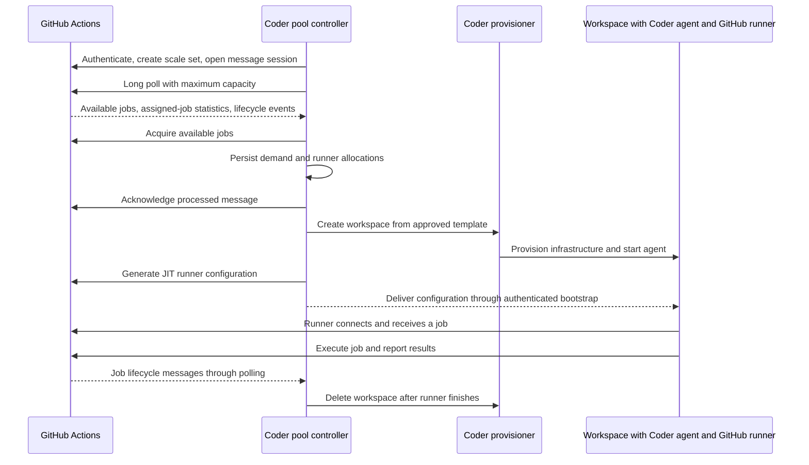

# Coder as a GitHub Actions runner provider

Research date: 2026-10-24. This report is for Coder maintainers evaluating a native GitHub Actions runner provider. It uses committed Coder revision `7eacfe95b28dd776bafbd7d5f04b9b7188ab1930` as the baseline and distinguishes existing capabilities from proposed additions. An uncommitted prototype was already present in the working tree when this report was rechecked; its implementation and prior validation notes are preserved in the appendix.

## Recommendation

Build an organization-scoped **GitHub Actions runner pool** in Coder. Each pool maps a GitHub runner scale set to a Coder template, provisions a fresh workspace for each runner, and deletes that workspace after one job. Run the upstream GitHub runner inside the workspace without forking it.

Use GitHub's standalone [`actions/scaleset`](https://github.com/actions/scaleset) Go client for the GitHub integration. It exists specifically so infrastructure providers can implement their own provisioning and autoscaling, including on VMs and containers, without adopting Kubernetes or Actions Runner Controller (ARC). GitHub also documents this integration path. [G1], [S1]

The main correction to the initial idea is the direction of the integration: **the recommended design has Coder connect to GitHub to receive demand**. The public sources inspected do not define a generic provider API that GitHub calls to ask for machines. Coder can expose a `workflow_job` webhook endpoint if inbound callbacks are required, but that is an alternative autoscaling implementation. It is not necessary for scale sets.

A controller can prove the integration using existing Coder APIs before its reconciliation moves into `coderd`. The existing working-tree prototype already takes the native-controller approach. The main implementation work is durable lifecycle management, capacity control, and isolation.

The required additions fall into six areas:

1. Organization-scoped pool configuration, management APIs, RBAC, and audit records.
2. A GitHub credential adapter and supervised scale-set polling with durable processing before acknowledgment.
3. Allocation records and a capacity reconciler that include pending workspace builds and survive controller restarts.
4. A runner template and secure delivery of a per-runner JIT configuration alongside the Coder agent.
5. One-job workspace disposal, draining, registration recovery, and retryable infrastructure deletion.
6. Operational status, retained diagnostics, capacity limits, and isolation appropriate to the workflow's trust level.

The sections below explain these requirements against the baseline. Proposed API routes are design suggestions; the appendix lists the routes used by the current prototype.

## What was inspected

I cloned and read these repositories, including the actual runner implementation:

| Repository                          | Inspected revision                                    | Purpose                                                                             |
|-------------------------------------|-------------------------------------------------------|-------------------------------------------------------------------------------------|
| `coder/coder`                       | `7eacfe95b28dd776bafbd7d5f04b9b7188ab1930`            | Workspace creation, builds, secrets, authorization, lifecycle, and prebuilds        |
| `actions/runner`                    | `f4a774978d9562d6539be5055c17c0eb970d08df`            | Registration, JIT configuration, job execution, ephemeral behavior, and credentials |
| `actions/scaleset`                  | `af394d86c0d5024225238b0209043c70193bcfe6` (`v0.5.0`) | Scale-set API, authentication, sessions, demand, and example scaler                 |
| `actions/scaleset`                  | `6ce025902cd964747a078c2aabe7340ebc667eca` (`v0.4.0`) | Compatibility and listener behavior in the preceding release                        |
| `actions/actions-runner-controller` | `23159a8e2d70ca4cece740fe43a8d9eb0c2818de`            | Reference lifecycle and recovery from partially completed registration              |

I also read GitHub's documentation source, whose retrieved tree identified revision `02c25d16369fe27f9bdb28d1201f6b452f0d21dd`, and its public REST OpenAPI description. Findings below distinguish source behavior from proposed Coder behavior. The source investigation itself made no service-side claims; live runner registration and workflow results from the subsequent implementation are recorded in the appendix. [G1], [G2], [G3], [G4], [G5]

## What GitHub expects

### Three different components

1. **GitHub's Actions service** owns workflow scheduling, job routing, job credentials, and results.
2. **A scaling controller** receives demand and creates or removes runner machines. This is the component Coder would implement.
3. **The GitHub runner application** connects to GitHub, receives a job, runs its steps, uploads logs and results, and exits. This runs alongside the Coder agent inside the workspace.

The Coder agent continues to provide workspace connectivity and management. It does not become the Actions execution engine. A provisioner creates infrastructure through the existing template; it does not need to implement GitHub scheduling.

The runner source confirms that JIT configuration is accepted at startup, decoded into runner configuration and credential files, and then used by the existing listener and worker. The listener has broker/session recovery and the worker reports completion to GitHub. Reimplementing that protocol in Go would add substantial compatibility work without helping Coder provision machines. [R1], [R2], [R3]

### Recommended scale-set flow



This diagram shows the proposed production bootstrap timing. The first prototype can supply JIT configuration during workspace creation using existing workspace secrets instead.

The GitHub-side sequence is supported directly by the SDK. [S2], [S3], [S4]

1. Authenticate with a GitHub App installation, preferably, or a suitable token.
2. Look up the runner group and create or find the scale set. Persist its ID. Give it an explicit pool name, such as `coder-linux-small`.
3. Call `MessageSessionClient` to open a session. Arrange for session closure and supervised reconnection.
4. Long-poll `GetMessage`, reporting maximum capacity through `X-ScaleSetMaxCapacity`.
5. Process `JobAvailable` messages with `AcquireJobs`; otherwise those jobs remain unacquired. Acquisition reserves demand for the scale set, not a specific workspace.
6. Use `Statistics.TotalAssignedJobs` as the capacity signal. It includes assigned jobs waiting for runners and jobs already running. Do not reconstruct demand by counting event messages: a response contains at most 50 messages, while statistics represent the current total. Acquisition may only be reflected in subsequent statistics.
7. Generate a distinct JIT configuration for each runner with `GenerateJitRunnerConfig`. Persist the returned runner ID and its workspace association.
8. Start the upstream runner. GitHub assigns a job to an available runner in the scale set; Coder does not choose which job a runner gets.
9. Consume `JobStarted` and `JobCompleted` to associate jobs with runner IDs/names. Acknowledge messages only after their relevant state is durably recorded.
10. Independently reconcile workspace and runner state, including cleanup. Acknowledging a message must not wait for Terraform provisioning or destruction.

The SDK exchanges App credentials for installation and registration tokens, exchanges registration credentials at `/actions/runner-registration`, and calls the returned Actions service. The scale-set runtime paths include `_apis/runtime/runnerscalesets`, sessions, `acquirejobs`, and `generatejitconfig`. These are **GitHub endpoints Coder calls**, not API routes Coder needs to expose. Use the SDK rather than assembling these preview runtime requests throughout Coder. [S2], [S3]

For a user, the intended workflow change can be as small as this illustrative, untested configuration:

```yaml
jobs:
  test:
    runs-on: coder-linux-small
    steps:
      - uses: actions/checkout@v4
      - run: make test
```

Runner group access must authorize that repository to use the scale set. Use one explicit pool label for the first version. Current GitHub sources support multiple labels, but GHES has version and feature-flag requirements; avoid depending on generic labels such as `self-hosted` automatically appearing on a scale set. [G2], [S1]

### Important SDK compatibility finding

Do not simply add `github.com/actions/scaleset@latest` to this checkout:

| Source                 | Declared Go version | Relevant behavior                                                                                              |
|------------------------|---------------------|----------------------------------------------------------------------------------------------------------------|
| This Coder checkout    | `1.26.9`            | Current repository toolchain requirement                                                                       |
| Scale-set SDK `v0.4.0` | `1.25.3`            | Fits that toolchain, but its listener deletes a message before acquiring jobs and invoking lifecycle callbacks |
| Scale-set SDK `v0.5.0` | `1.27.3`            | Its listener calls the scaler before acknowledging; the scaler interface also changed                          |

The SDK README still says Go 1.25 or later; the inspected `go.mod` is more restrictive. Both the dependency and API compatibility need a deliberate decision. [S5], [S6], [C1]

**Suggested initial choice:** evaluate the `v0.4.0` low-level client behind a small Coder interface and implement a polling loop that persists before acknowledgment. Alternatively, obtain an upstream release/backport with the required behavior on Coder's supported Go version. Do not use the `v0.4.0` convenience listener unchanged for durable processing. Moving Coder's toolchain is a separate decision, not a prerequisite to prove the idea.

Even the newer listener does not supply database durability, controller ownership, or supervision: errors can terminate `Run`. The Docker example keeps runner state in memory, assumes known runner names, and removes containers immediately on completion. It demonstrates the protocol, not a production-ready Coder controller. [S4], [S6]

### Alternative: an inbound `workflow_job` webhook

If a GitHub-consumed Coder API is a requirement, implement an HTTPS endpoint receiving `workflow_job` events. GitHub documents `queued`, `in_progress`, and `completed` as an autoscaling input. Register ordinary ephemeral runners using the public REST JIT endpoint or `config.sh --ephemeral`. [G1], [G5]

That endpoint needs to:

- Verify `X-Hub-Signature-256` as an HMAC-SHA256 over the original request body, using a constant-time comparison.
- Resolve the signed installation/repository to a configured Coder organization and pool; reject unknown sources and unsupported event types.
- Deduplicate by delivery ID and by job identity/attempt, tolerate reordered state transitions, and enqueue durable work before responding.
- Return a successful response within GitHub.com's 10-second delivery window. Never provision synchronously inside the handler.
- Reconcile missed deliveries with GitHub job state and support redelivery; delivery failure does not provide a durable demand queue by itself.
- Match the full configured labels and runner-group policy. A webhook does not reserve a job for the workspace being created, and overlapping pools can overprovision for the same job.

An ordinary runner JIT configuration from `/orgs/{org}/actions/runners/generate-jitconfig` is different from the scale-set-specific configuration returned by `GenerateJitRunnerConfig`. The public REST request takes `name`, `runner_group_id`, and `labels`; it has no scale-set membership field. Do not use it to bootstrap a scale-set runner. [G5], [S2]

| Approach                          | Inbound GitHub access to Coder | Advantages                                                                                                            | Costs                                                                                                           |
|-----------------------------------|--------------------------------|-----------------------------------------------------------------------------------------------------------------------|-----------------------------------------------------------------------------------------------------------------|
| Scale-set controller              | Not required for scheduling    | GitHub supplies assignment-aware demand and lifecycle messages; works with private Coder deployments that have egress | Preview SDK, sessions, durable reconciliation                                                                   |
| `workflow_job` webhook controller | Required                       | Uses webhook and public runner REST APIs; directly fits an inbound API requirement                                    | Delivery recovery, label matching, competing pool demand, and job-state reconciliation                          |
| ARC with Coder workspaces         | ARC-dependent                  | Existing Kubernetes operator                                                                                          | ARC's implementation provisions Kubernetes runner pods; using workspaces would still require an adapter or fork |

Choose scale sets for the native provider. Retain webhook mode as a separate compatibility option only if a concrete requirement justifies maintaining two scheduling paths.

## What Coder already provides

| Existing component                          | How it helps                                                                                         | Limitation or integration work                                                                                   |
|---------------------------------------------|------------------------------------------------------------------------------------------------------|------------------------------------------------------------------------------------------------------------------|
| `CreateUserWorkspace` and `createWorkspace` | Create a template-backed workspace and initial asynchronous build                                    | Requires an owner, organization/template access, external-auth validation, and auditing                          |
| `createWorkspaceOptions` transaction hooks  | Atomically connect a new runner allocation to its created workspace/build                            | Internal API; an external prototype needs deterministic names and recovery after ambiguous API responses         |
| `wsbuilder` and provisioner jobs            | Existing Terraform lifecycle, quotas/usage checks, template parameters, routing tags, and build logs | Include pending builds in capacity; retain normal authorization and usage checks                                 |
| Workspace build API                         | Start, stop, delete, and cancel builds                                                               | Runner disposal requires a delete transition and confirmed infrastructure destruction; stopping is insufficient  |
| Workspace secrets and agent manifest        | Deliver build-scoped secrets to the agent, outside Terraform parameters/state                        | Not a one-time credential-consumption API; values remain live for the current build until cleared                |
| Coder agent and scripts                     | Start a supervisor/runner and provide diagnostic access                                              | Agent connection or workspace `running` status does not establish that the GitHub runner is online or idle       |
| Template presets and prebuilds              | Possible reduction of cold-start time                                                                | Existing prebuild implementation is Enterprise; claims and identity changes need validation for runner templates |
| Lifecycle executor and prebuild reconciler  | Patterns for background reconciliation and replica coordination                                      | Developer workspace autostop/dormancy policies are not a CI job lifecycle                                        |
| Service accounts                            | Suitable workspace owner for a machine-managed pool                                                  | Service accounts are currently Premium; ownership for an OSS offering must be decided explicitly                 |

These are present in the inspected checkout, rather than capabilities that need to be invented for this feature. [C2], [C3], [C4], [C5], [C6], [C7], [C8]

A minimal external controller can therefore use the SDK plus Coder's existing APIs to create and delete workspaces without changing Coder core. A native provider still needs product configuration, durable associations, ownership, authorization, and reliable cleanup.

## Proposed implementation in Coder

### 1. Organization-scoped resources and management APIs

Introduce connection and pool resources. A connection stores a GitHub host, installation/scope identity, and credential reference. A pool selects a connection, scale-set name/ID, runner group, Coder template/version or preset, machine identity, capacity, and lifecycle policy.

Proposed API routes, all new and subject to API review:

```text
POST   /api/v2/organizations/{organization}/github-actions/connections
GET    /api/v2/organizations/{organization}/github-actions/connections
DELETE /api/v2/organizations/{organization}/github-actions/connections/{connection}

POST   /api/v2/organizations/{organization}/github-actions/pools
GET    /api/v2/organizations/{organization}/github-actions/pools
GET    /api/v2/organizations/{organization}/github-actions/pools/{pool}
PATCH  /api/v2/organizations/{organization}/github-actions/pools/{pool}
DELETE /api/v2/organizations/{organization}/github-actions/pools/{pool}
GET    /api/v2/organizations/{organization}/github-actions/pools/{pool}/runners
```

These are Coder administrator APIs. GitHub does not call them. Include pause/drain behavior in pool updates; delete should first stop acquisition, then drain jobs and clean up managed resources. An explicit force mode can have separate cancellation semantics.

For webhook mode only, add a separately authenticated webhook receiver. For production bootstrap, consider an agent-authenticated endpoint, described below. Neither should require putting a Coder administrator token in a runner.

Register handlers in `coderd/coderd.go`, add SDK types/client methods, Swagger annotations, RBAC resources/actions, audit records, and tests. Every new resource must carry `organization_id`, use organization-scoped authorization, and validate that the connection, template, owner, and pool belong to the permitted organization. Use an explicit background-service identity with the minimum required rights. Public unauthenticated ingress that needs database access should use `dbauthz.AsSystemRestricted` only after authenticating its integration identity, with explicit tenant checks.

### 2. Durable records and replica ownership

At minimum, add the following logical records through SQL migrations and queries:

| Record                | Required information                                                                                                                                          |
|-----------------------|---------------------------------------------------------------------------------------------------------------------------------------------------------------|
| GitHub connection     | Organization, GitHub host and scope, installation ID, credential reference, status, last authentication error                                                 |
| Runner pool           | Organization, connection, GitHub scale-set/group IDs, template/version/preset, approved parameters, owner, capacity and timeout policy, paused/draining state |
| Runner allocation     | Organization, pool, unique allocation ID/name, GitHub runner ID, workspace/build ID, provisioning/registration/job/cleanup state, timestamps and retry state  |
| Job observation       | Pool, GitHub runner request ID and job/workflow metadata, observed lifecycle, associated runner, result, event deduplication state                            |
| Pool controller state | Owner lease/fencing generation, latest statistics and freshness, session/message processing state sufficient for recovery                                     |

Use unique constraints on managed names and GitHub runner identities, plus organization-consistent foreign keys. Allow only one Coder pool to own a given GitHub host/scope/group/scale-set identity. Record whether the pool created or explicitly adopted the scale set so deleting a pool cannot silently remove unrelated GitHub resources.

Do not assume a scale-set `RunnerRequestID`, a webhook job ID, and the runner's internal job GUID are interchangeable. Store the identifiers the chosen protocol actually supplies; preserve assignment retries instead of assuming one workflow job implies one allocation forever. [S3]

Elect one active controller per pool, with database-backed ownership and fencing. Reconcile on timers as well as events. Treat Postgres as authoritative for Coder allocations and GitHub statistics as authoritative for GitHub demand; pubsub can wake workers but must not be the sole record of work.

Record intent before external side effects. Use deterministic allocation names to recover from crashes between GitHub registration, workspace creation, and database updates. When possible, link workspace/build creation and allocation updates in one database transaction using the existing hooks. Do not hold a transaction open across GitHub calls or Terraform operations.

GitHub registration and Postgres cannot be committed atomically. ARC explicitly handles registration succeeding before its runner ID/configuration is persisted: it looks up the deterministic runner name and verifies scale-set ownership before recovery. Coder needs an equivalent recovery path that also proves an existing runner is safe to replace. Never delete a runner merely because its name matches. [A1]

### 3. A capacity reconciler

Keep GitHub listening separate from slow infrastructure reconciliation. The listener durably records statistics/events and wakes a worker; the worker schedules workspace builds and observes their progress.

For an initial pool with zero warm runners, the total target is `min(max_runners, TotalAssignedJobs)`. If later offering an idle reserve, define it explicitly: `min(max_runners, TotalAssignedJobs + idle_reserve)`. This is a reserve of idle runners in addition to assigned demand, not a floor on total runners.

Capacity accounting must:

- Count allocations whose workspaces are queued, provisioning, registering, idle, or busy so repeated polls do not create duplicates.
- Exclude completed runners from usable capacity while still counting their not-yet-destroyed infrastructure against a separate resource budget.
- Bound concurrent creates/deletes and rate-limit registration. GitHub currently documents 1,500 runner registrations per five minutes per repository/organization/enterprise. Infrastructure and Coder quotas can impose lower ceilings. [G3]
- Advertise feasible GitHub capacity based on the pool's configured cap and provisioning health, accounting for already running jobs rather than treating remaining free slots as the total cap.
- Pause new acquisition when templates, permissions, credentials, quota, or provisioner availability prevent fulfillment. Mark stale GitHub statistics and avoid scaling indefinitely from an old demand sample.
- Avoid killing busy runners when demand falls or maximum capacity is reduced. For scale-down, first prevent an idle runner from acquiring work and resolve any concurrent job assignment before deleting its workspace.

GitHub's ordinary runner-routing documentation says an assigned job is requeued if a runner does not pick it up within 60 seconds, and queued jobs fail after 24 hours. The 60-second rule is not a promise that a cold workspace must finish provisioning within that window; scale-set acquisition/reassignment has its own behavior. Measure cold-start and assignment recovery with the real service. [G1], [S1]

### 4. A runner template and bootstrap contract

Ship one reference Linux template/image first. It needs the Coder agent, the official GitHub runner, certificates, Git, and the tools required by its workflows. Docker/container jobs and service containers need an explicitly supported Docker or container-hook setup. A generic Coder development template is not automatically equivalent to GitHub's hosted runner image.

Launch a runner supervisor from a short startup script. Avoid making agent readiness wait for an entire CI job. Track these independently: infrastructure provisioned, agent connected, GitHub runner online, job executing, runner exited, and infrastructure deleted.

For the prototype, pass the JIT value in `CreateWorkspaceRequest.Secrets` as an ephemeral workspace secret targeting `ACTIONS_RUNNER_INPUT_JITCONFIG`, and launch the upstream `run.sh`. The runner supports that environment input, masks it internally, and removes the input variable from its own environment after reading it. It decodes the JIT payload into credential/configuration files, so it is a secret, not just a label or registration hint. [R1], [R4], [C4]

There are concrete limits to this shortcut:

- Workspace secret validation limits a value to 24 KiB. Measure actual encoded JIT payload size, including GHES cases, before choosing this delivery method. [C9]
- The JIT value is minted before asynchronous provisioning if included in the create request. Its actual usable lifetime and slow-start behavior need testing. A public registration token expires after one hour; that does not establish the lifetime of a JIT configuration. [G5]
- `ephemeral: true` means the secret is not carried into the next Coder build. It does not mean it is erased after the runner first reads it. Plan value clearing and retention accordingly. [C4]
- Environment delivery must not expose the config through tracing, startup logs, unrelated processes, or support bundles. Do not interpolate it into Terraform, rich parameters, or a command-line argument.

For production, prefer an agent-authenticated bootstrap request once the machine is ready, bound to the allocation's specific workspace, build, and agent. A possible new route is `/api/v2/workspaceagents/me/github-actions/runner-config`. It would mint or release only that allocation's JIT configuration, with expiry, replay/retry handling, and durable registration recovery. This requires new implementation; the existing workspace-secret API does not provide one-time, late-bound delivery.

Do not put a GitHub App private key, installation-management token, PAT, or pool-wide Coder API token in a workspace. The runner receives only its own runner credentials; GitHub supplies job credentials through its normal execution protocol. A runner restart must not register a used workspace for another job. Replace the allocation instead.

### 5. Disposal and failure recovery

Use an allocation lifecycle such as:

```text
reserved -> provisioning -> registering -> idle -> busy -> finishing -> deleting -> deleted
                   \-> failed -----------------------------> deleting
```

Persist status transitions and treat deletion as retryable work, with alerts for persistent failures. Both success and job failure should dispose of the runner; the runner process's exit code is not a substitute for GitHub's job conclusion.

Handle these cases explicitly:

- Workspace creation/build fails after a GitHub runner was registered: remove that registration and destroy any partial infrastructure through the normal Coder build path.
- Runner never connects, exits before taking a job, loses connectivity, or crashes during a job: bound startup/registration time, reconcile GitHub state, and let GitHub resolve its assignment before replacement. Do not infer job cancellation from a transient Coder disconnect.
- `JobCompleted` arrives: it may describe a canceled assignment that never obtained a runner. Only clean up an associated runner, and preserve final runner reporting/log flushing with a bounded exit grace period before destroying the machine.
- Job events are missing or replayed: reconcile runner existence, supervisor state where available, workspace status, and deadlines. Job hooks can accelerate observation but are not the sole cleanup guarantee.
- Deletion fails or a controller restarts during deletion: keep retrying, retain the association, and report the leaked-resource cost. Never silently mark infrastructure deleted or use orphan deletion as normal cleanup.
- An administrator deletes/restarts the workspace, changes the template, removes the App installation, or drains the pool: stop new work as appropriate and converge both systems to the requested state.

GitHub's ephemeral setting limits job assignment and removes runner registration after its job; it does not destroy the Coder workspace, disks, containers, or cloud resources. Upstream runner code also deletes local configuration on its successful ephemeral completion path. Coder must still own infrastructure disposal. [G1], [R1]

Disable ordinary scheduled autostart for runner workspaces and coordinate template autostop, dormancy, and maximum lifetime policies with job execution. A CI job may not produce the interactive activity that developer-workspace policies expect. Keep an explicit maximum job/allocation lifetime as a recovery mechanism, with a visible cancellation policy rather than an accidental developer-workspace timeout.

## Authentication, isolation, and operations

### GitHub credentials and scope

Use an organization-owned GitHub App for organization pools. GitHub documents **Self-hosted runners: read and write** organization permission. Repository-scoped registration needs **Administration: read and write** repository permission; Metadata is read-only. Add Actions read permissions only when using job REST reconciliation or webhook subscriptions that require them. Coder's existing GitHub user login/external-auth grants are not a replacement for installation credentials. [G4]

GitHub's documented ARC authentication does not support GitHub App authentication for enterprise-level runners. That scope requires a suitable classic PAT with `manage_runners:enterprise`. Classic PAT scopes for repository and organization runners are `repo` and `admin:org`, respectively. Fine-grained PATs are also documented for repository/organization registration. Start with organization scope and Apps; treat enterprise scope and GHES as separately validated compatibility work. [G4]

Store control-plane credentials through a secret reference or the deployment's encrypted-secret mechanism. Coder has database encryption integration for workspace secret values, but encryption is configuration-dependent; do not describe every stored secret as encrypted by default. Rotation, installation suspension/removal, and credential failures should be visible at the connection/pool level. [C10]

### Isolation and workspace ownership

Run one job per fresh disposable workspace. Workflows execute arbitrary code, so choose an infrastructure boundary suitable for the trust level. For untrusted contributions, a dedicated VM or comparable boundary is preferable to privileged containers sharing a host. Never attach runner jobs to a developer's workspace, home directory, SSH credentials, external-auth tokens, or persistent disks.

Use a dedicated machine owner without personal user secrets or required interactive external-auth dependencies. The inspected manifest implementation merges the owner's user secrets into the workspace, so using a developer's identity could inject unrelated credentials into a CI job. [C5]

Scope pools to authorized repositories and runner groups. Initially restrict the reference deployment to trusted private repositories. Public repositories and fork pull requests need explicit trust, network, and approval policies; ephemeral registration does not make arbitrary code safe.

Keep control-plane/cloud management credentials outside job access. Terraform templates that attach cloud instance roles, mounts, network access, or Docker sockets need review for that exposure. Restrict egress and internal network access according to the job's purpose, including access to Coder agent credentials and APIs. Shared caches require a separate trust policy so one job cannot poison a more trusted job's inputs.

### Logs, images, and networking

- Preserve runner diagnostics outside the workspace before deletion, alongside build/bootstrap logs and links to the GitHub run/job. GitHub workflow logs do not replace runner startup and listener diagnostics. Redact JIT values and credentials. [G1]
- Track queued/assigned/running demand; queued/provisioning/registering/idle/busy/deleting allocations; time to runner readiness; queue delay; provisioning failures; listener ownership/session health; credential failures; and cleanup backlog. Avoid unbounded job/repository labels in Prometheus metrics.
- Maintain a tested runner image and update cadence. If automatic runner updates are disabled, GitHub requires updates within 30 days of a new runner release and can block jobs sooner for a critical security update. Account for updates when preparing images and warm capacity. [G1]
- For GitHub.com, the controller and runners need outbound HTTPS to the relevant GitHub/Actions services; job dependencies, artifacts, and packages require additional destinations. A private Coder deployment needs no inbound GitHub scheduling access in scale-set mode, but workspaces must still reach Coder's access URL and required provisioning services. GHES needs its own CA/proxy/network validation. [G1]
- Preserve MIT notices when redistributing the runner or SDK; inspect dependencies and bundled runner components as part of the normal distribution review. The inspected runner and scale-set repositories both use MIT licenses. [R5], [S7]

## Delivery plan and validation

These milestones describe a progression from the committed baseline. The existing prototype implements much of the native integration; its completed checks and remaining work are recorded separately in the appendix.

### First: prove the protocol with existing APIs

Build a small external Go controller for one GitHub.com organization, one scale set, and one dedicated Linux template. Use zero warm runners and a small fixed maximum. Keep credentials outside the workspaces. Implement durable allocation tracking from the start, even if the prototype uses a small standalone store.

Demonstrate the complete path: queue a workflow with the pool label, acquire demand, create a Coder workspace, launch the upstream runner with JIT configuration, run checkout and a command, observe the result, remove runner registration if still present, and confirm the workspace infrastructure was destroyed. Record actual startup latency, JIT size/lifetime behavior, update behavior, and API requests per job.

This experiment determines whether any Coder agent/template changes are needed before committing to the full product API. It does not require a new Terraform provisioner, runner fork, or Kubernetes controller.

### Then: integrate and harden in `coderd`

1. Add organization-scoped schema, authorization, audit records, SDK types, and pool/connection management handlers.
2. Add the GitHub adapter, compatible SDK dependency, listener ownership, durable event processing, and supervised reconnection.
3. Integrate workspace creation and allocation association, provisioning concurrency, JIT bootstrap, and reference template/image.
4. Implement draining, deletion retries, orphan reconciliation, timeouts, log retention, and operational status.
5. Add management UI/CLI and user-facing documentation after the lifecycle works. Explicitly decide OSS/Premium packaging for service-account ownership and optional prebuilds.

Use targeted Go tests for state-machine and controller behavior, mocked GitHub clients, and real-Postgres tests for allocation/lease/transaction behavior. Before shipping, exercise live GitHub integration with these acceptance scenarios:

- Scale from zero; run multiple concurrent and matrix jobs; enforce configured capacity including pending Coder builds.
- Restart or fail over `coderd` during message handling, registration, provisioning, active jobs, and deletion without duplicate active runners.
- Replay messages, lose an acknowledgment, simulate partial GitHub registration success, and recover an unknown runner name safely.
- Cancel a queued job and a running job; reduce capacity; pause/drain a pool; confirm busy jobs are not accidentally killed.
- Fail a template build, remove provisioner capacity, exceed quota, return GitHub rate limits, expire/revoke credentials, and recover without runaway retries.
- Lose completion events or runner connectivity; fail infrastructure destruction; confirm bounded recovery and a visible cleanup backlog.
- Verify cross-organization denial, runner-group repository restrictions, secret redaction, and absence of JIT/App credentials in Terraform state.
- Run two successive jobs and prove that the second has a different disposable workspace and no filesystem/credential residue from the first.

During implementation, use `go test` for Go tests and repository-required `make -j16 gen` and `make -j16 lint` checks. The implementation appendix records checks performed in prior work; the acceptance scenarios here define the wider production validation scope.

### Defer until the basic lifecycle is reliable

Warm runner reserves/prebuilds, Windows/macOS templates, GPU pools, enterprise-level registration, GHES support, public-repository execution, multiple labels, and persistent caches should follow the first production pool. Warm capacity is an optimization, not a substitute for reliable deletion. Never reuse a workspace that has executed a job as a clean warm runner.

## Decisions and remaining uncertainties

- **Scheduling:** recommend scale sets; confirm whether inbound webhook delivery is a product requirement rather than an assumed GitHub contract.
- **Packaging:** decide native runner-pool availability and machine-owner identity without silently depending on Premium service accounts or Enterprise prebuilds.
- **SDK:** select a Go-compatible dependency and verify the chosen version's retry, acknowledgment, authentication, and session behavior.
- **Bootstrap:** measure encoded JIT size and validity; choose existing build secrets for the prototype and assess late agent-authenticated delivery for production.
- **Isolation:** define the supported infrastructure and trust model, including Docker requirements and fork PR policy.
- **Performance:** measure workspace cold-start time and scale-set assignment recovery before setting capacity/timeout defaults or promising latency.
- **Recovery:** validate session takeover, removal-versus-assignment races, registration-name recovery, and completion/log-flush timing against GitHub. Source inspection alone cannot establish all service-side guarantees.

The first practical milestone is a working controller and disposable reference workspace running one real GitHub job end to end. The prototype notes below record that milestone; the next step is production validation against the failure and isolation scenarios above. Most provisioning machinery is already in Coder. The native feature is the reliable bridge between GitHub demand and Coder's workspace lifecycle.

## Appendix: existing working-tree prototype

These notes describe the uncommitted prototype already present in this workspace and its prior local validation records. Its API shape and current scope differ from the broader connection/pool design proposed above.

The working changes implement a native `coderd` controller using
`github.com/actions/scaleset v0.4.0`. It polls GitHub, acquires jobs, and creates
one disposable workspace per upstream runner. No webhook receiver is implemented.
The GitHub PAT stays in coderd; each workspace receives only its own JIT
configuration through an ephemeral workspace secret.

The implementation includes organization-scoped pool and allocation tables,
RBAC and API-key scopes, audit integration, database-encryption key rotation,
leased pool ownership, persistence before message acknowledgment, registration
recovery by allocation name, and transactional workspace associations. Cleanup
uses normal workspace deletion builds and retries until infrastructure deletion
is confirmed. Startup and job deadlines handle abandoned allocations. The job
deadline forcibly disposes of a busy workspace; ordinary pool deletion drains
running jobs.

### Management API

All routes require a Coder session and organization-scoped runner-pool rights:

```text
POST   /api/v2/organizations/{organization}/github-runner-pools
GET    /api/v2/organizations/{organization}/github-runner-pools
GET    /api/v2/organizations/{organization}/github-runner-pools/{pool}
PATCH  /api/v2/organizations/{organization}/github-runner-pools/{pool}
DELETE /api/v2/organizations/{organization}/github-runner-pools/{pool}
GET    /api/v2/organizations/{organization}/github-runner-pools/{pool}/runners
```

Create a dedicated active workspace owner without personal secrets, then import
`examples/templates/github-actions-runner`. The reference template uses the
upstream `ghcr.io/actions/actions-runner:2.338.1` image in an unprivileged Docker
container without persistent workspace volumes or a host Docker socket.

Example create body, using IDs from the deployment and a credential supplied
securely at request time:

```json
{
  "name": "coder-linux-small",
  "owner_id": "<dedicated-owner-uuid>",
  "template_id": "<runner-template-uuid>",
  "github_config_url": "https://github.com/example/repository",
  "github_token": "<runner-administration-token>",
  "max_runners": 2,
  "startup_timeout_seconds": 600,
  "job_timeout_seconds": 21600
}
```

Use `runs-on: coder-linux-small` in the workflow. The remote scale-set name
also includes a pool-ID suffix for recovery; the pool name is its routing label.
Responses and audit records omit the PAT. `PATCH` accepts `state` (`active`,
`paused`, or `draining`) and `max_runners`. `DELETE` returns 202 and starts
draining. A draining pool cannot resume. The allocation endpoint exposes
workspace associations, lifecycle state, result, and errors.

The controller requests no workspace autostop TTL. Template-enforced scheduling
policies still need to permit the expected job duration. The reference Docker
template supports shell workflows; Docker actions and service containers need
an isolated Docker setup that is not included in this template.

### Management UI

Open **Admin settings > GitHub runners** to manage pools. The page scopes
operations to a selected organization and honors its runner-pool permissions.
It supports pool creation, template and workspace-owner selection, capacity
updates, pause/resume, drain/delete confirmation, and runner allocation history.
Pool and allocation status refresh while the page is open. Credentials are
entered only when creating a pool; the UI does not display stored tokens.

### Live validation

A private test repository was created under the supplied dedicated account:
[flashy-duck/coder-runner-e2e-20261024-083339](https://github.com/flashy-duck/coder-runner-e2e-20261024-083339).

[Workflow run 40078666090](https://github.com/flashy-duck/coder-runner-e2e-20261024-083339/actions/runs/40078666090)
completed successfully with two matrix jobs. Coderd observed assigned demand of
two and created these distinct workspace allocations:

| Runner                             | Workspace ID                           | Result             |
|------------------------------------|----------------------------------------|--------------------|
| `gha-a3cd68d128964d029dd9f58ecd42` | `879a95eb-ecc7-46a5-b14b-d6b8af69b547` | succeeded, deleted |
| `gha-8e65eff166e1405eb3e2bc527c61` | `32b56351-1968-4c1a-bd58-eef25046d13c` | succeeded, deleted |

After a graceful coderd restart, the controller recovered the existing scale
set. Pausing the pool kept a newly dispatched workflow queued without creating
allocations. Resuming the pool ran both matrix jobs successfully in
[workflow run 40079035480](https://github.com/flashy-duck/coder-runner-e2e-20261024-083339/actions/runs/40079035480),
using two more fresh workspaces:

| Runner                             | Workspace ID                           | Result             |
|------------------------------------|----------------------------------------|--------------------|
| `gha-bed238875a904ea28f7864a98474` | `c7266c23-b75c-40e6-bd93-d50920639f9b` | succeeded, deleted |
| `gha-08afc915a82147aa820771719621` | `17b49796-4854-437a-859d-d9932844a986` | succeeded, deleted |

The jobs verified a non-root self-hosted runner, an initially absent filesystem
marker, and absence of the JIT input and PAT environment variables in job steps.
After completion, all four allocation records reached `deleted`, all four
workspace APIs returned 410 Gone, and Docker had no remaining runner containers.
Deleting a separate empty pool also removed its remote scale set and reached
`deleted`. The main pool remains active with routing label `coder-linux-e2e`.

The development server was started with `./scripts/develop.sh --db-reset` for
this test. Code changes remain uncommitted. The test workflow itself is stored
in the separate test repository so GitHub can execute it.

### Verification and remaining work

Targeted and broader Go tests cover the controller lifecycle, event replay,
persistence before acknowledgment, lost-lease rejection, tenant authorization,
and token encryption/key rotation. Completed checks:

- `make -j16 gen`
- `make -j16 lint`
- `go test ./coderd/githubrunners ./coderd/database/dbauthz ./coderd/audit ./enterprise/audit ./enterprise/dbcrypt ./codersdk`
- `go test ./coderd -run TestGitHubRunnerPoolAPI -count=1`
- `go test -race ./coderd/githubrunners -count=1`
- `pnpm --dir site check` and `pnpm --dir site format` (no formatting changes)
- Frontend self-review and eight-role deep review of the generated API types,
  with no findings

The live restart, pause/resume, and pool-deletion checks are described above.

The reconciler creates at most one new allocation per five-second cycle per
pool; this conservative limit needs throughput measurements before supporting
large bursts.

This is an initial provider implementation. GitHub App authentication, GHES,
Windows/macOS reference images, a management CLI, late agent-authenticated JIT
bootstrap, credential editing, external runner-diagnostic archival, and detailed
controller metrics remain product work. Pool names remain reserved after soft
deletion. There is no warm runner reserve. Lease behavior has database tests;
failover under in-flight external requests still needs a multi-replica live
exercise. Use VM isolation for untrusted workflow code.

## Sources

GitHub documentation and API descriptions:

- [G1: Self-hosted runner reference, routing, autoscaling, updates, and networking](https://docs.github.com/en/actions/reference/runners/self-hosted-runners)
- [G2: Runner scale-set concepts](https://docs.github.com/en/actions/concepts/runners/runner-scale-sets)
- [G3: GitHub Actions limits](https://docs.github.com/en/actions/reference/limits)
- [G4: ARC API authentication and scope-specific permissions](https://docs.github.com/en/actions/how-tos/manage-runners/use-actions-runner-controller/authenticate-to-the-api)
- [G5: Self-hosted runner REST endpoints](https://docs.github.com/en/rest/actions/self-hosted-runners), [workflow_job event](https://docs.github.com/en/webhooks/webhook-events-and-payloads#workflow_job), [webhook delivery practices](https://docs.github.com/en/webhooks/using-webhooks/best-practices-for-using-webhooks), and [signature validation](https://docs.github.com/en/webhooks/using-webhooks/validating-webhook-deliveries)

GitHub runner implementation, pinned to the inspected commit:

- [R1: Runner.cs, JIT loading, execution, and ephemeral cleanup](https://github.com/actions/runner/blob/f4a774978d9562d6539be5055c17c0eb970d08df/src/Runner.Listener/Runner.cs)
- [R2: ConfigurationManager.cs, registration and OAuth credentials](https://github.com/actions/runner/blob/f4a774978d9562d6539be5055c17c0eb970d08df/src/Runner.Listener/Configuration/ConfigurationManager.cs)
- [R3: BrokerMessageListener.cs](https://github.com/actions/runner/blob/f4a774978d9562d6539be5055c17c0eb970d08df/src/Runner.Listener/BrokerMessageListener.cs) and [JobRunner.cs](https://github.com/actions/runner/blob/f4a774978d9562d6539be5055c17c0eb970d08df/src/Runner.Worker/JobRunner.cs)
- [R4: CommandSettings.cs, environment arguments and masking](https://github.com/actions/runner/blob/f4a774978d9562d6539be5055c17c0eb970d08df/src/Runner.Listener/CommandSettings.cs)
- [R5: Runner license](https://github.com/actions/runner/blob/f4a774978d9562d6539be5055c17c0eb970d08df/LICENSE)

Scale-set SDK and reference controller:

- [S1: Scale-set README](https://github.com/actions/scaleset/blob/af394d86c0d5024225238b0209043c70193bcfe6/README.md)
- [S2: Client, credential exchange, registration, and JIT APIs](https://github.com/actions/scaleset/blob/af394d86c0d5024225238b0209043c70193bcfe6/client.go)
- [S3: Session client](https://github.com/actions/scaleset/blob/af394d86c0d5024225238b0209043c70193bcfe6/session_client.go) and [message/statistics types](https://github.com/actions/scaleset/blob/af394d86c0d5024225238b0209043c70193bcfe6/types.go)
- [S4: Docker example scaler](https://github.com/actions/scaleset/blob/af394d86c0d5024225238b0209043c70193bcfe6/examples/dockerscaleset/scaler.go)
- [S5: v0.5.0 go.mod](https://github.com/actions/scaleset/blob/af394d86c0d5024225238b0209043c70193bcfe6/go.mod) and [v0.4.0 go.mod](https://github.com/actions/scaleset/blob/6ce025902cd964747a078c2aabe7340ebc667eca/go.mod)
- [S6: v0.5.0 listener](https://github.com/actions/scaleset/blob/af394d86c0d5024225238b0209043c70193bcfe6/listener/listener.go) and [v0.4.0 listener](https://github.com/actions/scaleset/blob/6ce025902cd964747a078c2aabe7340ebc667eca/listener/listener.go)
- [S7: Scale-set SDK license](https://github.com/actions/scaleset/blob/af394d86c0d5024225238b0209043c70193bcfe6/LICENSE)
- [A1: ARC ephemeral runner lifecycle and registration recovery](https://github.com/actions/actions-runner-controller/blob/23159a8e2d70ca4cece740fe43a8d9eb0c2818de/controllers/actions.github.com/ephemeralrunner_controller.go)

Coder source, pinned to the inspected checkout:

- [C1: Coder go.mod](https://github.com/coder/coder/blob/7eacfe95b28dd776bafbd7d5f04b9b7188ab1930/go.mod)
- [C2: Workspace creation and transaction hooks](https://github.com/coder/coder/blob/7eacfe95b28dd776bafbd7d5f04b9b7188ab1930/coderd/workspaces.go)
- [C3: Workspace build handlers](https://github.com/coder/coder/blob/7eacfe95b28dd776bafbd7d5f04b9b7188ab1930/coderd/workspacebuilds.go) and [workspace builder](https://github.com/coder/coder/blob/7eacfe95b28dd776bafbd7d5f04b9b7188ab1930/coderd/wsbuilder/wsbuilder.go)
- [C4: Workspace secret API types and delivery semantics](https://github.com/coder/coder/blob/7eacfe95b28dd776bafbd7d5f04b9b7188ab1930/codersdk/workspacesecrets.go) and [secret lifecycle queries](https://github.com/coder/coder/blob/7eacfe95b28dd776bafbd7d5f04b9b7188ab1930/coderd/database/queries/workspace_secrets.sql)
- [C5: Agent manifest and owner secret injection](https://github.com/coder/coder/blob/7eacfe95b28dd776bafbd7d5f04b9b7188ab1930/coderd/agentapi/manifest.go)
- [C6: Prebuild reconciliation and replica coordination](https://github.com/coder/coder/blob/7eacfe95b28dd776bafbd7d5f04b9b7188ab1930/enterprise/coderd/prebuilds/reconcile.go) and [OSS prebuild defaults](https://github.com/coder/coder/blob/7eacfe95b28dd776bafbd7d5f04b9b7188ab1930/coderd/prebuilds/noop.go)
- [C7: Workspace lifecycle executor](https://github.com/coder/coder/blob/7eacfe95b28dd776bafbd7d5f04b9b7188ab1930/coderd/autobuild/lifecycle_executor.go)
- [C8: Service-account entitlement checks](https://github.com/coder/coder/blob/7eacfe95b28dd776bafbd7d5f04b9b7188ab1930/coderd/users.go)
- [C9: Secret size and delivery validation](https://github.com/coder/coder/blob/7eacfe95b28dd776bafbd7d5f04b9b7188ab1930/codersdk/usersecretvalidation.go)
- [C10: Database encryption of workspace secrets](https://github.com/coder/coder/blob/7eacfe95b28dd776bafbd7d5f04b9b7188ab1930/enterprise/dbcrypt/dbcrypt.go)

[G1]: https://docs.github.com/en/actions/reference/runners/self-hosted-runners
[G2]: https://docs.github.com/en/actions/concepts/runners/runner-scale-sets
[G3]: https://docs.github.com/en/actions/reference/limits
[G4]: https://docs.github.com/en/actions/how-tos/manage-runners/use-actions-runner-controller/authenticate-to-the-api
[G5]: https://docs.github.com/en/rest/actions/self-hosted-runners
[R1]: https://github.com/actions/runner/blob/f4a774978d9562d6539be5055c17c0eb970d08df/src/Runner.Listener/Runner.cs
[R2]: https://github.com/actions/runner/blob/f4a774978d9562d6539be5055c17c0eb970d08df/src/Runner.Listener/Configuration/ConfigurationManager.cs
[R3]: https://github.com/actions/runner/blob/f4a774978d9562d6539be5055c17c0eb970d08df/src/Runner.Listener/BrokerMessageListener.cs
[R4]: https://github.com/actions/runner/blob/f4a774978d9562d6539be5055c17c0eb970d08df/src/Runner.Listener/CommandSettings.cs
[R5]: https://github.com/actions/runner/blob/f4a774978d9562d6539be5055c17c0eb970d08df/LICENSE
[S1]: https://github.com/actions/scaleset/blob/af394d86c0d5024225238b0209043c70193bcfe6/README.md
[S2]: https://github.com/actions/scaleset/blob/af394d86c0d5024225238b0209043c70193bcfe6/client.go
[S3]: https://github.com/actions/scaleset/blob/af394d86c0d5024225238b0209043c70193bcfe6/session_client.go
[S4]: https://github.com/actions/scaleset/blob/af394d86c0d5024225238b0209043c70193bcfe6/examples/dockerscaleset/scaler.go
[S5]: https://github.com/actions/scaleset/blob/af394d86c0d5024225238b0209043c70193bcfe6/go.mod
[S6]: https://github.com/actions/scaleset/blob/af394d86c0d5024225238b0209043c70193bcfe6/listener/listener.go
[S7]: https://github.com/actions/scaleset/blob/af394d86c0d5024225238b0209043c70193bcfe6/LICENSE
[A1]: https://github.com/actions/actions-runner-controller/blob/23159a8e2d70ca4cece740fe43a8d9eb0c2818de/controllers/actions.github.com/ephemeralrunner_controller.go
[C1]: https://github.com/coder/coder/blob/7eacfe95b28dd776bafbd7d5f04b9b7188ab1930/go.mod
[C2]: https://github.com/coder/coder/blob/7eacfe95b28dd776bafbd7d5f04b9b7188ab1930/coderd/workspaces.go
[C3]: https://github.com/coder/coder/blob/7eacfe95b28dd776bafbd7d5f04b9b7188ab1930/coderd/workspacebuilds.go
[C4]: https://github.com/coder/coder/blob/7eacfe95b28dd776bafbd7d5f04b9b7188ab1930/codersdk/workspacesecrets.go
[C5]: https://github.com/coder/coder/blob/7eacfe95b28dd776bafbd7d5f04b9b7188ab1930/coderd/agentapi/manifest.go
[C6]: https://github.com/coder/coder/blob/7eacfe95b28dd776bafbd7d5f04b9b7188ab1930/enterprise/coderd/prebuilds/reconcile.go
[C7]: https://github.com/coder/coder/blob/7eacfe95b28dd776bafbd7d5f04b9b7188ab1930/coderd/autobuild/lifecycle_executor.go
[C8]: https://github.com/coder/coder/blob/7eacfe95b28dd776bafbd7d5f04b9b7188ab1930/coderd/users.go
[C9]: https://github.com/coder/coder/blob/7eacfe95b28dd776bafbd7d5f04b9b7188ab1930/codersdk/usersecretvalidation.go
[C10]: https://github.com/coder/coder/blob/7eacfe95b28dd776bafbd7d5f04b9b7188ab1930/enterprise/dbcrypt/dbcrypt.go
