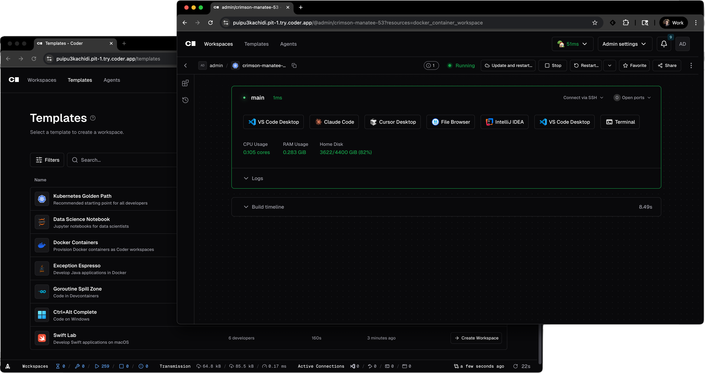

<!-- markdownlint-disable MD041 -->
<div align="center">
  <a href="https://coder.com#gh-light-mode-only">
    
  </a>
  <a href="https://coder.com#gh-dark-mode-only">
    
  </a>

  <h1>
  Self-Hosted Cloud Development Environments and AI Agents
  </h1>

  <a href="https://coder.com#gh-light-mode-only">
    
  </a>
  <a href="https://coder.com#gh-dark-mode-only">
    
  </a>

  <br>
  <br>

[Quickstart](#quickstart) | [Docs](https://coder.com/docs) | [Troubleshooting](https://coder.com/docs/troubleshooting) | [Premium](https://coder.com/pricing#compare-plans)

[](https://cdr.co/discord-Y6fMxGdNRg)
[](https://github.com/coder/coder/releases/latest)
[](https://pkg.go.dev/github.com/coder/coder)
[](https://www.bestpractices.dev/projects/9511)
[](https://scorecard.dev/viewer/?uri=github.com%2Fcoder%2Fcoder)
[](./LICENSE)
[](https://deepwiki.com/coder/coder)

</div>

[Coder](https://coder.com) is a self-hosted platform for cloud development environments and AI coding agents.
Define workspaces in Terraform, connect from any IDE, and run AI coding agents on infrastructure you control.

- **Workspaces as code**: EC2 VMs, Kubernetes Pods, Docker containers, and more, defined in Terraform.
- **Lower costs**: idle workspaces shut down automatically.
- **Fast onboarding**: new developers get a working environment in seconds.
- **AI agents on your infrastructure**: bring any model, keep LLM credentials out of workspaces, and audit every action.

<p align="center">
  
</p>

## Quickstart

Install Coder on Linux or macOS. On Windows, download the installer from [GitHub Releases](https://github.com/coder/coder/releases/latest).

```shell
curl -fsSL https://coder.com/install.sh | sh
```

Start the server:

```shell
coder server
```

Open [http://localhost:3000](http://localhost:3000), create your first user, and follow the prompts to create a template and a workspace.

This setup is for evaluation. For production, refer to the [install guides](https://coder.com/docs/install).

## Next steps

- [Quickstart tutorial](https://coder.com/docs/get-started): build your first template and workspace step by step
- [Connect your IDE](https://coder.com/docs/user-guides/workspace-access): VS Code, JetBrains, Cursor, SSH, and more
- [Coder Agents](https://coder.com/docs/ai-coder/agents): delegate coding work to AI agents
- [Coder Registry](https://registry.coder.com): ready-to-use templates and modules
- [Documentation](https://coder.com/docs): everything else

## Get help

- [Troubleshooting](https://coder.com/docs/troubleshooting): fixes for common problems
- [Discord](https://discord.gg/coder) and [GitHub Discussions](https://github.com/coder/coder/discussions): ask the community
- [GitHub Issues](https://github.com/coder/coder/issues/new): report a bug or request a feature
- [Coder Premium](https://coder.com/pricing#compare-plans): dedicated support for your organization

## Contributing

Contributions are welcome. Read the [contribution guide](./CONTRIBUTING.md) to get started.
Interested in joining the team? Visit our [careers page](https://jobs.ashbyhq.com/coder?utm_source=github&utm_medium=readme&utm_campaign=unknown).
