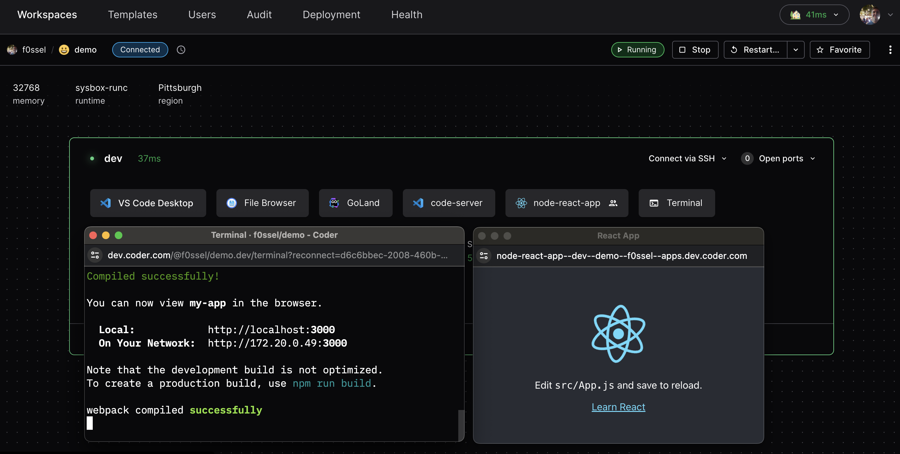

One way to port forward is to configure a `coder_app` resource in the workspace's template.
This approach shows a visual application icon in the dashboard.
See the following `coder_app` example for a Node React app and note the `subdomain` and `share` settings:

```tf
# node app
resource "coder_app" "node-react-app" {
  agent_id  = coder_agent.dev.id
  slug      = "node-react-app"
  icon      = "https://upload.wikimedia.org/wikipedia/commons/a/a7/React-icon.svg"
  url       = "http://localhost:3000"
  subdomain = true
  share     = "authenticated"

  healthcheck {
    url       = "http://localhost:3000/healthz"
    interval  = 10
    threshold = 30
  }

}
```

Valid `share` values include `owner` - private to the user, `authenticated` - accessible by any user authenticated to the Coder deployment, and `public` - accessible by users outside of the Coder deployment.


