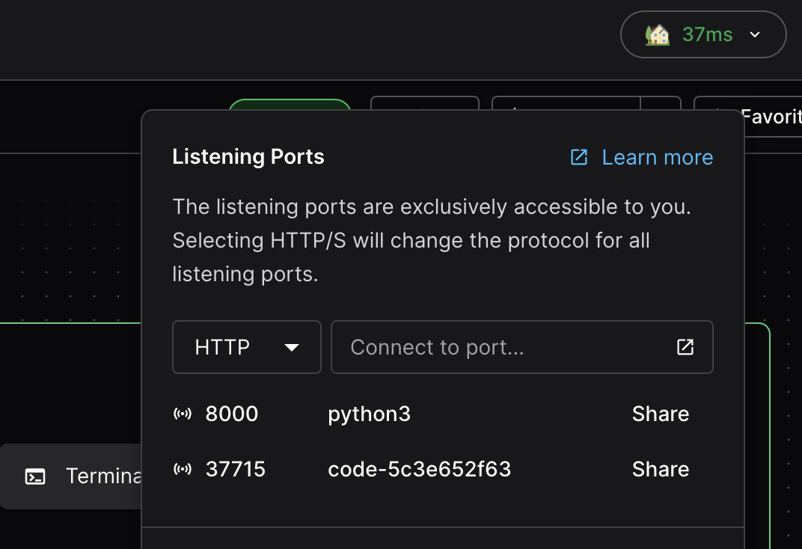

Another way to port forward in the dashboard is to use the "Open Ports" button to specify an arbitrary port.
Coder will also detect if apps inside the workspace are listening on ports, and list them below the port input (this is only supported on Windows and Linux workspace agents).

