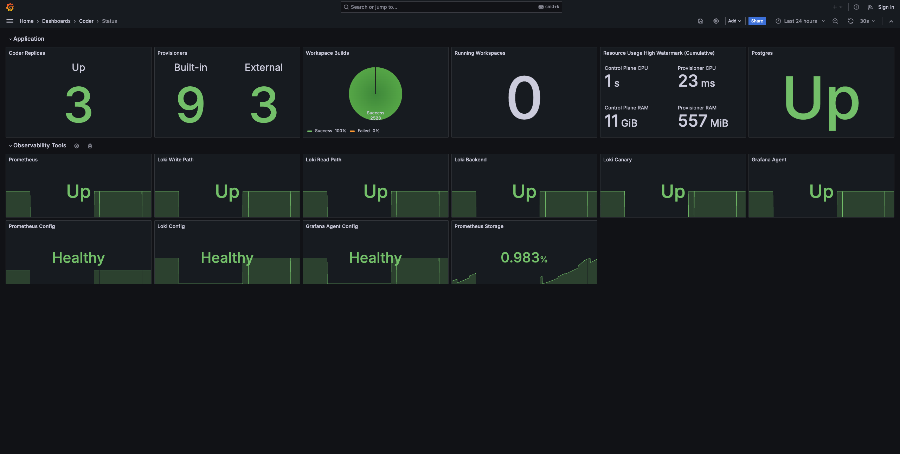

Coder exposes logs, metrics, health checks, connection logs, and notifications so you can monitor the control plane, provisioners, and workspaces with the tools you already use.
Start with the page that matches what you need to watch:

<children></children>

## Observability Helm chart

If you run Coder on Kubernetes, the Observability Helm chart deploys Prometheus, Grafana, Alertmanager, and pre-built dashboards that monitor the control plane, provisioners, and workspaces.

To install the chart and run its dashboards, visit the [Observability Helm chart repository](https://github.com/coder/observability) on GitHub.
