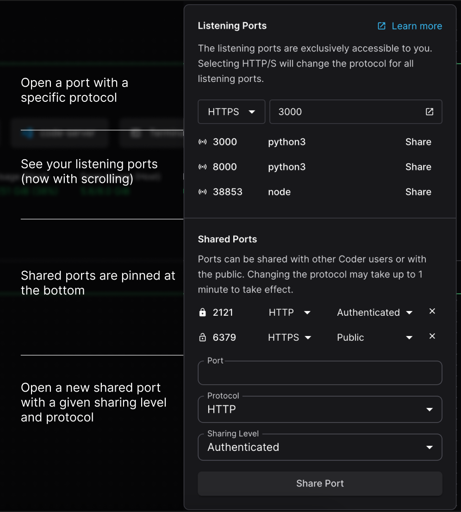
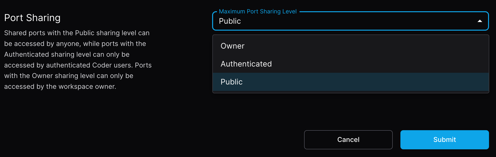

Port forwarding lets developers securely access processes on their Coder workspace from a local machine.
A common use case is testing web applications in a browser.

There are four ways to forward ports in Coder:

| Method                                 | Details                                                                                                                                                                                  |
|:---------------------------------------|:-----------------------------------------------------------------------------------------------------------------------------------------------------------------------------------------|
| [Coder Desktop](#coder-desktop)        | Automatic port forwarding via virtual private network (VPN) tunnel. All workspace ports are available at `workspace.coder:PORT` with no manual setup. Supports peer-to-peer connections. |
| [CLI](#the-coder-port-forward-command) | Forwards specific Transmission Control Protocol (TCP) or User Datagram Protocol (UDP) ports from the workspace to local ports. Supports peer-to-peer connections.                        |
| [Dashboard](#dashboard)                | Proxies traffic through the Coder control plane.                                                                                                                                         |
| [SSH](#ssh)                            | Forwards ports over an SSH connection.                                                                                                                                                   |

Coder Desktop and `coder port-forward` are generally more performant than:

1. The Dashboard, which proxies traffic through the Coder control plane instead of peer-to-peer like the Coder CLI and Coder Desktop
1. `sshd` which does double encryption of traffic with both Wireguard and SSH

## Coder Desktop

[Coder Desktop](../../workspaces/desktop/index.md) provides automatic port forwarding to every service running in your workspace.
Once Coder Connect is enabled, any port your application listens on is instantly accessible at `<workspace-name>.coder:PORT` from your local machine, with no additional commands or configuration.

This is the simplest option for most users.
See the [Coder Desktop documentation](../../workspaces/desktop/index.md) for installation and setup.

## The `coder port-forward` command

<include>../../_includes/port-forwarding/cli-syntax.md</include>

### Examples

<include>../../_includes/port-forwarding/cli-examples.md</include>

Forward the remote TCP port `3000` and all ports from `9990` to `9999` to their respective local ports to the `agent` in your Workspace (typically main or dev).
This is needed when you have multiple agents in your workspace.

```console
coder port-forward myworkspace.agent --tcp 3000,9990-9999
```

For more examples, see `coder port-forward --help`.

## Dashboard

<include>../../_includes/port-forwarding/dashboard-requirements.md</include>

### From a coder_app resource

<include>../../_includes/port-forwarding/coder-app.md</include>

<a id="accessing-workspace-ports"></a>

## Access workspace ports

<include>../../_includes/port-forwarding/open-ports.md</include>

<a id="sharing-ports"></a>

### Share ports

We allow developers to share ports as URLs, either with other authenticated coder users or publicly.
Using the open ports interface, developers can assign a sharing levels that match our `coder_app`’s share option in [Coder terraform provider](https://registry.terraform.io/providers/coder/coder/latest/docs/resources/app#share-1).

- `owner` (Default): The implicit sharing level for all listening ports, only visible to the workspace owner
- `authenticated`: Accessible by other authenticated Coder users on the same deployment.
- `public`: Accessible by any user with the associated URL.

Once a port is shared at either `authenticated` or `public` levels, it will stay pinned in the open ports UI for better accessibility regardless of whether or not it is still accessible.



The sharing level is limited by the maximum level enforced in the template settings in premium deployments, and not restricted in open source software (OSS) deployments.

This can also be used to change the sharing level of `coder_app`s by entering their port number in the sharable ports UI.
The `share` attribute on `coder_app` resource uses a different method of authentication and **is not impacted by the template's maximum sharing level**, nor the level of a shared port that points to the app.

### Configure maximum port sharing level

> [!NOTE]
> Configuring port sharing level is a Premium feature.
> [Learn more](https://coder.com/pricing#compare-plans).

Premium-licensed template admins can control the maximum port sharing level for workspaces under a given template in the template settings.
By default, the maximum sharing level is set to `Owner`, meaning port sharing is disabled for end-users.
OSS deployments allow all workspaces to share ports at both the `authenticated` and `public` levels.



<a id="configuring-port-protocol"></a>

### Configure port protocol

<include>../../_includes/port-forwarding/port-protocol.md</include>

You can access any port on the workspace and can configure the port protocol manually by appending a `s` to the port in the URL.

```txt
# Uses HTTP
https://33295--agent--workspace--user--apps.example.com/
# Uses HTTPS
https://33295s--agent--workspace--user--apps.example.com/
```

### Cross-origin resource sharing (CORS)

When forwarding via the dashboard, Coder automatically sets headers that allow requests between separately forwarded applications belonging to the same user.

When forwarding through other methods the application itself will need to set its own cross-origin resource sharing (CORS) headers if they are being forwarded through different origins since Coder does not intercept these cases.
See below for the required headers.

#### Authentication

Since ports forwarded through the dashboard are private, cross-origin requests must include credentials (set `credentials: "include"` if using `fetch`) or the requests cannot be authenticated and you will see an error resembling the following:

```txt
Access to fetch at
'<https://coder.example.com/api/v2/applications/auth-redirect>' from origin
'<https://8000--dev--user--apps.coder.example.com>' has been blocked by CORS
policy: No 'Access-Control-Allow-Origin' header is present on the requested
resource. If an opaque response serves your needs, set the request's mode to
'no-cors' to fetch the resource with CORS disabled.
```

#### Headers

Below is a list of the cross-origin headers Coder sets with example values:

```txt
access-control-allow-credentials: true
access-control-allow-methods: PUT
access-control-allow-headers: X-Custom-Header
access-control-allow-origin: https://8000--dev--user--apps.coder.example.com
vary: Origin
vary: Access-Control-Request-Method
vary: Access-Control-Request-Headers
```

The allowed origin will be set to the origin provided by the browser if the users are identical.
Credentials are allowed and the allowed methods and headers will echo whatever the request sends.

#### Configuration

These cross-origin headers are not configurable by administrative settings.

If applications set any of the above headers they will be stripped from the response except for `Vary` headers that are set to a value other than the ones listed above.

In other words, CORS behavior through the dashboard is not currently configurable by either admins or users.

#### Allowed by default

<table class="tg">
<caption>
Which requests between forwarded apps the dashboard allows by default.
Columns are the origin: the user, workspace, and app that sends the request.
Rows are the destination: the user, workspace, and app that receives it.
</caption>
<thead>
  <tr>
    <th class="tg-0pky" scope="row" colspan="3">From user</th>
    <th class="tg-0pky" scope="col" colspan="3">Alice</th>
    <th class="tg-0pky" scope="col">Bob</th>
  </tr>
  <tr>
    <th class="tg-0pky" scope="row" colspan="3">From workspace</th>
    <th class="tg-0pky" scope="col">Workspace 1</th>
    <th class="tg-0pky" scope="col" colspan="2">Workspace 2</th>
    <th class="tg-0pky" scope="col">Workspace 3</th>
  </tr>
  <tr>
    <th class="tg-0pky" scope="col">To user</th>
    <th class="tg-0pky" scope="col">To workspace</th>
    <th class="tg-0pky" scope="col">To app</th>
    <th class="tg-0pky" scope="col">App A</th>
    <th class="tg-0pky" scope="col">App B</th>
    <th class="tg-0pky" scope="col">App C</th>
    <th class="tg-0pky" scope="col">App D</th>
  </tr>
</thead>
<tbody>
  <tr>
    <th class="tg-0pky" scope="row" rowspan="3">Alice</th>
    <th class="tg-0pky" scope="row" rowspan="2">Workspace 1</th>
    <th class="tg-0pky" scope="row">App A</th>
    <td class="tg-0pky">✅</td>
    <td class="tg-0pky">✅<span style="font-weight:400;font-style:normal">*</span></td>
    <td class="tg-0pky">✅<span style="font-weight:400;font-style:normal">*</span></td>
    <td class="tg-0pky">❌</td>
  </tr>
  <tr>
    <th class="tg-0pky" scope="row">App B</th>
    <td class="tg-0pky">✅*</td>
    <td class="tg-0pky">✅</td>
    <td class="tg-0pky">✅<span style="font-weight:400;font-style:normal">*</span></td>
    <td class="tg-0pky">❌</td>
  </tr>
  <tr>
    <th class="tg-0pky" scope="row">Workspace 2</th>
    <th class="tg-0pky" scope="row">App C</th>
    <td class="tg-0pky">✅<span style="font-weight:400;font-style:normal">*</span></td>
    <td class="tg-0pky">✅<span style="font-weight:400;font-style:normal">*</span></td>
    <td class="tg-0pky">✅</td>
    <td class="tg-0pky">❌</td>
  </tr>
  <tr>
    <th class="tg-0pky" scope="row">Bob</th>
    <th class="tg-0pky" scope="row">Workspace 3</th>
    <th class="tg-0pky" scope="row">App D</th>
    <td class="tg-0pky">❌</td>
    <td class="tg-0pky">❌</td>
    <td class="tg-0pky">❌</td>
    <td class="tg-0pky">✅</td>
  </tr>
</tbody>
</table>

> '\*' means `credentials: "include"` is required

## SSH

First, [configure SSH](../../workspaces/workspace-access/index.md#configure-ssh) on your local machine.
Then, use `ssh` to forward like so:

```console
ssh -L 8080:localhost:8000 coder.myworkspace
```

You can read more on SSH port forwarding [here](https://www.ssh.com/academy/ssh/tunneling/example).
