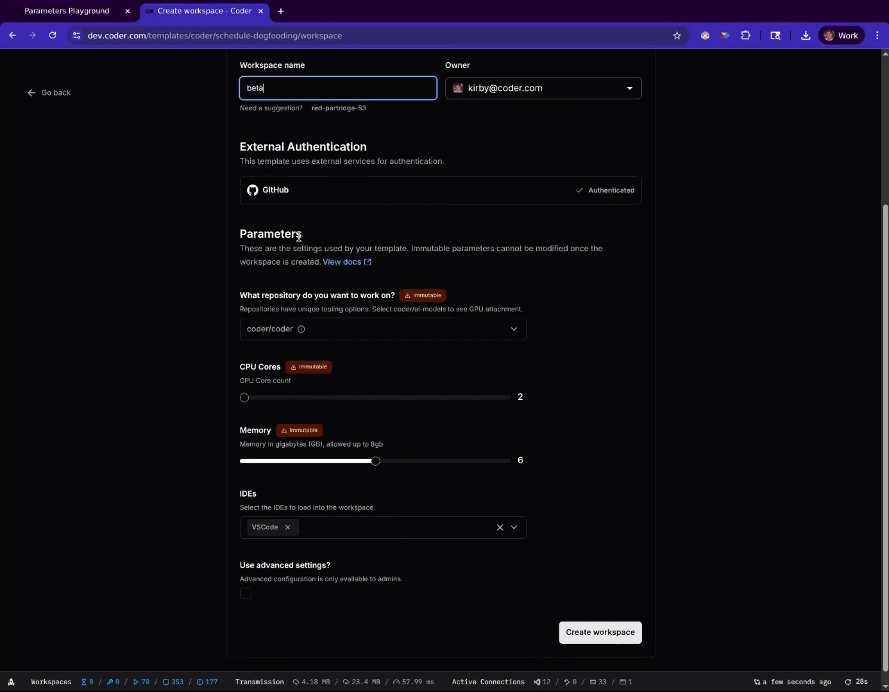

Conditional parameters react to the user's other selections in the workspace creation form.
Use native Terraform syntax and parameter attributes like `count` to:

- Hide parameters unless the user activates them.
- Set default values based on other selections.
- Change the available options based on other parameter inputs.

Combine these patterns to build an intuitive form that branches for each use case, so you maintain one template instead of several.



To make a parameter's validation rules depend on other selections, refer to [Validation that depends on other parameters](./validation.md#validation-that-depends-on-other-parameters).
To change parameters based on who is filling in the form, refer to [Identity-aware parameters](./identity-aware-parameters.md).

## Show or hide a parameter

Use Terraform conditionals and the [`count`](https://developer.hashicorp.com/terraform/language/meta-arguments/count) meta-argument so that a checkbox shows or hides a later parameter.

[Try conditional parameters on the Parameter Playground](https://playground.coder.app/parameters/xmG5MKEGNM).

```tf
data "coder_parameter" "show_cpu_cores" {
  name         = "show_cpu_cores"
  display_name = "Toggles next parameter"
  description  = "Select this checkbox to show the CPU cores parameter."
  type         = "bool"
  form_type    = "checkbox"
  default      = false
  order        = 1
}

data "coder_parameter" "cpu_cores" {
  # Only show this parameter if the previous box is selected.
  count = data.coder_parameter.show_cpu_cores.value ? 1 : 0

  name         = "cpu_cores"
  display_name = "CPU Cores"
  type         = "number"
  form_type    = "slider"
  default      = 2
  order        = 2
  validation {
    min = 1
    max = 8
  }
}
```

## Set defaults from other parameters

Influence which option is selected by default for one parameter based on the selection of another.
With cascading default parameter settings, you can suggest an option dynamically without strict enforcement.

[Try dynamic defaults in the Parameter Playground](https://playground.coder.app/parameters/DEi-Bi6DVe).

```tf
locals {
  ides = [
    "VS Code",
    "IntelliJ", "GoLand",
    "WebStorm", "PyCharm",
    "Databricks", "Jupyter Notebook",
  ]
  mlkit_ides = jsonencode(["Databricks", "PyCharm"])
  core_ides = jsonencode(["VS Code", "GoLand"])
}

data "coder_parameter" "git_repo" {
  name = "git_repo"
  display_name = "Git repo"
  description = "Select a git repo to work on."
  order = 1
  mutable = true
  type = "string"
  form_type = "dropdown"

  option {
    # A Go-heavy repository
    name = "coder/coder"
    value = "coder/coder"
  }

  option {
    # A python-heavy repository
    name = "coder/mlkit"
    value = "coder/mlkit"
  }
}

data "coder_parameter" "ide_selector" {
  # Conditionally expose this parameter
  count = try(data.coder_parameter.git_repo.value, "") != "" ? 1 : 0

  name = "ide_selector"
  description  = "Choose any IDEs for your workspace."
  order        = 2
  mutable      = true

  display_name = "Select IDEs"
  form_type = "multi-select"
  type      = "list(string)"
  default   = try(data.coder_parameter.git_repo.value, "") == "coder/mlkit" ? local.mlkit_ides : local.core_ides


  dynamic "option" {
    for_each = local.ides
    content {
      name  = option.value
      value = option.value
    }
  }
}
```
