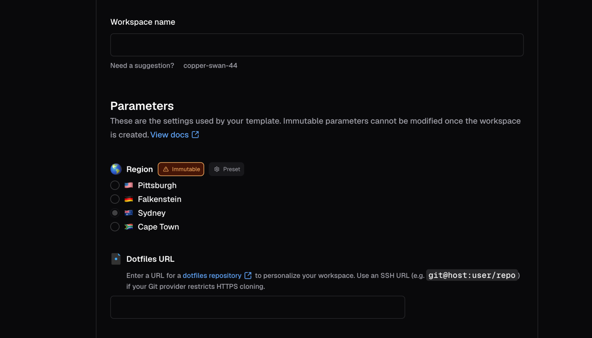

Parameters prompt the user for information when they create or update a workspace, such as a region, an instance size, or a repository URL.
You declare each parameter in your template's Terraform with the [`coder_parameter`](https://registry.terraform.io/providers/coder/coder/latest/docs/data-sources/parameter) data source, so the workspace creation form lives next to the provisioning code that uses it.



Users set parameter values in the dashboard or with the CLI.

Because Coder evaluates parameters as Terraform, a parameter can do more than collect a value.
It can react to other parameters, change based on who is filling in the form, and render as a dropdown, slider, multi-select, or other control.
Use these capabilities to replace several near-duplicate templates with one template whose form adapts to each team.

> [!NOTE]
> Earlier Coder releases called these capabilities _dynamic parameters_.
> Every template uses them by default, so this section covers them alongside the basics.
> Templates that still use [compatibility mode](./compatibility-mode.md) render the older classic form.

This section covers:

- [Form types and styling](./form-types.md): Choose the input control for each parameter, such as a dropdown, slider, or text area.
- [Validation](./validation.md): Constrain values with ranges, monotonic numbers, regular expressions, and rules that depend on other parameters.
- [Conditional parameters](./conditional-parameters.md): Show, hide, or change parameters based on the user's other selections.
- [Identity-aware parameters](./identity-aware-parameters.md): Change parameters based on the user's roles and groups.
- [Workspace presets](./workspace-presets.md): Bundle common parameter values into a single choice.
- [Compatibility mode](./compatibility-mode.md): Move templates off the deprecated classic parameter flow.
- [Troubleshooting](./troubleshooting.md): Fix common problems with parameter forms.

> [!TIP]
> You can try most examples in this section in the [Parameters Playground](https://playground.coder.app/parameters).
> With the Parameters Playground, you can experiment before you change a live template.

## Define a parameter

Hardcode the template properties that you control, such as a security group.
Use parameters for the properties that developers choose, such as instance size, geographical location, or repository URL.

This example lets a developer choose a Docker host for the workspace:

```tf
data "coder_parameter" "docker_host" {
  name        = "Region"
  description = "Which region would you like to deploy to?"
  icon        = "/emojis/1f30f.png"
  type        = "string"
  default     = "tcp://100.94.74.63:2375"

  option {
    name = "Pittsburgh, USA"
    value = "tcp://100.94.74.63:2375"
    icon = "/emojis/1f1fa-1f1f8.png"
  }

  option {
    name = "Helsinki, Finland"
    value = "tcp://100.117.102.81:2375"
    icon = "/emojis/1f1eb-1f1ee.png"
  }

  option {
    name = "Sydney, Australia"
    value = "tcp://100.127.2.1:2375"
    icon = "/emojis/1f1e6-1f1f9.png"
  }
}
```

From there, a template can refer to a parameter's value:

```tf
provider "docker" {
  host = data.coder_parameter.docker_host.value
}
```

## Coder provider version

Form types, styling, and the other features in this section require version 2.4.0 or later of the Coder Terraform provider.
Set the version in your template's `terraform` block:

```tf
terraform {
  required_providers {
    coder = {
      source = "coder/coder"
      version = ">=2.4.0"
    }
  }
}
```

If a template's active version was published before Coder supported these features, publish a new version to generate the metadata the form requires.
To publish one without editing the template's Terraform, [refresh the template data](../../managing-templates/index.md#refresh-template-data).

## How Coder evaluates parameters

Coder parses every parameter from your template's Terraform and evaluates it again each time the user changes a value in the form.
You can use native Terraform functions, locals, and conditionals in any parameter attribute.

Coder reads Terraform `data` sources once, when it imports a template version, and stores the results.
Rendering the form evaluates your parameter expressions against those stored results, so a `data` source where its underlying value changes in your cloud or cluster keeps returning the imported value.

The `coder_workspace_owner` data source is the exception.
Coder substitutes the identity of the user filling in the form each time it renders, which is what makes [identity-aware parameters](./identity-aware-parameters.md) work.

To pick up a change to any other `data` source, [refresh the template data](../../managing-templates/index.md#refresh-template-data).
This imports the active version's source files again and publishes the result as a new active version.

> [!IMPORTANT]
> Parameters do not support external data fetching via HTTP endpoints at workspace build time.
>
> External fetching would introduce unpredictability in workspace builds after publishing a template.
> Instead, you should pull in any required data for a workspace build as a [locals](https://developer.hashicorp.com/terraform/tutorials/configuration-language/locals) or JSON file, then reference that data in Terraform.
>
> If you have a use case for external data fetching, file an issue or create a discussion in the [Coder GitHub repository](https://github.com/coder/coder).

## Types

A Coder parameter can have one of these types:

- `string`
- `bool`
- `number`
- `list(string)`

To specify a default value for a parameter with the `list(string)` type, use a JSON array and the Terraform [jsonencode](https://developer.hashicorp.com/terraform/language/functions/jsonencode) function.
For example:

```tf
data "coder_parameter" "security_groups" {
  name        = "Security groups"
  icon        = "/icon/aws.png"
  type        = "list(string)"
  description = "Select appropriate security groups."
  mutable     = true
  default = jsonencode([
    "Web Server Security Group",
    "Database Security Group",
    "Backend Security Group"
  ])
}
```

> [!NOTE]
> Overriding a `list(string)` on the CLI is tricky because:
>
> - `--parameter "parameter_name=parameter_value"` is parsed as CSV.
> - `parameter_value` is parsed as JSON.
>
> So, to properly specify a `list(string)` with the `--parameter` CLI argument, you will need to take care of both CSV quoting and shell quoting.
>
> For the above example, to override the default values of the `security_groups` parameter, you will need to pass the following argument to `coder create`:
>
> ```shell
> --parameter "\"security_groups=[\"\"DevOps Security Group\"\",\"\"Backend Security Group\"\"]\""
> ```
>
> Alternatively, you can use `--rich-parameter-file` to work around the above issues.
> This allows you to specify parameters as YAML.
> An equivalent parameter file for the above `--parameter` is provided below:
>
> ```yaml
> security_groups:
>   - DevOps Security Group
>   - Backend Security Group
> ```

## Options

A `string` parameter can provide a set of options to limit the user's choices:

```tf
data "coder_parameter" "docker_host" {
  name        = "Region"
  description = "Which region would you like to deploy to?"
  type        = "string"
  default     = "tcp://100.94.74.63:2375"

  option {
    name = "Pittsburgh, USA"
    value = "tcp://100.94.74.63:2375"
    icon = "/emojis/1f1fa-1f1f8.png"
  }

  option {
    name = "Helsinki, Finland"
    value = "tcp://100.117.102.81:2375"
    icon = "/emojis/1f1eb-1f1ee.png"
  }

  option {
    name = "Sydney, Australia"
    value = "tcp://100.127.2.1:2375"
    icon = "/emojis/1f1e6-1f1f9.png"
  }
}
```

<a id="incompatibility-in-parameter-options-for-workspace-builds"></a>

### Option changes across template versions

When creating Coder templates, authors have the flexibility to modify parameter options associated with rich parameters.
Such modifications can involve adding, substituting, or removing a parameter option.
It's important to note that making these changes can lead to discrepancies in parameter values utilized by ongoing workspace builds.

Consequently, workspace users will be prompted to select the new value from a pop-up window or by using the command-line interface.
While this additional interactive step might seem like an interruption, it serves a crucial purpose.
It prevents workspace users from becoming trapped with outdated template versions, ensuring they can smoothly update their workspace without any hindrances.

Example:

- Bob creates a workspace using the `python-dev` template.
  This template has a parameter `image_tag`, and Bob selects `1.12`.
- Later, the template author Alice is notified of a critical vulnerability in a package installed in the `python-dev` template, which affects the image tag `1.12`.
- Alice remediates this vulnerability, and pushes an updated template version that replaces option `1.12` with `1.13` for the `image_tag` parameter.
  She then notifies all users of that template to update their workspace immediately.
- Bob saves their work, and selects the `Update` option in the UI.
  As their workspace uses the now-invalid option `1.12`, for the `image_tag` parameter, they are prompted to select a new value for `image_tag`.

## Required and optional parameters

A parameter is _required_ if it doesn't have the `default` property.
The user **must** provide a value to this parameter before creating a workspace:

```tf
data "coder_parameter" "account_name" {
  name        = "Account name"
  description = "Cloud account name"
  mutable     = true
}
```

If a parameter contains the `default` property, Coder will use this value if the user does not specify any:

```tf
data "coder_parameter" "base_image" {
  name        = "Base image"
  description = "Base machine image to download"
  default     = "ubuntu:latest"
}
```

Admins can also set the `default` property to an empty value so that the parameter field can remain empty:

```tf
data "coder_parameter" "dotfiles_url" {
  name        = "dotfiles URL"
  description = "Git repository with dotfiles"
  mutable     = true
  default     = ""
}
```

## Mutability

Immutable parameters can only be set in these situations:

- Creating a workspace for the first time.
- Updating a workspace to a new template version.
  This sets the initial value for required parameters.

The idea is to prevent users from modifying fragile or persistent workspace resources like volumes, regions, and so on.

Example:

```tf
data "coder_parameter" "region" {
  name        = "Region"
  description = "Region where the workspace is hosted"
  mutable     = false
  default     = "us-east-1"
}
```

If a required parameter is empty or if the workspace creation page detects an incompatibility between selected parameters, the **Create workspace** button is disabled until the issues are resolved.

## Ephemeral parameters

Ephemeral parameters are introduced to users in order to model specific behaviors in a Coder workspace, such as reverting to a previous image, restoring from a volume snapshot, or building a project without using cache.
These parameters are settable when creating, starting, updating, or restarting a workspace but do not persist after the workspace is stopped.

Since these parameters are ephemeral in nature, subsequent builds proceed in the standard manner:

```tf
data "coder_parameter" "force_rebuild" {
  name         = "force_rebuild"
  type         = "bool"
  description  = "Rebuild the Docker image rather than use the cached one."
  mutable      = true
  default      = false
  ephemeral    = true
}
```

## Autofill parameters from a URL

When the template doesn't specify default values, Coder looks for URL query parameters with the form `param.<name>=<value>` to autofill parameters.

This feature enables platform teams to create pre-filled workspace creation links.
