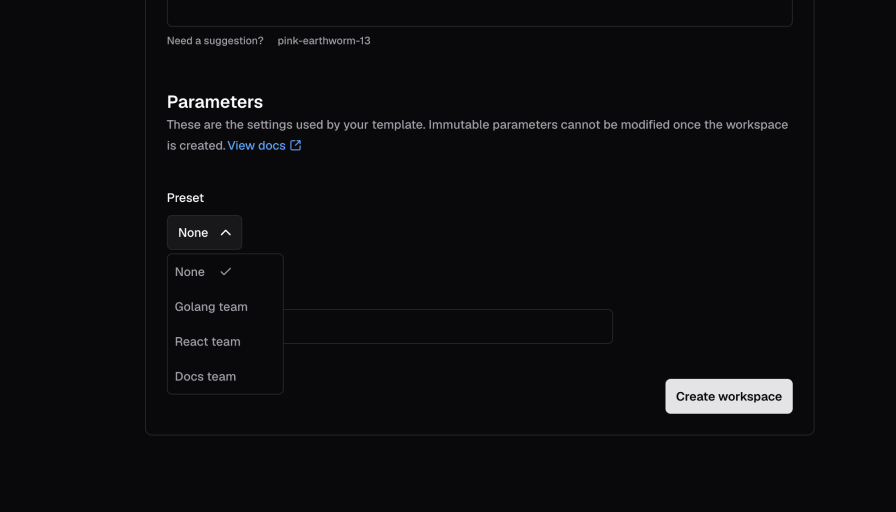

Workspace presets bundle commonly used combinations of parameter values into a single option, so developers can pick the one that fits their needs.



Use the [`coder_workspace_preset`](https://registry.terraform.io/providers/coder/coder/latest/docs/data-sources/workspace_preset) data source to define the preset parameters.
After you save the template file, the presets will be available for all new workspace deployments.

## Optional preset fields

In addition to the required `name` and `parameters` fields, you can enhance your workspace presets with optional `description` and `icon` fields:

- **description**:
  A helpful text description that provides additional context about the preset.
  This helps users understand what the preset is for and when to use it.
- **icon**:
  A visual icon displayed alongside the preset name in the UI.
  Use emoji icons with the format `/emojis/{code}.png` (for example, `/emojis/1f1fa-1f1f8.png` for the US flag emoji 🇺🇸).

For a complete list of all available fields, visit the [Terraform provider documentation](https://registry.terraform.io/providers/coder/coder/latest/docs/data-sources/workspace_preset#schema).

<details><summary>Expand for an example</summary>

```tf
data "coder_workspace_preset" "goland-gpu" {
  name        = "GoLand with GPU"
  description = "Development workspace with GPU acceleration for GoLand IDE"
  icon        = "/emojis/1f680.png"
  parameters = {
    "machine_type"  = "n1-standard-1"
    "attach_gpu"    = "true"
    "gcp_region"    = "europe-west4-c"
    "jetbrains_ide" = "GO"
  }
}

data "coder_workspace_preset" "pittsburgh" {
  name        = "Pittsburgh"
  description = "Development workspace hosted in United States"
  icon        = "/emojis/1f1fa-1f1f8.png"
  parameters = {
    "region"       = "us-pittsburgh"
    "machine_type" = "n1-standard-2"
  }
}

data "coder_parameter" "machine_type" {
  name          = "machine_type"
  display_name  = "Machine Type"
  type          = "string"
  default       = "n1-standard-2"
}

data "coder_parameter" "attach_gpu" {
  name          = "attach_gpu"
  display_name  = "Attach GPU?"
  type          = "bool"
  default       = "false"
}

data "coder_parameter" "gcp_region" {
  name          = "gcp_region"
  display_name  = "GCP Region"
  type          = "string"
  default       = "us-central1-a"
}

data "coder_parameter" "jetbrains_ide" {
  name          = "jetbrains_ide"
  display_name  = "JetBrains IDE"
  type          = "string"
  default       = "IU"
}

data "coder_parameter" "region" {
  name          = "region"
  display_name  = "Region"
  type          = "string"
  default       = "us-east-1"
}
```

</details>

## Learn more

[Prebuilt workspaces](../prebuilt-workspaces.md) use presets to define the configuration of each pool of ready-to-claim workspaces.
