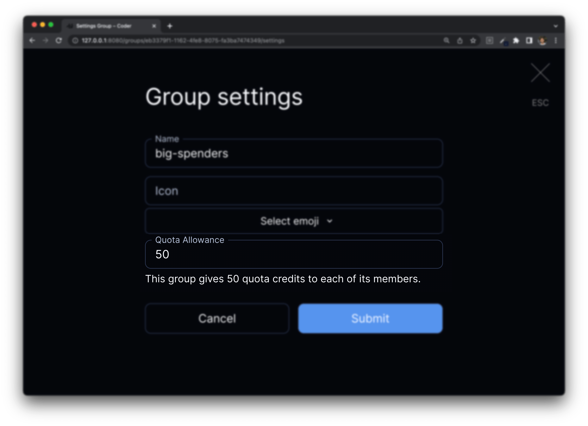
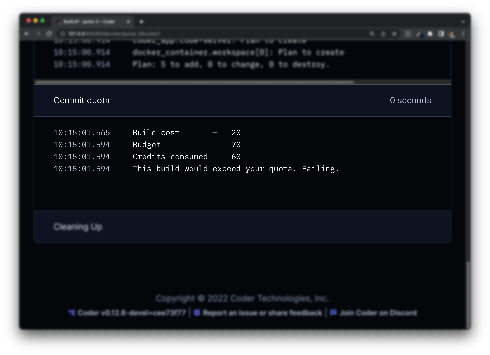

Quotas are a mechanism for controlling spend by associating costs with workspace
templates and assigning budgets to users. Users that exceed their budget will be
blocked from launching more workspaces until they either delete their other
workspaces or get their budget extended.

For example: A template is configured with a cost of 5 credits per day, and the
user is granted 15 credits, which can be consumed by both started and stopped
workspaces. This budget limits the user to 3 concurrent workspaces.

Quotas are a Premium feature.
You grant quota allowances to [groups](./groups-roles.md), and Coder calculates
each user's budget separately in each [organization](./organizations.md).

## Definitions

- **Credits** is the fundamental unit representing cost in the quota system.
  This integer can be arbitrary, or it can map to your preferred currency.
- **Budget** is the per-user, enforced, upper limit to credit spend.
- **Allowance** is a grant of credits to the budget.

<a id="establishing-costs"></a>

## Establish costs

Templates describe their cost through the `daily_cost` attribute in
[`resource_metadata`](https://registry.terraform.io/providers/coder/coder/latest/docs/resources/metadata).
Since costs are associated with resources, an offline workspace may consume less
quota than an online workspace.

A common use case is separating costs for a persistent volume and ephemeral
compute:

```tf
resource "docker_volume" "home_volume" {
  name = "coder-${data.coder_workspace_owner.me.name}-${data.coder_workspace.me.name}-root"
}

resource "coder_metadata" "home_volume" {
    resource_id = docker_volume.home_volume.id
    daily_cost  = 10
}

resource "docker_container" "workspace" {
  count = data.coder_workspace.me.start_count
  image = "codercom/code-server:latest"
  ...
  volumes {
    container_path = "/home/coder/"
    volume_name    = docker_volume.home_volume.name
    read_only      = false
  }
}

resource "coder_metadata" "workspace" {
    count       = data.coder_workspace.me.start_count
    resource_id = docker_container.workspace.id
    daily_cost  = 20
}
```

When the workspace above is shut down, the `docker_container` and
`coder_metadata` both get deleted. This reduces the cost from 30 credits to 10
credits.

Resources without a `daily_cost` value are considered to cost 0. If the cost was
removed on the `docker_volume` above, the template would consume 0 credits when
it's offline. This technique is good for incentivizing users to shut down their
unused workspaces and freeing up compute in the cluster.

<a id="establishing-budgets"></a>

## Establish budgets

Each group has a configurable Quota Allowance. A user's budget is calculated as
the sum of their allowances.



For example:

| Group Name | Quota Allowance |
|------------|-----------------|
| Frontend   | 10              |
| Backend    | 20              |
| Data       | 30              |

<br/>

| Username | Groups            | Effective Budget |
|----------|-------------------|------------------|
| jill     | Frontend, Backend | 30               |
| jack     | Backend, Data     | 50               |
| sam      | Data              | 30               |
| alex     | Frontend          | 10               |

By default, groups are assumed to have a default allowance of 0.

## Quota Enforcement

Coder enforces Quota on workspace start and stop operations. The workspace build
process dynamically calculates costs, so quota violation fails builds as opposed
to failing the build-triggering operation. For example, the Workspace Create
Form will never get held up by quota enforcement.



Coder checks quota for one build at a time for each user in each organization.
Builds that start together, such as several autostarts, are each checked against the credits that earlier checks consumed.
Only the quota check takes turns, so builds don't wait for each other to finish.

Each control plane replica limits concurrent quota checks so they leave database connections available for other work.
The automatic limit is one quarter of `CODER_PG_CONN_MAX_OPEN`, rounded down, with a minimum of 1 and a maximum of 8.
With the default pool of 10 connections, each replica allows two quota transactions.

To change the limit without resizing the connection pool, set `CODER_QUOTA_MAX_CONCURRENT_COMMITS` to a positive value smaller than `CODER_PG_CONN_MAX_OPEN`.
Set it to `0` to use the automatic limit.
If the pool has only one connection, the only positive limit is one.
The control plane rejects invalid limits at startup.

Quota transactions have a waiting budget of 30&nbsp;seconds for earlier checks, a transaction connection, or a retry.
This budget doesn't interrupt a quota check that's already running.
If the budget expires before the next attempt starts, the build fails with a `Failed to commit quota` error.
You can start or stop the workspace again.

## Up next

- [Group Sync](./idp-sync.md)
- [Control plane configuration](../setup/index.md)
