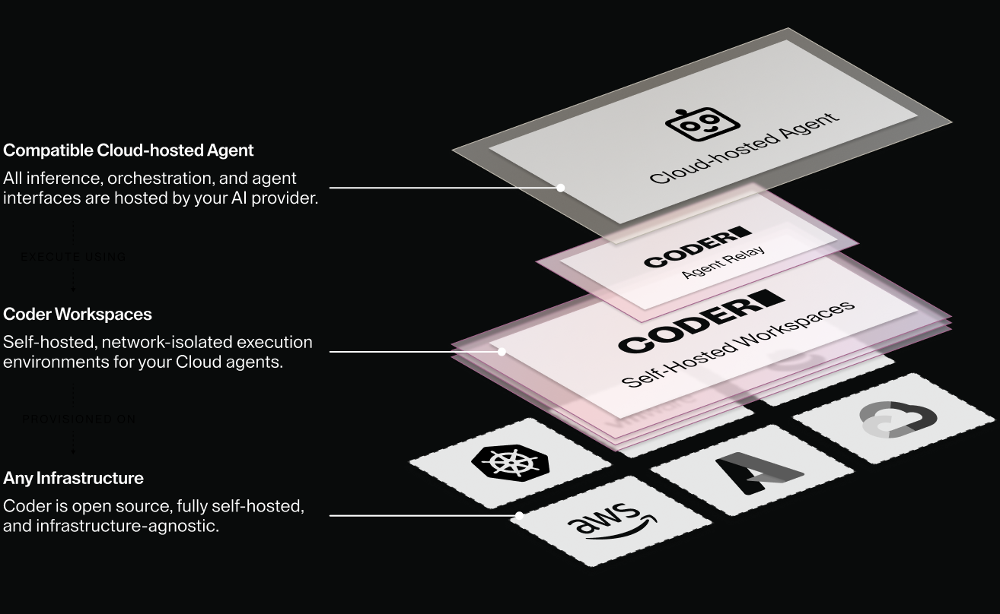
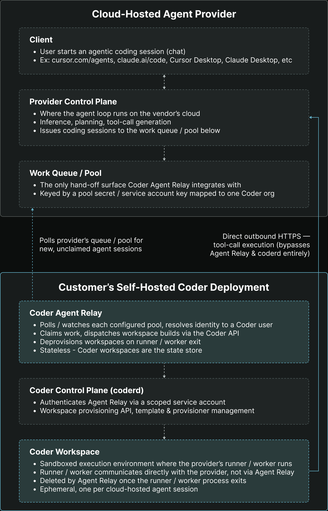

> [!NOTE]
> Agent Relay is in [beta](../../reference/feature-stages.md#beta) and requires a Premium license.
> Test it in a staging deployment before you roll it out to production users.

Agent Relay connects a cloud-hosted AI coding agent's sessions to self-hosted [Coder workspaces](../../user-guides/workspace-management.md).
Developers keep the cloud agent's client and workflow.
Coder provides the workspace where the agent's tool calls run.

This page explains how Agent Relay works and what it does and does not do.
To deploy it, refer to [Set up Agent Relay](./setup.md).

## How Agent Relay works

Agent Relay is a stateless daemon that runs separately from the Coder control plane.
It authenticates to your Coder deployment with a service account and keeps no state of its own.
Your Coder deployment is the state store.

1. A developer starts a session in a supported provider's client and targets a self-hosted pool that Agent Relay serves.
1. Agent Relay claims the pending session from the provider and matches the developer to a Coder user.
1. Agent Relay asks the Coder control plane to build a workspace for that user from the pool's mapped template.
1. A provider worker inside the workspace connects to the session and runs the agent's tool calls.
1. When the session ends, Agent Relay deletes the workspace.

Each session gets its own ephemeral workspace.
Agent Relay does not build workspaces itself.
Coder's provisioners run the `create` and `delete` builds.

## Key concepts

- **Pool**: The unit of Agent Relay configuration.
  Each pool maps one provider pool to exactly one Coder organization and one template.
  Anthropic calls a Claude Code pool an *environment* in claude.ai.
- **Worker**: The Coder workspace that serves one session from a pool.
  Claude Code calls it a *runner*.
- **Service account**: The Coder user that Agent Relay authenticates as.
  One relay uses exactly one service account.
- **Session owner**: The Coder user who owns a session's workspace.
  By default, this is the Coder user whose email matches the email the provider reports for the developer.

A developer's choice of pool decides which template their workspace uses.

## What Agent Relay is and isn't

Agent Relay changes where a cloud agent's tool calls run.
It doesn't change where the agent's orchestration or AI inference run.
Those stay with the cloud provider.

Agent Relay is not:

- A replacement for [Coder Agents](../agents/index.md), Coder's own AI workflow infrastructure that runs its native agent loop inside the Coder control plane and calls out to your configured LLM provider for inference.
- A proxy or observability layer for a provider's AI inference.
  Coder has no access to model selection or token usage for sessions that run through Agent Relay.
- A self-hosted deployment of a cloud provider's control plane.
  The provider's orchestration stays cloud-hosted.
- A way to make agent sessions air-gapped.
  Workspaces must reach the provider's API.

## Business value

- Developers keep using the cloud agent client and workflow they already know.
- Platform and security teams control the infrastructure where agent sessions run and which internal resources those sessions can reach.
- Agent sessions run in workspaces built from the same templates, networking, and governance controls as the rest of your Coder deployment.
- Each session's workspace belongs to a Coder user and appears in the Coder [audit log](../../admin/security/audit-logs.md).
- Each session gets its own workspace, provisioned on demand and deleted when the session ends.

## Supported providers

| Provider                        | Provider feature                                                                     | Required plan                |
|---------------------------------|--------------------------------------------------------------------------------------|------------------------------|
| [Claude Code](./claude-code.md) | [Self-hosted environments](https://code.claude.com/docs/en/self-hosted-environments) | Anthropic Team or Enterprise |
| [Cursor](./cursor.md)           | [Self-hosted machines](https://cursor.com/docs/cloud-agent/self-hosted)              | Cursor Enterprise            |

One Agent Relay process can serve pools for both providers.

## Requirements

- A Coder deployment with a Premium license, on version 2.37 or later.
- A Coder service account with a long-lived token.
- A workspace template for each pool that includes the provider's Agent Relay module.
- Provisioner capacity for Agent Relay builds.
- A Kubernetes cluster for the Helm chart, or another runtime that can run a container.

The daemon is distributed as a public container image and Helm chart:

- Image: `ghcr.io/coder/agent-relay`, tagged `X.Y.Z`, `X.Y`, and `latest` for each release.
- Helm chart: `oci://ghcr.io/coder/chart/coder-agent-relay`, versioned to match the image it deploys.

## Known limitations

- Agent Relay matches users by email.
  A developer whose provider account email differs from their Coder account email can't be served.
- Agent Relay checks a user's account status and access when a session starts.
  If you suspend a user or remove their access later, their existing workspace isn't affected.
- Relay sessions don't extend a template's autostop deadline.
  Refer to [Workspace lifecycle](./setup.md#workspace-lifecycle).
- Each pool maps to one template.
  Agent Relay doesn't select templates by repository.
- When Agent Relay rejects a Claude Code session, the reason appears in Agent Relay's logs but not in the Claude client.
  Cursor shows the reason in the developer's chat.
- Run only one relay for a given set of pools.
  Agent Relay doesn't support running more than one replica for the same pools.

## Learn more

- [Set up Agent Relay](./setup.md)
- [Agent Relay for Claude Code](./claude-code.md)
- [Agent Relay for Cursor](./cursor.md)
- [Configure Slack for Agent Relay](./slack.md)
- [Monitor Agent Relay](./monitoring.md)
- [Agent Relay configuration reference](./configuration.md)
- [Coder Agents](../agents/index.md)
