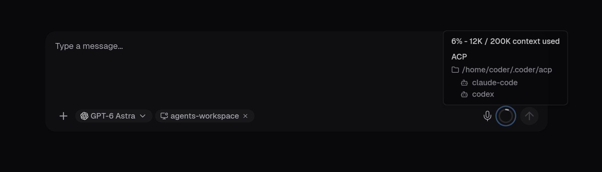
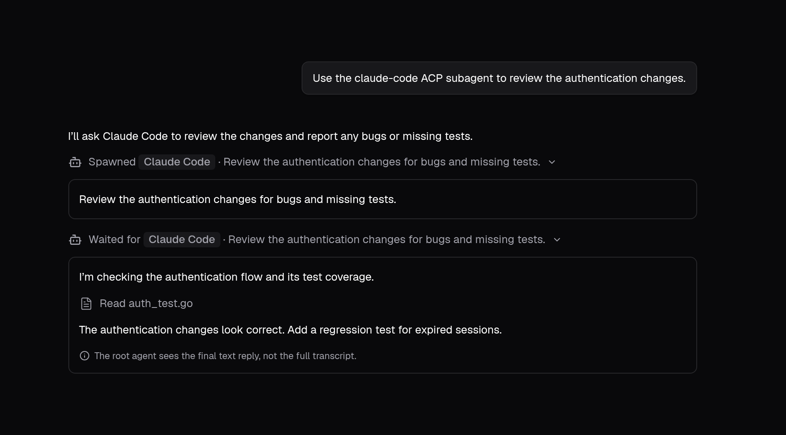

As a developer, you can use ACP subagents to delegate parts of a Coder Agents task to external coding agents in your workspace.
A harness, such as Codex or Claude Code, is a program that runs an external coding agent.
An ACP adapter launches the harness and connects it to Coder through the [Agent Client Protocol (ACP)](https://agentclientprotocol.com/).

## Prerequisites

ACP subagents are experimental.
Your deployment administrator must include `chat-acp-subagents` in the `CODER_EXPERIMENTS` environment variable or the `coder server --experiments` list.

You need a running workspace attached to your chat.
ACP subagents are available in the main chat in execute mode.
They aren't available in plan mode or to Coder Agents subagents.

## Configure a harness

Configure harnesses inside the workspace where you want the subagents to run.
This example uses Claude Code.
Visit the [ACP registry](https://agentclientprotocol.com/registry) to explore other available harnesses.

1. Install the harness and its ACP adapter in your workspace.

   For Claude Code, use the [Claude Agent SDK ACP adapter](https://github.com/zed-industries/claude-agent-acp) and its installation instructions.
   The example configuration uses the adapter's `claude-agent-acp` executable.

1. Authenticate the harness in the workspace using its own authentication instructions.

   ACP subagents use the harness's credentials, independently of the providers configured for Coder Agents.
   The workspace needs network access to the harness's model provider.

1. Create the `~/.coder/acp` directory in the workspace user's home directory.
1. Add a file named `claude.json` to that directory with the following content:

   ```json
   {
     "display_name": "Claude Code",
     "command": "claude-agent-acp"
   }
   ```

   The command must start the ACP adapter, which launches the harness.
   The adapter executable must be available to the workspace agent.
   Use an absolute executable path if the adapter isn't on the workspace agent's `PATH`.

Each `.json` file directly inside `~/.coder/acp/` configures one harness.
The filename without `.json` is the harness identifier (for example, `claude`).
Files in subdirectories aren't loaded.

| Field          | Description                                                                   |
|----------------|-------------------------------------------------------------------------------|
| `command`      | Required shell command that starts the ACP adapter.                           |
| `display_name` | Optional name shown in subagent activity. Defaults to the harness identifier. |
| `enabled`      | Optional switch. Defaults to `true`. Set to `false` to turn off the harness.  |

ACP subagents use the harness's own tools and configuration.
They don't inherit the chat's MCP servers.
Coder automatically approves tool permission requests received through the adapter.

## Check the context popup

You can find the harnesses available to your agent in the context popup.
Open the context usage indicator in the chat composer.
The **ACP** section lists available harnesses by identifier, grouped under their configuration directory.



Coder discovers harnesses after workspace startup scripts finish and checks for configuration changes every 30&nbsp;seconds.
The harness list updates automatically in existing chats when Coder detects a change.
You don't need to restart the workspace after you edit a harness configuration.

## Delegate a task

In execute mode, send a message that names the harness and the task you want to delegate.
For example:

```txt
Use the claude ACP subagent to review the authentication changes.
```



## ACP subagent tools

The main agent can use these tools when an ACP harness is available in the workspace attached to your chat.

### `acp_spawn_agent`

Starts a subagent with a configured harness in your workspace and sends it the delegated task.
Adapters usually expose options that the main agent can configure, such as the model or operating mode.
The available options depend on the harness and ACP adapter.

### `acp_wait_agent`

Waits for a subagent's current turn to finish and returns its text reply to the main agent.
While it waits, the chat streams the subagent's messages and tool activity.
A timeout or canceled wait leaves the subagent running.

### `acp_message_agent`

Sends a follow-up message to an idle subagent, starting another turn in the same session.
Subagents that are still working reject new messages.

### `acp_interrupt_agent`

Requests cancellation of a subagent's current turn.
The main agent uses `acp_wait_agent` to confirm when the subagent stops.

## Troubleshooting

If a harness doesn't load as expected, check the [workspace agent logs](../../admin/monitoring/logs.md#workspace-logs) for errors.
