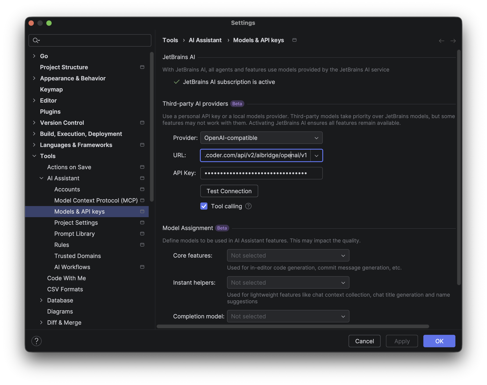
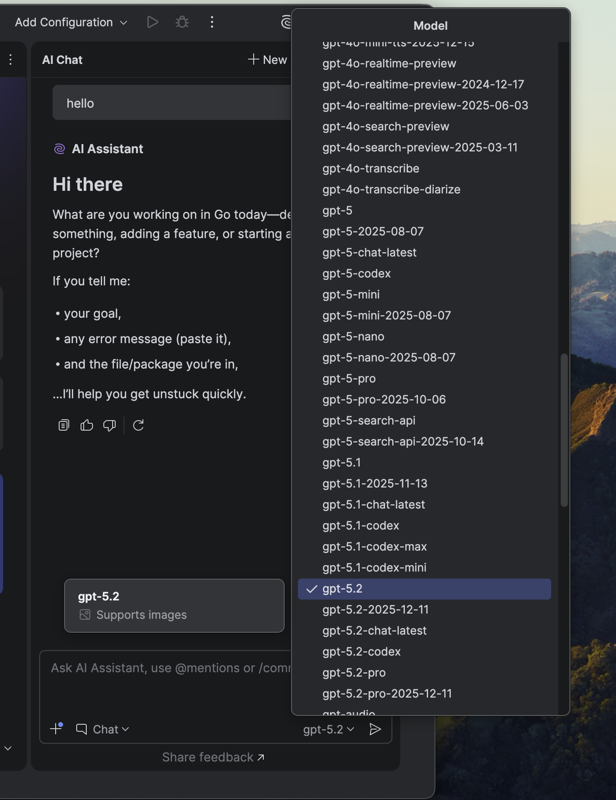

> [!NOTE]
> AI Gateway is part of [AI Governance](../../index.md), which is included with a Premium license.

JetBrains IDE (IntelliJ IDEA, PyCharm, WebStorm, and so on) support AI Gateway via the [third-party model configuration](https://www.jetbrains.com/help/ai-assistant/use-custom-models.html#provide-your-own-api-key) feature.
In a Coder workspace, the Claude Agent and Codex agents in AI Chat can also use AI Gateway.
For details, refer to [Claude Agent and Codex in Coder workspaces](#claude-agent-and-codex-in-coder-workspaces).

## Prerequisites

* [**JetBrains AI Assistant**](https://www.jetbrains.com/help/ai-assistant/installation-guide-ai-assistant.html): Installed and enabled.
* **Authentication**:
  Your **[Coder API token](../../../admin/users/sessions-tokens.md#generate-a-long-lived-api-token-on-behalf-of-yourself)**.

## Centralized API Key

1. **Open Settings**:
   Go to **Settings** > **Tools** > **AI Assistant** > **Models & API Keys**.
1. **Configure Provider**:
   Go to **Third-party AI providers**.
1. **Choose Provider**:
   Choose **OpenAI-compatible**.
1. **URL**:
   `https://coder.example.com/api/v2/ai-gateway/openai/v1`
1. **API Key**:
   Paste your **[Coder API token](../../../admin/users/sessions-tokens.md#generate-a-long-lived-api-token-on-behalf-of-yourself)**.
1. **Apply**:
   Select **Apply** and **OK**.

## Use the AI Assistant

1. Go back to **AI Chat** on theleft side bar and choose **Chat**.
1. In the Model dropdown, select the desired model (for example, `gpt-5.2`).

You can now use the AI Assistant chat with the configured provider.

> [!NOTE]
>
> * JetBrains AI Assistant currently only supports OpenAI-compatible endpoints.
>   There is an open [issue](https://youtrack.jetbrains.com/issue/LLM-22740) tracking support for Anthropic.
> * JetBrains AI Assistant might not support all models that support OpenAI's `/chat/completions` endpoint in Chat mode.
> * JetBrains AI Assistant does not send an identifying user agent, so AI Gateway records these sessions with the client `Unknown`.
>   Usage, tokens, and audit data are still captured.

## BYOK (Personal API Key)

> [!NOTE]
> At the time of writing, JetBrains AI Assistant does not support sending custom headers, so Bring Your Own Key (BYOK) mode is not available.

## Claude Agent and Codex in Coder workspaces

When you connect a JetBrains IDE 2026.3 or later to a Coder workspace, the Claude Agent and Codex agents in AI Chat run inside the workspace.
They inherit the workspace environment, so they route requests through AI Gateway when the workspace is configured for it.
You don't need to configure a provider in the IDE or sign in to JetBrains AI.

The IDE installs its own copy of each agent in the workspace from the Agent Client Protocol (ACP) registry.
It doesn't use the CLIs installed in the workspace, but each agent reads the same settings as its CLI:

| Agent        | Settings read from the workspace                         |
|--------------|----------------------------------------------------------|
| Claude Agent | `ANTHROPIC_BASE_URL` and `ANTHROPIC_AUTH_TOKEN`          |
| Codex        | The AI Gateway model provider in `~/.codex/config.toml`  |

To configure this for every workspace, set `enable_ai_gateway = true` on the [Claude Code module](./claude-code.md#pre-configuring-in-templates) and the [Codex module](./codex.md#pre-configuring-in-templates).
For Claude Agent, you can instead set the environment variables on the workspace agent, as shown in [Configure in-workspace tools](./index.md#configure-in-workspace-tools).

To use an agent:

1. Connect to the workspace with [JetBrains Toolbox](../../../workspaces/workspace-access/jetbrains/toolbox.md) or [JetBrains Gateway](../../../workspaces/workspace-access/jetbrains/gateway.md).
1. Open **AI Chat**.
1. Select **Claude Agent** or **Codex** from the agent selector.
1. Send a prompt.

The session appears in the AI Gateway [sessions list](../audit.md#sessions-list).

> [!NOTE]
> Claude Agent lists the account as **Claude subscription** with an **OAuth token**.
> This is expected, because Claude Agent sends `ANTHROPIC_AUTH_TOKEN` as a bearer token.
> Requests still go to AI Gateway.

**References:**
[Use custom models with JetBrains AI Assistant](https://www.jetbrains.com/help/ai-assistant/use-custom-models.html#provide-your-own-api-key)
