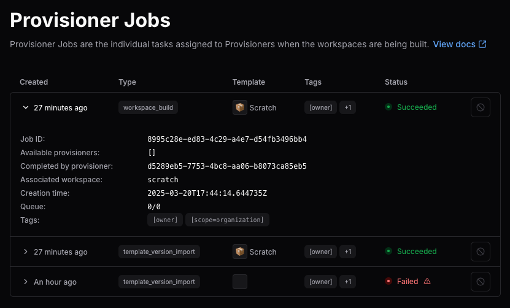
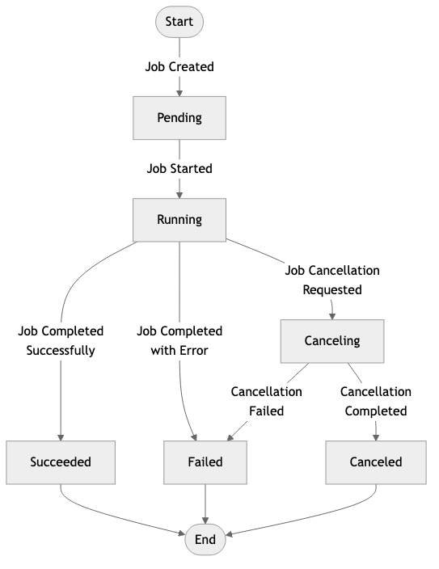

[Provisioners](./index.md) start and run provisioner jobs to create or delete workspaces.
Each time a workspace is built, rebuilt, or destroyed, it generates a new job and assigns the job to an available provisioner daemon for execution.

While most jobs complete smoothly, issues with templates, cloud resources, or misconfigured provisioners can cause jobs to fail or to wait in the queue in a `Pending` state.
Coder fails some stuck jobs for you, as described in [Automatic job timeouts](#automatic-job-timeouts).



## How to find provisioner jobs

Coder admins can view and manage provisioner jobs.

Use the dashboard, CLI, or API:

- **Dashboard**:

   Select **Admin settings** > **Organizations** > **Provisioner Jobs**

   Provisioners are organization-specific.
   If you have more than one organization, select it first.

- **CLI**:
  `coder provisioner jobs list`
- **API**:
  `/api/v2/provisioner/jobs`

## Manage provisioner jobs from the dashboard

View more information about and manage your provisioner jobs from the Coder dashboard.

1. Under **Admin settings** select **Organizations**, then select **Provisioner jobs**.

1. Select the **>** to expand each entry for more information.

1. To delete a job, select the 🚫 at the end of the entry's row.

   If your user doesn't have the correct permissions, this option is grayed out.

## Provisioner job status

Each provisioner job has a lifecycle state:

| Status        | Description                                                    |
|---------------|----------------------------------------------------------------|
| **Pending**   | Job is queued but has not yet been picked up by a provisioner. |
| **Running**   | A provisioner is actively working on the job.                  |
| **Completed** | Job succeeded.                                                 |
| **Failed**    | Provisioner encountered an error, or Coder timed the job out.  |
| **Canceled**  | Job was manually terminated by an admin.                       |

The following diagram shows how a provisioner job transitions between lifecycle states:



## Automatic job timeouts

Coder fails jobs that stop making progress, so that they don't block a workspace indefinitely:

- A **Running** job fails when its provisioner sends no updates for 5 minutes.
- A **Pending** job fails after 30 minutes in the queue, unless a provisioner that can run it is online and making progress.

A provisioner can run a job when it belongs to the same organization and its [tags](./index.md#provisioner-tags) match the job.
It is making progress when it completed a job in the last 30 minutes, or when it is running a job that still sends updates.

Pending jobs behind provisioners that are making progress have no maximum wait time.
They stay in the queue until a provisioner picks them up or you cancel them.
A running build that is stuck but still sends updates counts as progress, so the jobs queued behind it wait until you cancel that build.

A pending job that Coder fails shows this error:

```text
Coder: Build has been detected as pending for 30 minutes and has been terminated by the reaper.
```

## When to cancel provisioner jobs

A job might need to be canceled when:

- It has been stuck in **Pending** for too long.
  This can be due to misconfigured tags, unavailable provisioners, or a long queue behind busy provisioners.
  Coder fails the job after 30 minutes in the first two cases.
  A job behind provisioners that keep making progress stays queued until you cancel it.
- It is **Running** indefinitely, often caused by external system failures or buggy templates.
- An admin wants to abort a failed attempt, fix the root cause, and retry provisioning.
- A workspace was deleted in the UI but the underlying cloud resource wasn’t cleaned up, causing a hanging delete job.

Canceling a job does not automatically retry the operation.
It clears the stuck state and allows the admin or user to trigger the action again if needed.

## Troubleshoot provisioner jobs

Provisioner jobs can fail or slow workspace creation for a number of reasons.
Follow these steps to identify problematic jobs or daemons:

1. Filter jobs by `pending` status in the dashboard, or use the CLI:

   ```sh
   coder provisioner jobs list -s pending
   ```

1. Look for daemons with multiple failed jobs and for template [tag mismatches](./index.md#provisioner-tags).

1. Cancel the job through the dashboard, or use the CLI:

   ```sh
   coder provisioner jobs cancel <job-id>
   ```
