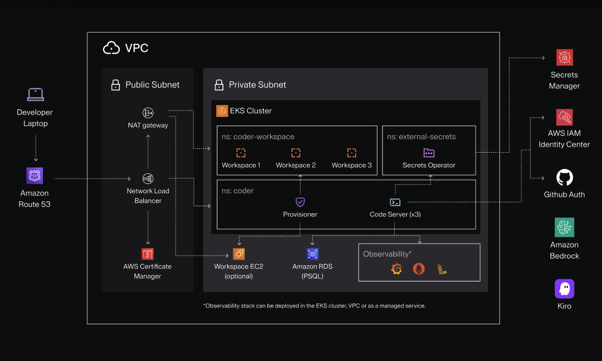
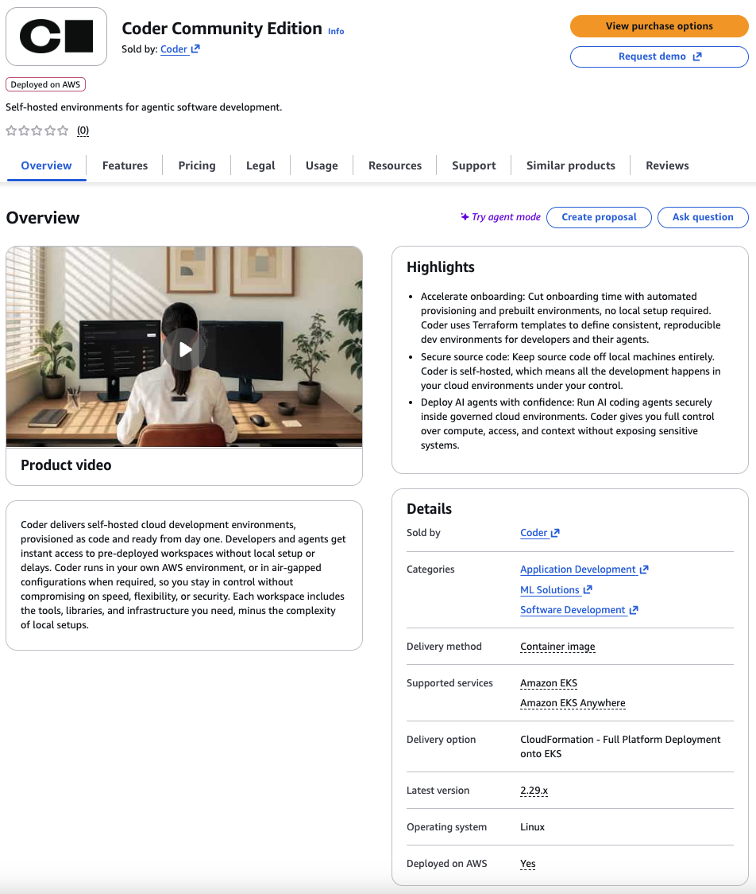
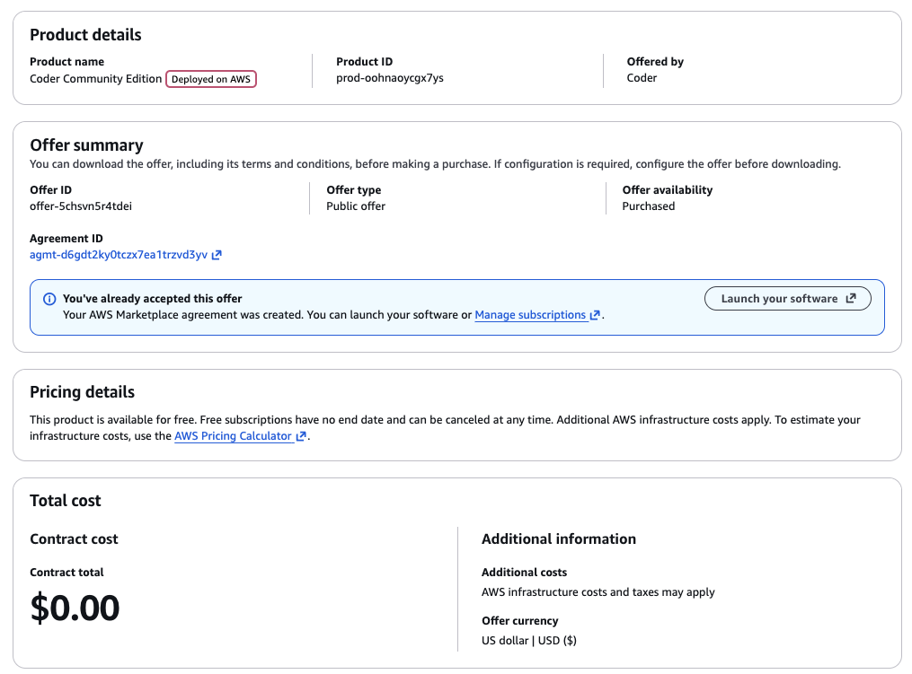
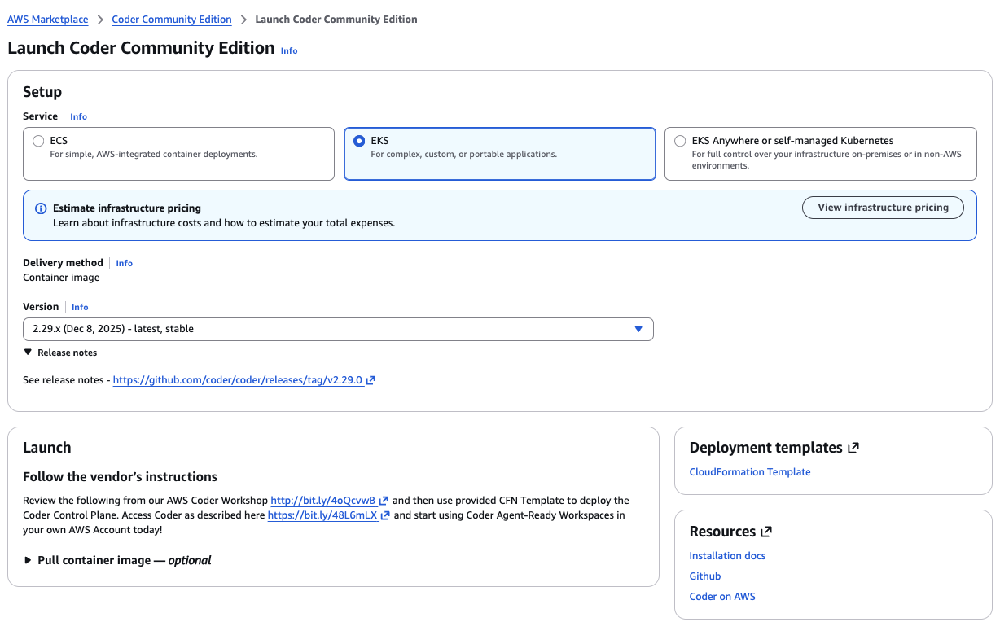
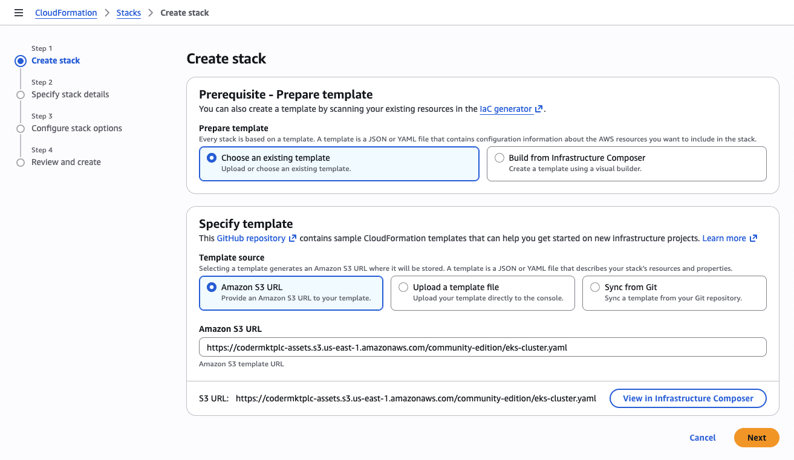
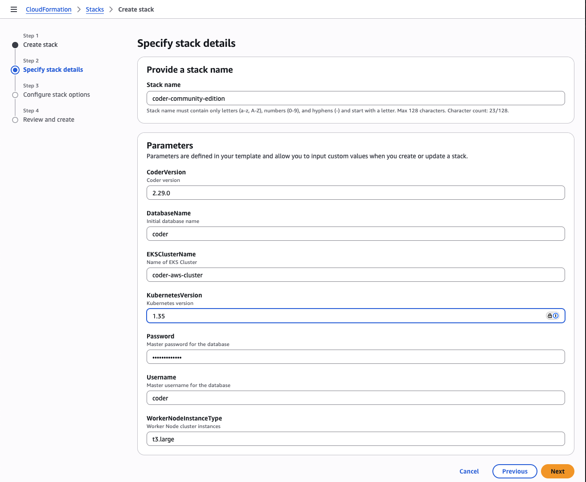
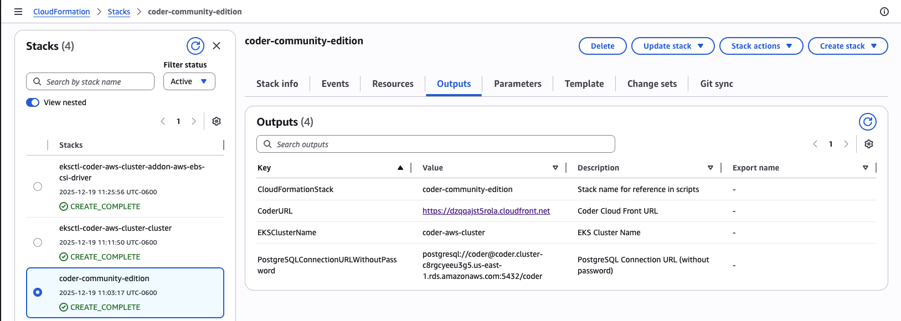

This guide is for a Coder deployment administrator who installs Coder on Amazon Web Services (AWS).
It covers these options:

- [Install Coder on Amazon EKS](#install-coder-on-amazon-eks) with Helm, on an Amazon Elastic Kubernetes Service (EKS) cluster you already run.
  Use this path for a deployment that other people depend on.
- [Launch Coder Community Edition from the AWS Marketplace](#launch-coder-community-edition-from-the-aws-marketplace) for a proof of concept.
  The listing uses a [Coder-provided CloudFormation template](https://codermktplc-assets.s3.us-east-1.amazonaws.com/community-edition/eks-cluster.yaml) that creates a new EKS cluster and other AWS resources.

To run Coder on a single Amazon Elastic Compute Cloud (EC2) instance instead, use the [install script](../../../get-started/index.md#step-2-install-and-start-coder) on any popular Linux distribution.

## Install Coder on Amazon EKS

You need an EKS cluster that meets the [Kubernetes requirements](../kubernetes/index.md#requirements).

1. Install Coder with Helm by following [Install Coder on Kubernetes](../kubernetes/index.md).

   - For the database, use a [managed PostgreSQL service](../kubernetes/index.md#managed-postgresql-recommended) such as Amazon Relational Database Service (RDS) for PostgreSQL.
   - Before you run `helm install`, add the [AWS load balancing settings](../kubernetes/index.md#aws) to your values file to request a Network Load Balancer for Coder.

1. [Create your first template](../../../templates/creating-templates.md#from-a-starter-template).

   To run workspaces as pods in the same cluster, start from the Kubernetes starter template.

If the cluster has no internet access, also follow [Air-gapped deployments](../../prepare/airgap.md).

## Launch Coder Community Edition from the AWS Marketplace

Use this path for a proof of concept in a sandbox AWS account.
The CloudFormation stack creates an EKS cluster, related sub-stacks, and a CodeBuild pipeline that runs the Helm install.
To install Coder on a cluster you already run, use [Install Coder on Amazon EKS](#install-coder-on-amazon-eks) instead.

The deployed AWS Coder Reference Architecture is below: 

### Requirements

This guide assumes your AWS account has `AdministratorAccess` permissions given the number and types of AWS Services deployed.
After deployment of Coder into a AWS proof of concept (POC) or Sandbox account, it is recommended that the permissions be scaled back to only what your deployment requires.

### Launch the listing

We publish an Ubuntu 22.04 Container Image with Coder pre-installed and a supporting AWS Marketplace Launch guide.
Search for `Coder Community Edition` in the AWS Marketplace or [launch directly from the Coder listing](https://aws.amazon.com/marketplace/pp/prodview-34vmflqoi3zo4).

Use `View purchase options` to create a zero-cost subscription to Coder Community Edition and then use `Launch your software` to deploy to your current AWS Account.

Select `EKS` for the Launch setup, choose the desired or latest version to deploy, and then review the **Launch** instructions for a more detailed explanation of what the stack deploys.
When you are ready to proceed, select the `CloudFormation Template` link under **Deployment templates**.

You will then be taken to the AWS Management Console, CloudFormation `Create stack` in the currently selected AWS Region.
Select `Next` to view the Coder Community Edition CloudFormation Stack parameters.

The default parameters will support POCs and small team deployments of Coder using `t3.large` (2&nbsp;cores and 8&nbsp;GB memory) Nodes.
While the deployment uses EKS Auto-mode and will scale using Karpenter, keep in mind this platforms is intended for proof-of-concept deployments.
You should adjust your infrastructure when preparing for production use.
See: [Scaling Coder](../../plan/index.md)

Select `Next` and follow the prompts to submit the CloudFormation Stack.
Deployment of the Stack can take 10-20&nbsp;minutes, and will create EKS related sub-stacks and a CodeBuild pipeline that automates the initial Helm deployment of Coder and final AWS network services integration.
Once the Stack successfully creates, access the `Outputs` as shown below:

Look for the `CoderURL` output link, and use to navigate to your newly deployed instance of Coder Community Edition.

That's all!
Use the UI to create your first user, template, and workspace.
We recommend starting with a Kubernetes template since Coder Community Edition is deployed to EKS.

### Next steps

- [IDEs with Coder](../../../workspaces/workspace-access/index.md)
- [Writing custom templates for Coder](../../../templates/index.md)
- [Configure the control plane](../../../admin/setup/index.md)
- [Use your own domain + TLS](../../../admin/setup/index.md#tls--reverse-proxy)
