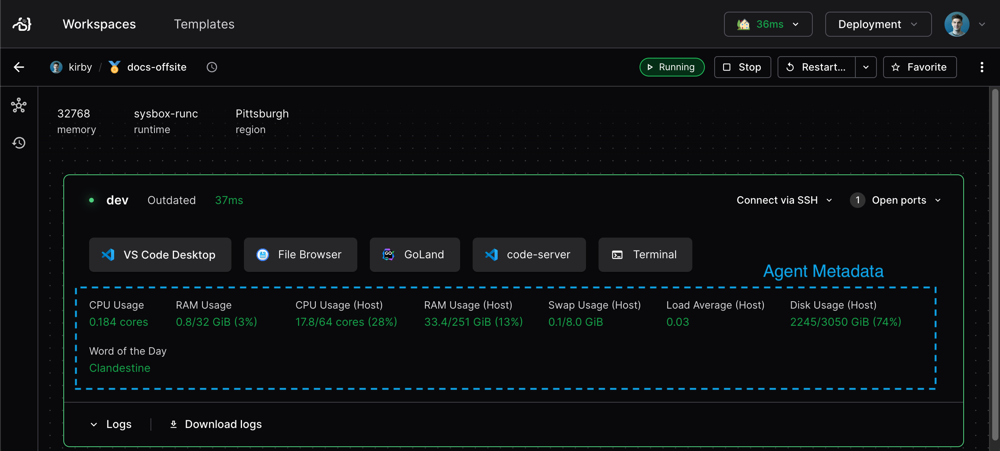

You can show live operational metrics to workspace users with agent metadata.
It is the dynamic complement of [resource metadata](./resource-metadata.md).

You specify agent metadata in the [`coder_agent`](https://registry.terraform.io/providers/coder/coder/latest/docs/resources/agent).

## Examples

All of these examples use [heredoc strings](https://developer.hashicorp.com/terraform/language/expressions/strings#heredoc-strings) for the script declaration.
With heredoc strings, you can script without messy escape codes, just as if you were working in your terminal.

Some of the examples use the [`coder stat`](../../reference/cli/stat/index.md) command.
This is useful for determining CPU and memory usage of the VM or container that the workspace is running in, which is more accurate than resource usage about the workspace's host.

Here's a standard set of metadata snippets for Linux agents:

```tf
resource "coder_agent" "main" {
  os             = "linux"
  ...
  metadata {
    display_name = "CPU Usage"
    key  = "cpu"
    # Uses the coder stat command to get container CPU usage.
    script = "coder stat cpu"
    interval = 1
    timeout = 1
  }

  metadata {
    display_name = "Memory Usage"
    key  = "mem"
    # Uses the coder stat command to get container memory usage in GiB.
    script = "coder stat mem --prefix Gi"
    interval = 1
    timeout = 1
  }

  metadata {
    display_name = "CPU Usage (Host)"
    key  = "cpu_host"
    # calculates CPU usage by summing the "us" and "sy" columns of
    # top.
    script = <<EOT
    top -bn1 | awk 'FNR==3 {printf "%2.0f%%", $2+$3+$4}'
    EOT
    interval = 1
    timeout = 1
  }

    metadata {
    display_name = "Memory Usage (Host)"
    key  = "mem_host"
    script = <<EOT
    free | awk '/^Mem/ { printf("%.0f%%", $3/$2 * 100.0) }'
    EOT
    interval = 1
    timeout = 1
  }

  metadata {
    display_name = "Disk Usage"
    key  = "disk"
    script = "df -h | awk '$6 ~ /^\\/$/ { print $5 }'"
    interval = 1
    timeout = 1
  }

  metadata {
    display_name = "Load Average"
    key  = "load"
    script = <<EOT
        awk '{print $1,$2,$3}' /proc/loadavg
    EOT
    interval = 1
    timeout = 1
  }
}
```

## Useful utilities

You can also show agent metadata for information about the workspace's host.

[top](https://manpages.ubuntu.com/manpages/jammy/en/man1/top.1.html) is available in most Linux distributions and provides virtual memory, CPU and input/output (IO) statistics.
Running `top` produces output that looks like:

```txt
%Cpu(s): 65.8 us,  4.4 sy,  0.0 ni, 29.3 id,  0.3 wa,  0.0 hi,  0.2 si,  0.0 st
MiB Mem :  16009.0 total,    493.7 free,   4624.8 used,  10890.5 buff/cache
MiB Swap:      0.0 total,      0.0 free,      0.0 used.  11021.3 avail Mem
```

[vmstat](https://manpages.ubuntu.com/manpages/jammy/en/man8/vmstat.8.html) is available in most Linux distributions and provides virtual memory, CPU and IO statistics.
Running `vmstat` produces output that looks like:

```txt
procs -----------memory---------- ---swap-- -----io---- -system-- ------cpu-----
r  b   swpd   free   buff  cache   si   so    bi    bo   in   cs us sy id wa st
0  0  19580 4781680 12133692 217646944    0    2     4    32    1    0  1  1 98  0  0
```

[dstat](https://manpages.ubuntu.com/manpages/jammy/man1/dstat.1.html) is considerably more parseable than `vmstat` but often not included in base images.
It is easily installed by most package managers under the name `dstat`.
The output of running `dstat 1 1` looks like:

```txt
--total-cpu-usage-- -dsk/total- -net/total- ---paging-- ---system--
usr sys idl wai stl| read  writ| recv  send|  in   out | int   csw
1   1  98   0   0|3422k   25M|   0     0 | 153k  904k| 123k  174k
```

<a id="managing-the-database-load"></a>

## Manage the database load

Agent metadata adds write load to your Coder database, and the load grows with the number of agents and metadata snippets.

Each Coder server replica collects metadata updates from the agents connected to it and writes them in batches.
Each metadata key for each agent takes one place in the batch, and a newer update replaces the value that is waiting.
Coder writes the batch to the database every 5&nbsp;seconds, or sooner when 500 entries are waiting.
Each write is a single statement that covers every entry in the batch.
After each write, Coder sends notifications to the UI for the agents it updated, so live stats keep streaming.

For example, let's say you have

- 10 running agents
- each with 6 metadata snippets

In this example, at most 60 entries wait in the batch, which is under the 500-entry limit.
The database therefore receives one batch statement from each replica every 5&nbsp;seconds, no matter how often each snippet runs.

When a replica has more than 500 entries waiting, it writes more often than every 5&nbsp;seconds.
To lower the load, reduce the number of metadata snippets in the template.

## Next Steps

- [Resource metadata](./resource-metadata.md)
- [Parameters](./parameters/index.md)
