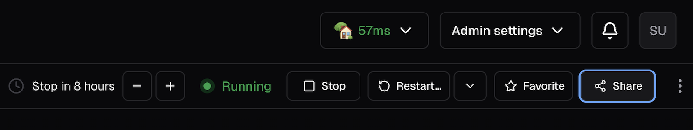
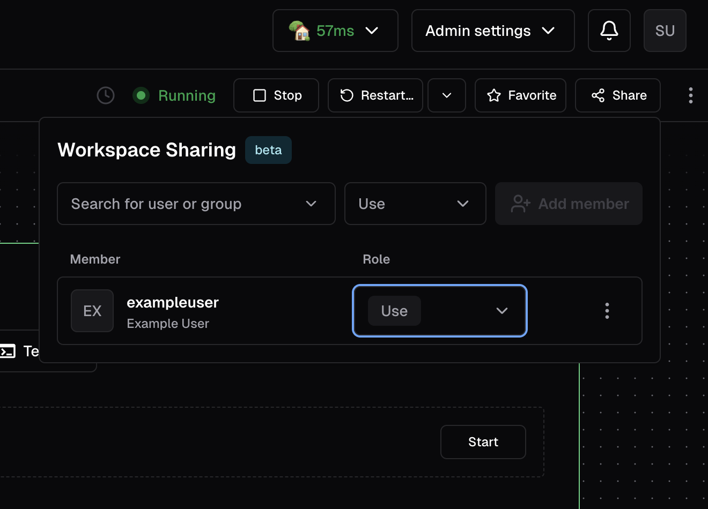
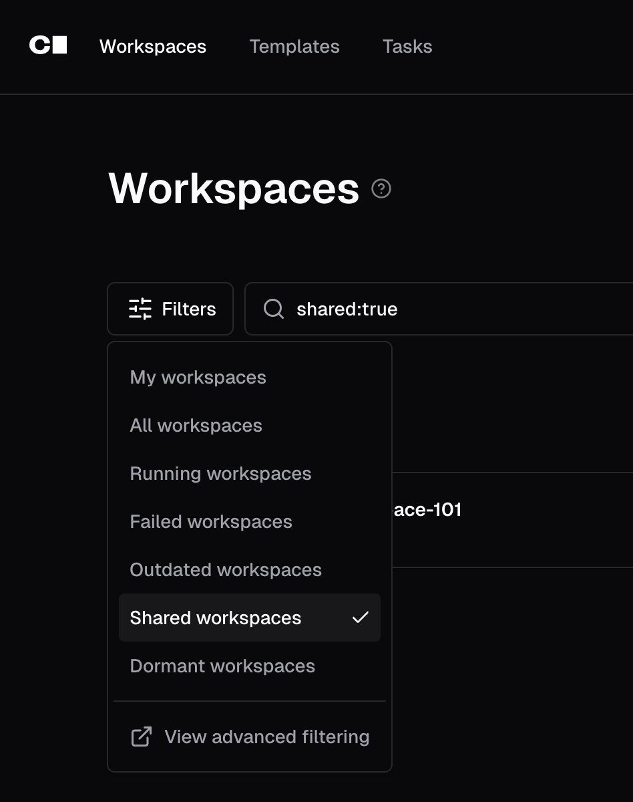

Multiple users can securely connect to a single Coder workspace for programming and debugging.

<!-- Insert screenshot of UI here -->

## Features

Workspace sharing is available to all Coder users by default, but platform admins with a Premium subscription can choose to disable sharing within their organizations or for their entire deployment.

Owners of a workspace can grant access to other users or groups with scoped roles.

This is helpful in a number of scenarios, including:

- Developers can do ad-hoc debugging or pair programming.
- A workspace can be owned by a group of users for QA, on-call rotations, or shared staging.
- AI workflows where an agent prepares a workspace and a developer takes over to review or finalize the work (ex. with [Coder Agents](https://coder.com/docs/ai-coder/agents).)

<a id="getting-started"></a>

## Get started

Workspaces can be shared through either the Coder CLI or UI.

Before you begin, ensure that you have a version of Coder with workspace sharing enabled and that your account has permission to share workspaces.
This is true by default if you are an OSS user, but deployments with Premium licenses may be restricted by admins.

### CLI

To share a workspace:

- `coder sharing share <workspace> --user alice`
  - Shares the workspace with a single user, `alice`, with `use` permissions
- `coder sharing share <workspace> --user alice:admin,bob`
  - Shares the workspace with two users - `alice` with `admin` permissions, and `bob` with `use` permissions
- `coder sharing share <workspace> --group contractor`
  - Shares the workspace with `contractor`, which is a group of users

To remove sharing from a workspace:

- `coder sharing remove <workspace> --user alice`
  - Workspace is no longer shared with the user `alice`.
- `coder sharing remove <workspace> --group contractor`
  - Workspace is no longer shared with the group `contractor`.

> [!IMPORTANT]
> The workspace must be restarted for the user or group removal to take effect.

To show who a workspace is shared with:

- `coder sharing status <workspace>`

To list shared workspaces:

- `coder list --search shared:true`
- `coder list --search shared_with_user:me`
- `coder list --search shared_with_user:<user>`
- `coder list --search shared_with_group:<group>`

To list the workspaces you own together with the ones shared with you, directly or through a group:

- `coder list --search user:me`

For full command details, see [`coder sharing`](../reference/cli/sharing/index.md).

### UI

<a id="sharing-your-workspace"></a>

#### Share your workspace

1. Open a workspace that you own.

1. Locate and select the 'Share' button.



1. Add the users or groups that you want to share the workspace with.
   For each one, select a role.



- `use` allows for connection via SSH and apps, the ability to start and stop the workspace, view logs and stats, and update on start when required.
- `admin` allows for all of the above, as well as the ability to rename the workspace, update at any time, and invite others with the `use` role.
- Neither role allows for the user to delete the workspace.
- After removing a user/group, a workspace restart is required for the removal to take effect.

<a id="using-a-shared-workspace"></a>

#### Use a shared workspace

Once a workspace is shared, you can find the shared workspace by filtering for "Shared" in the Workspaces page.



<a id="accessing-workspace-apps-in-shared-workspaces"></a>

#### Access workspace apps in shared workspaces

Sharing a workspace grants SSH and terminal access to other users.
However, workspace apps like code-server may return a **404 page** for non-owners depending on how the app is routed.

By default, workspace apps that don't set `subdomain = true` use **path-based routing** (e.g., `coder.example.com/@user/workspace/apps/code-server/`).
Path-based apps share the same origin as the Coder dashboard, so Coder blocks non-owners from accessing them to prevent [cross-site scripting risks](../tutorials/best-practices/security-best-practices.md#disable-path-based-apps).
This restriction applies even when the user has been granted access through workspace sharing.

To allow other users to access workspace apps, configure subdomain-based access:

1. Set a [wildcard access URL](../admin/networking/wildcard-access-url.md) on your deployment (e.g., `CODER_WILDCARD_ACCESS_URL=*.coder.example.com`).
2. Set `subdomain = true` on the workspace app.
   For example, if you use the [code-server module](https://registry.coder.com/modules/coder/code-server):

   ```tf
   module "code-server" {
     source    = "registry.coder.com/coder/code-server/coder"
     agent_id  = coder_agent.main.id
     subdomain = true
     # ...
   }
   ```

Subdomain-based apps run in an isolated browser security context, so Coder allows other users to access them without additional configuration.

### Policies

There are several sharing policy levels that can be selected on a per-organization basis.

- **Everyone**:
  anybody can share their workspace with any individual or group in the same organization.
- **Service Accounts Only**:
  only workspaces owned by service accounts can be shared with any individual or group in the same organization.
- **Disabled**:
  workspaces within the organization cannot be shared.

The **Disabled** policy applies to every workspace in the organization.
It overrides the sharing permission of any role held by a member of that organization, including Organization Admin.

The **Disabled** policy can also be applied to the entire deployment by [setting the `CODER_DISABLE_WORKSPACE_SHARING` environment variable, or by using the corresponding command argument or config value](https://coder.com/docs/reference/cli/server#--disable-workspace-sharing).

## Git identity and credentials

Git in a shared workspace uses the workspace owner's identity and credentials for every user who connects, including users with only the `use` role.
Coder resolves each of the following from the workspace owner, not from the user who runs the command:

| What                        | Where it comes from                                                                                                                                                 | Result for shared users                                                  |
|-----------------------------|---------------------------------------------------------------------------------------------------------------------------------------------------------------------|--------------------------------------------------------------------------|
| Commit author and committer | The `GIT_AUTHOR_*` and `GIT_COMMITTER_*` environment variables, if the template sets them from `data.coder_workspace_owner.me` at build time                        | Commits are attributed to the owner                                      |
| Git over SSH                | The owner's [Coder Git SSH key](../admin/external-auth.md#ssh-authentication), which `coder gitssh` injects through `GIT_SSH_COMMAND`                               | Pushes and pulls authenticate as the owner                               |
| Git over HTTPS              | The owner's [external auth](../admin/external-auth.md#oauth-external-auth) token, which Coder supplies through `GIT_ASKPASS` and `coder external-auth access-token` | Git, and any tool that uses the token, acts with the owner's permissions |
| User secrets                | The owner's [user secrets](./user-secrets.md)                                                                                                                       | Shared users can read the owner's injected secret values                 |

### Security implications

The `use` role grants SSH and terminal access, which is enough to run Git with the owner's credentials.

> [!WARNING]
> Share a personally owned workspace only with users you trust to act with your source control permissions.
> Any shared user can push code, open pull requests, or call your Git provider's API as you, and the Git provider attributes that activity to your account.

### Use a service account for shared or long-lived workspaces

To keep personal credentials out of a shared workspace, have a [service account](../admin/users/headless-auth.md) own the workspace instead of a person.
Git in the workspace then uses the service account's identity and credentials instead of a person's.
Creating service accounts requires a Premium license.

Service accounts have no email address and can't sign in to the Coder dashboard.
If the template sets the commit identity from the workspace owner, commits show the service account's name with an empty email address.
To give the workspace access to repositories, run `coder publickey` as the service account, then add the key to a dedicated machine account on your Git provider.
Grant that account only the repository access the shared work needs.

For a complete setup, refer to [Persistent shared workspaces with service accounts](../tutorials/persistent-shared-workspaces.md).

### Commit and push as yourself

A shared user can override the owner's identity and credentials for their own session.

> [!WARNING]
> Every user of a workspace connects as the same operating system user and shares the same home directory.
> Credentials that you store in the workspace, such as a GitHub CLI token or an SSH private key, are readable by every other user of the workspace.

To set your commit identity for the current shell session, export the Git identity variables:

```sh
export GIT_AUTHOR_NAME="Alice Example"
export GIT_AUTHOR_EMAIL="alice@example.com"
export GIT_COMMITTER_NAME="$GIT_AUTHOR_NAME"
export GIT_COMMITTER_EMAIL="$GIT_AUTHOR_EMAIL"
```

Git gives these environment variables precedence over Git configuration.
If the template sets them, `git config user.name` and `git -c user.name=...` don't change the commit identity.
To change only the author of a single commit, run `git commit --author="Alice Example <alice@example.com>"`.
The committer stays the owner.

To authenticate with your own Git provider account instead of the owner's, use one of the following:

- **SSH agent forwarding**: connect with `coder ssh --forward-agent <owner>/<workspace>`, then run `export GIT_SSH_COMMAND=ssh`.
  Git uses the keys in your local SSH agent instead of the owner's Coder Git SSH key, and no private key is written to the workspace.
  While you're connected, other users of the workspace can use the forwarded agent socket.
- **GitHub CLI**: run `gh auth login` to sign in, then `gh auth setup-git` to make Git use that token over HTTPS.
  The GitHub CLI stores the token in the workspace, and `gh auth setup-git` updates the shared `~/.gitconfig`, so the change affects every user of the workspace.
  Run `gh auth logout` when you finish.
