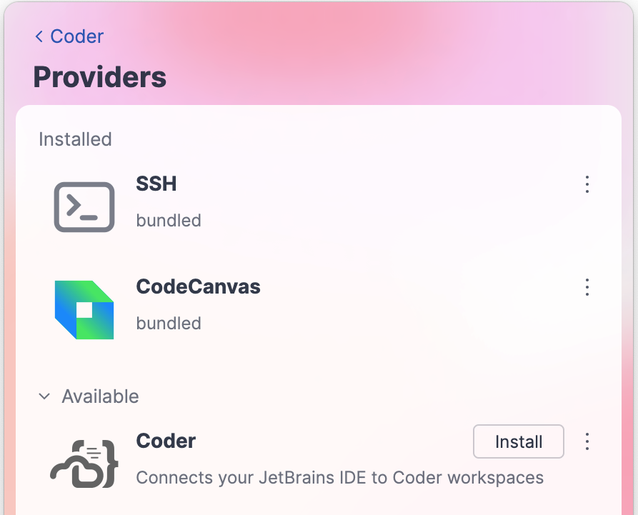
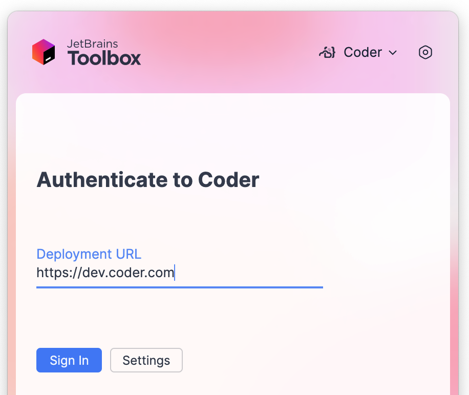
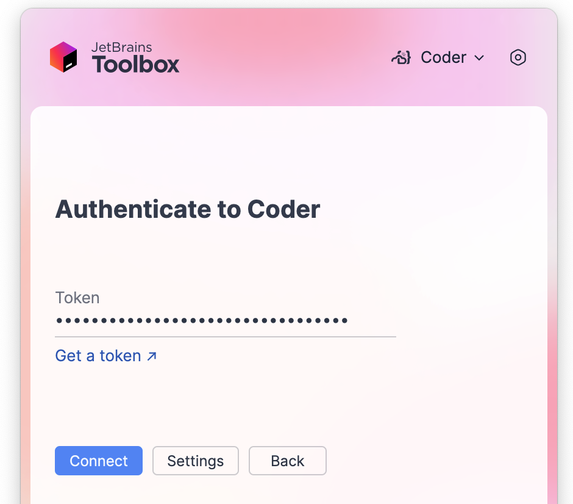
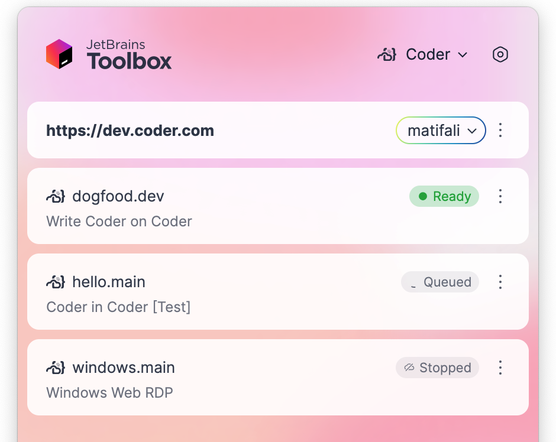
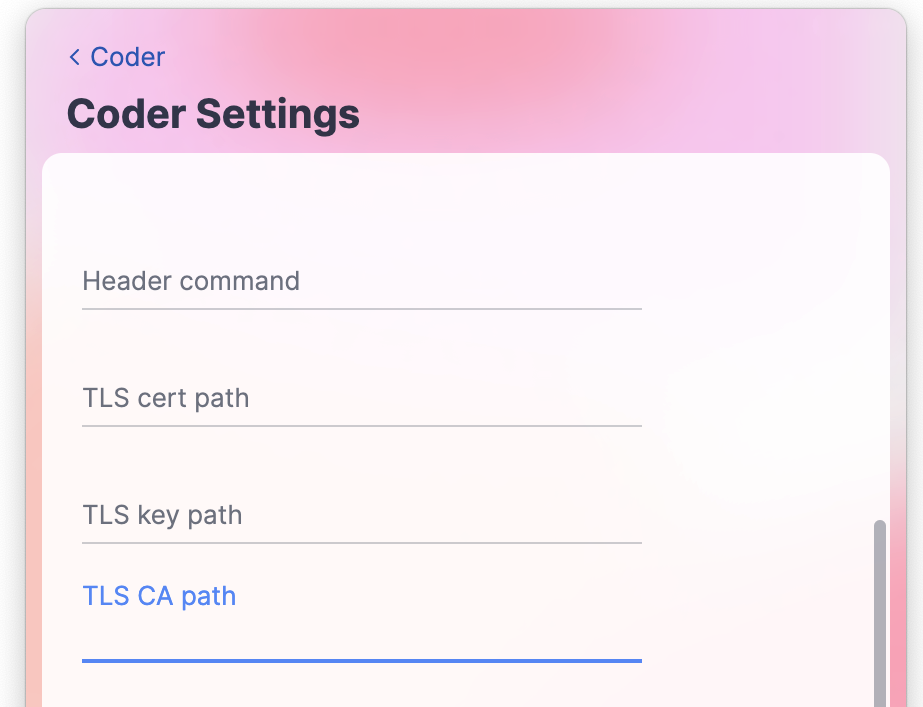

JetBrains Toolbox helps you manage JetBrains products and includes remote development capabilities for connecting to Coder workspaces.

For more details, visit the [official JetBrains documentation](https://www.jetbrains.com/help/toolbox-app/manage-providers.html#shx3a8_18).

## Install the Coder provider for Toolbox

These instructions use Coder plugin version 0.9.5 or later, which requires JetBrains Toolbox version 3.9.0 or later.

1. Install [JetBrains Toolbox](https://www.jetbrains.com/toolbox-app/) version 3.9.0 or later.
1. Open the Toolbox App.
1. From the switcher drop-down, select **Manage Providers**.
1. In the **Providers** window, select the **Coder** provider.
1. Select **Install** or update an existing installation to version 0.9.5 or later.



## Connect

1. In the Toolbox App, select **Coder**.
1. Enter the URL address and select **Sign In**.
   
1. Authenticate to Coder adding a token for the session and select **Connect**.

   

   After the authentication is completed, you are connected to your development environment and can open and work on projects.

   

## Use URI parameters

For direct connections or creating bookmarks, use custom URI links with parameters:

```sh
jetbrains://gateway/com.coder.toolbox?url=https://coder.example.com&token=<auth-token>&workspace=my-workspace
```

Required parameters:

- `url`: Your Coder deployment URL
- `token`: Coder authentication token
- `workspace`: Name of your workspace

Optional parameters:

- `agent_id`: ID of the agent (only required if workspace has multiple agents)
- `folder`: Specific project folder path to open
- `ide_product_code`: Specific IDE product code (for example, "IU" for IntelliJ IDEA Ultimate)
- `ide_build_number`: Specific build number of the JetBrains IDE

For more details, see the [coder-jetbrains-toolbox repository](https://github.com/coder/coder-jetbrains-toolbox#connect-to-a-coder-workspace-via-jetbrains-toolbox-uri).

## Configure internal certificates

To connect to a Coder deployment that uses internal certificates, configure the certificates directly in the Coder plugin settings in JetBrains Toolbox:

1. In the Toolbox App, select **Coder**.
1. Select the (⋮) next to the username in top right corner.
1. Select **Settings**.
1. Add your certificate path in the **CA Path** field.
   

## Troubleshooting

If you encounter issues connecting to your Coder workspace via JetBrains Toolbox, follow these steps to enable and capture debug logs:

### Enable Debug Logging

1. Open Toolbox
1. Navigate to the **Toolbox App Menu (hexagonal menu icon) > Settings > Advanced**.
1. In the screen that appears, select `DEBUG` for the Log level: section.
1. Hit the back button at the top.
1. Retry the same operation

### Capture debug logs

1. Access logs via **Toolbox App Menu > About > Show log files**.
2. Locate the log file named `jetbrains-toolbox.log` and attach it to your support ticket.

After sign-in, Coder's main page lists environments, each representing a workspace and agent pair.
For a workspace diagnostic archive, select **Collect logs** from the environment's action menu on that page or in the individual environment view.
With Coder plugin version 0.9.5 or later, the archive also includes a nested `coder-support.zip`.
The bundle contains Coder deployment, workspace, and agent diagnostics, plus local CLI SSH logs when available.
For the requirements, collection procedure, and archive contents, refer to [Generate from your IDE](../../../support/support-bundle.md#generate-from-your-ide), under **JetBrains Toolbox**.

> [!NOTE]
> The general **Settings** > **About** > **Collect logs and diagnostic data** action does not generate a Coder support bundle.

With Coder plugin version 0.9.4 or earlier, use the log-collection instructions on this page and [generate a Coder support bundle separately with the CLI](../../../support/support-bundle.md#generate-with-the-cli).
Upgrading Toolbox alone doesn't add bundle collection to those plugin versions.

## Additional Resources

- [JetBrains Toolbox documentation](https://www.jetbrains.com/help/toolbox-app)
- [Coder JetBrains Toolbox Plugin Github](https://github.com/coder/coder-jetbrains-toolbox)
