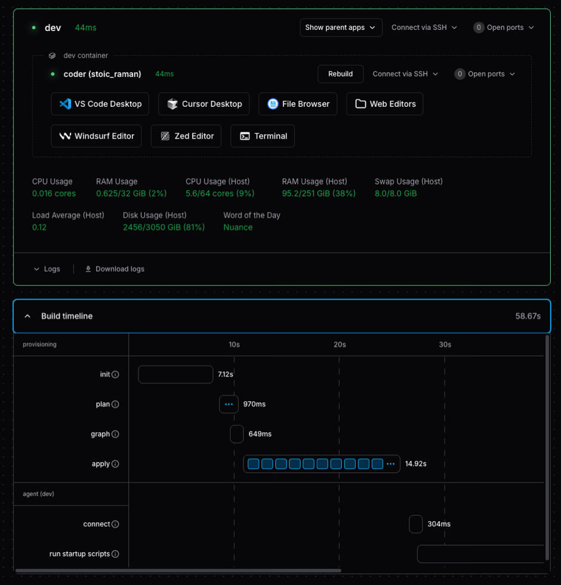
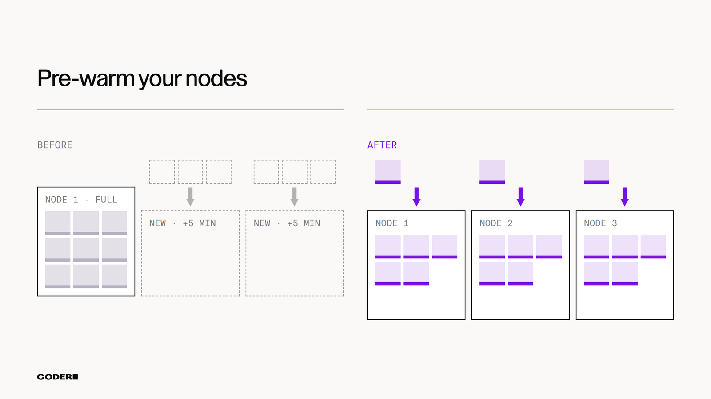
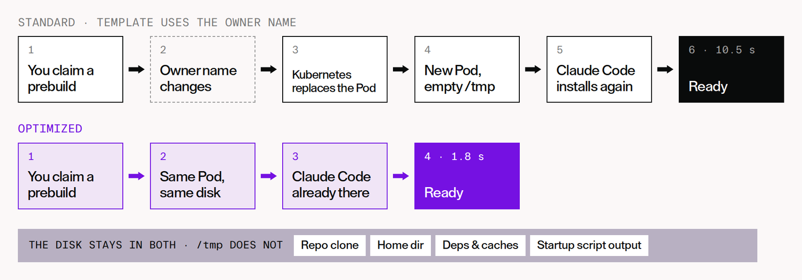

October 31, 2024

---

If it takes your workspace a long time to start, find out why and make some changes to your Coder templates to help speed things up.

To see these changes take a Kubernetes template from 98&nbsp;seconds to 1.8&nbsp;seconds, watch [Improving Coder Workspace Startup Times](https://www.youtube.com/watch?v=-xcVJQWVCxs&t=514s).

## Monitoring

You can monitor [Coder logs](../admin/monitoring/logs.md) through the system-native tools on your deployment platform, or stream logs to tools like Splunk, Datadog, Grafana Loki, and others.

### Workspace build timeline

Use the **Build timeline** to monitor the time it takes to start specific workspaces.
Identify long scripts, resources, and other things you can potentially optimize within the template.



You can also retrieve this detail programmatically from the API:

```sh
curl -X GET https://coder.example.com/api/v2/workspacebuilds/{workspacebuild}/timings \
  -H 'Accept: application/json' \
  -H 'Coder-Session-Token: API_KEY'
```

Visit the [API documentation](../reference/api/builds.md#get-workspace-build-timings-by-id) for more information.

### Coder Observability Chart

Use the [Observability Helm chart](https://github.com/coder/observability) for a pre-built set of dashboards to monitor your Coder deployments over time.
It includes pre-configured instances of Grafana, Prometheus, Loki, and Alertmanager to ingest and display key observability data.

We recommend that all administrators deploying on Kubernetes or on an existing Prometheus or Grafana stack set the observability bundle up with the control plane from the start.
For installation instructions, visit the [observability repository](https://github.com/coder/observability?tab=readme-ov-file#installation), or our [Kubernetes installation guide](../install/server/kubernetes/index.md).

### Enable Prometheus metrics for Coder

Coder exposes a variety of [application metrics](../admin/integrations/prometheus.md#available-metrics), such as `coderd_provisionerd_job_timings_seconds` and `coderd_agentstats_startup_script_seconds`, which measure how long the workspaces take to provision and how long the startup scripts take.

To make use of these metrics, you will need to [enable Prometheus metrics](../admin/integrations/prometheus.md#enable-prometheus-metrics) exposition.

If you are not using the [Observability Chart](#coder-observability-chart), you will need to install Prometheus and configure it to scrape the metrics from your Coder installation.

## Pre-warm Kubernetes nodes

On Kubernetes, when every node is full, a new workspace waits for the cluster to add a node, which can take minutes on a cloud provider.
Keep spare nodes ready when you expect the most load, such as weekday working hours, and scale down at night and on weekends.
Spare nodes cost money while they wait, so balance startup time against cost.



Set a schedule that raises the node minimum before working hours and lowers it after.
For example, on Amazon Elastic Kubernetes Service (EKS), the following schedule on the workspace node group's Auto Scaling group keeps three nodes ready during working hours, and still lets the group grow to 10:

```tf
resource "aws_autoscaling_schedule" "workday_start" {
  scheduled_action_name  = "coder-workday-start"
  autoscaling_group_name = var.workspace_node_group_asg
  recurrence             = "0 9 * * MON-FRI"
  time_zone              = "America/New_York"
  min_size               = 3
  desired_capacity       = 3
  max_size               = 10
}

resource "aws_autoscaling_schedule" "workday_end" {
  scheduled_action_name  = "coder-workday-end"
  autoscaling_group_name = var.workspace_node_group_asg
  recurrence             = "0 19 * * MON-FRI"
  time_zone              = "America/New_York"
  min_size               = 0
  desired_capacity       = 0
  max_size               = 10
}
```

This needs a managed node group.
EKS Auto Mode and Karpenter don't use Auto Scaling groups, so set capacity through NodePools instead.

A scale-down to zero terminates nodes that still run workspaces or prebuilt workspaces.
Schedule it after your workspaces auto-stop, or keep a minimum above zero.
Prebuilt workspaces don't auto-stop, so lower their pool first with [prebuild scheduling](../templates/extending-templates/prebuilt-workspaces.md#scheduling).

Other ways to keep capacity ready:

- Low-priority placeholder Pods that the scheduler evicts when a workspace needs the space, such as [Google Kubernetes Engine (GKE) capacity provisioning](https://docs.cloud.google.com/kubernetes-engine/docs/how-to/capacity-provisioning).
- [Warm pools for EKS managed node groups](https://docs.aws.amazon.com/eks/latest/userguide/warm-pools-managed-node-groups.html).
- [Azure Kubernetes Service (AKS) scale-down mode](https://learn.microsoft.com/en-us/azure/aks/scale-down-mode) set to `Deallocate`, which stops idle nodes instead of deleting them.

To avoid an image pull on a new node, pre-pull the workspace image on every node with a DaemonSet.
If the nodes are behind an egress firewall, allowlist or mirror the DaemonSet's images, including any helper image from `registry.k8s.io`, or the pre-pull fails quietly.
The [fast-workspaces-lab](https://github.com/coder-contrib/fast-workspaces-lab/tree/main/cluster) repository has a sample node schedule and pre-pull DaemonSet.

## Build tools into the image

Startup scripts that install packages add their install time to every workspace start.
Use the [build timeline](#workspace-build-timeline) to find them, then move them into the workspace image:

- **Languages and tools**, such as Node.js, Go, a browser, or cloud CLIs.
- **Module downloads**, such as code-server and agent CLIs.
  Install them in the image, then tell the module to skip the download, such as `offline = true` for the [code-server module](https://registry.coder.com/modules/coder/code-server) and `install_claude_code = false` for the [Claude Code module](https://registry.coder.com/modules/coder/claude-code).
- **The Coder agent.**
  The agent's init script downloads the agent binary from your Coder server at each start.
  Install the binary in the image, then start it directly with `coder agent`, and set `CODER_AGENT_URL` to the access URL and `CODER_AGENT_TOKEN` to the agent token.

Keep the agent in the image close to your Coder server's version.
Rebuild the image when you upgrade Coder, and at least every few months.

Install tools outside `/home`, such as in `/opt`, because a home volume hides anything the image puts there.

For a sample base image with the agent, code-server, Claude Code, browsers, and toolchains, refer to the [fast-workspaces-lab Dockerfile](https://github.com/coder-contrib/fast-workspaces-lab/blob/main/images/workspace/Dockerfile).
For a full example, refer to the [Plain Sandbox (Kubernetes)](https://registry.coder.com/templates/coder-labs/kubernetes-sandboxed) template's Dockerfile and speed tuning guide.

## Use prebuilt workspaces

[Prebuilt workspaces](../templates/extending-templates/prebuilt-workspaces.md), also known as *prebuilds*, keep a pool of ready workspaces for each preset, so a user claims one instead of waiting for a build.
A prebuild runs the startup scripts before the claim, so it can also do work that changes too often for the image, such as cloning a large repository or installing a tool that updates daily.



To keep a claim fast:

- Name resources by the workspace ID, not the owner, and ignore changes to owner-specific values, so the claim doesn't replace the Pod.
  For details, refer to [Prevent resource replacement](../templates/extending-templates/prebuilt-workspaces.md#prevent-resource-replacement).
- Clone repositories and build caches on the persistent disk in a startup script, so the prebuild does the work.
- Make startup scripts skip work that's already done, such as a tool that's already installed.
- Compare the workspace's Pod before and after a claim to confirm that it wasn't replaced.

The [fast-workspaces-lab](https://github.com/coder-contrib/fast-workspaces-lab/tree/main/templates) repository compares a [standard](https://github.com/coder-contrib/fast-workspaces-lab/tree/main/templates/04-standard-prebuilds) and an [optimized](https://github.com/coder-contrib/fast-workspaces-lab/tree/main/templates/05-optimized-prebuilds) prebuild template.

If a template offers several configurations, such as [sandbox profiles](../templates/extending-templates/sandbox-agents.md#define-sandbox-profiles-as-parameters), add one preset for each configuration that you want to start fast:

- Each preset keeps its own pool, so size each pool for how often people and agents pick it.
  A configuration without a preset always waits for a full build.
- Set every immutable parameter in the preset.
  Coder matches a request to a preset when the request includes all of the preset's values, so a request can match with another value for a parameter that the preset leaves out.
  The claim then tries to change that immutable value, so the create request fails instead of falling back to a new build.
- A create request can name a preset, or pass parameter values that match one.
  Coder claims a prebuild in both cases.
- Make the strictest or most common configuration both the default preset and the parameter default.
  The dashboard selects the default preset first, and a request without a value uses the parameter default.

Prebuilt workspaces need a Premium license.
[agent-sandbox](https://agent-sandbox.sigs.k8s.io/) warm pools are another way to keep booted sandboxes ready in the cluster, as in the [agent-sandbox (Kubernetes)](https://registry.coder.com/templates/coder-labs/kubernetes-agent-sandbox) template.

## Provisioners

`coder server` by default provides three built-in provisioner daemons (controlled by the [`CODER_PROVISIONER_DAEMONS`](../reference/cli/server/index.md#--provisioner-daemons) config option).
Each provisioner daemon can handle one single job (such as start, stop, or delete) at a time and can be resource intensive.
When all provisioners are busy, workspaces enter a "pending" state until a provisioner becomes available.

### Increase provisioner daemons

Provisioners are queue-based to reduce unpredictable load to the control plane.
If you require a higher bandwidth of provisioner jobs, you can do so by increasing the [`CODER_PROVISIONER_DAEMONS`](../reference/cli/server/index.md#--provisioner-daemons) config option.

You risk overloading Coder if you use too many built-in provisioners, so we recommend a maximum of five built-in provisioners per `coderd` replica.
For more than five provisioners, we recommend that you move to [External Provisioners](../install/operate/provisioners/index.md) and also consider [High Availability](../admin/networking/high-availability.md) to run multiple `coderd` replicas.

Visit the [CLI documentation](../reference/cli/server/index.md#--provisioner-daemons) for more information about increasing provisioner daemons, configuring external provisioners, and other options.

### Adjust provisioner CPU/memory

We recommend that you deploy Coder to its own respective Kubernetes cluster, separate from production applications.
Keep in mind that Coder runs development workloads, so the cluster should be deployed as such, without production-level configurations.

If you don't set `coder.resources`, the chart uses 2000m CPU and 4096Mi memory for requests and limits.
The [Helm provisioner values.yaml](../../helm/provisioner/values.yaml#L136-L145) shows these values as a commented example.

To lower these values for a development cluster, set `coder.resources` in your values file, for example:

```yaml
coder:
  resources:
    limits:
      cpu: "0.25"
      memory: "1Gi"
    requests:
      cpu: "0.25"
      memory: "1Gi"
```

Visit the [validated architecture documentation](../install/plan/sizing/index.md#workspace-nodes) for more information.

## Set up Terraform provider caching

### Template lock file

Without a lock file, `terraform init` selects the latest version of each provider that matches the template's version constraints.
Terraform exposes a mechanism to build a static list of provider versions, which improves cacheability.

Without caching, Terraform will download each provider on each build, and this can create unnecessary network and disk I/O.

`terraform init` generates a `.terraform.lock.hcl` which instructs Coder provisioners to cache specific versions of your providers.

When Coder imports a template version, it keeps the lock file that `terraform init` produced.
Builds on a provisioner with the same operating system and architecture as the importing one reuse it: they install the provider versions selected at import and verify cached providers against the lock file instead of fetching checksums and signatures.
Terraform still asks the provider registry which versions are available.
If `terraform init` fails with that lock file, for example because the provisioner's provider mirror no longer offers those versions, the build retries with the template's own lock file, or without one, and logs a warning.
If the warning appears on every build, push a new template version and update workspaces to it.
Coder doesn't reuse the lock file when [module caching](../templates/extending-templates/modules.md#module-caching) is disabled for the template or the deployment.
Committing your own lock file also pins provider versions across template pushes.

To use `terraform init` to build the static provider version list:

1. Pull your template to your local device:

   ```sh
   coder templates pull <template>
   ```

1. Run `terraform init` inside the template directory to build the lock file:

   ```sh
   terraform init
   ```

1. Push the templates back to your Coder deployment:

   ```sh
   coder templates push <template>
   ```

This bundles up your template and the lock file and uploads it to Coder.
The next time the template is used, Terraform will attempt to cache the specific provider versions.

### Cache directory

Coder will instruct Terraform to cache its downloaded providers in the configured [`CODER_CACHE_DIRECTORY`](../reference/cli/server/index.md#--cache-dir) directory.

Make sure that this directory is set to a location on disk which will persist across restarts of Coder or [external provisioners](../install/operate/provisioners/index.md), if you're using them.

## Skip the Kubernetes rollout wait

By default, Terraform waits for a Kubernetes Deployment to finish its rollout before the build completes.
Set `wait_for_rollout = false` so the build finishes as soon as Kubernetes accepts the Deployment, instead of waiting for the Pod to become ready:

```tf
resource "kubernetes_deployment_v1" "workspace" {
  wait_for_rollout = false
  # ...
}
```

`wait_for_rollout` applies only to Deployments, not bare Pods, so use a Deployment for the workspace if your template creates a Pod.

The tradeoff: a Pod that can't start, such as one with an image pull failure or one stuck in `Pending`, no longer fails the build, and the agent never connects.
Deploy [coder-logstream-kube](../admin/integrations/kubernetes-logs.md) to show those Kubernetes events in the workspace startup logs.
