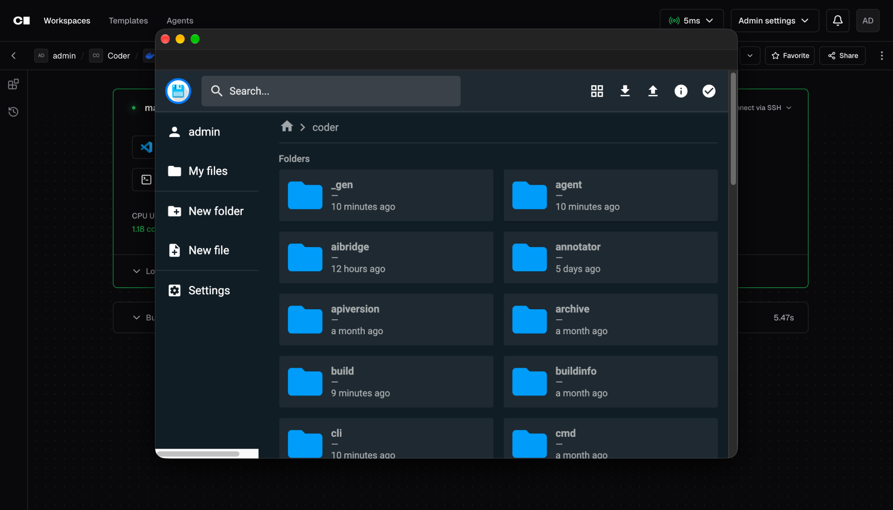

File Browser is a file manager for the web that can be used to upload, download, and view files in your workspace.
A template administrator can add it by following the [Extending Templates](../../templates/extending-templates/web-ides.md#file-browser) guide.

