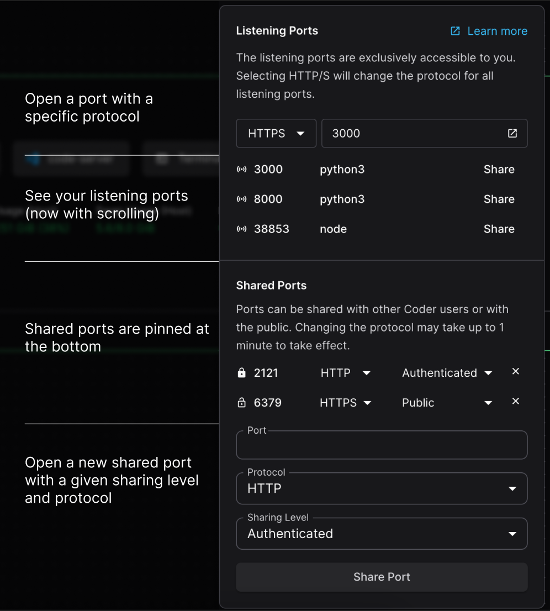

## Port forwarding

Port forwarding lets developers securely access processes on their Coder workspace from a local machine.
A common use case is testing web applications in a browser.

There are multiple ways to forward ports in Coder:

| Method                                                          | Details                                                                                                                                                                                                                          |
|:----------------------------------------------------------------|----------------------------------------------------------------------------------------------------------------------------------------------------------------------------------------------------------------------------------|
| [Coder Desktop](#coder-desktop)                                 | Uses a virtual private network (VPN) tunnel to your workspaces and provides access to all running ports. Supports peer-to-peer connections for the best performance.                                                             |
| [`coder port-forward` command](#the-coder-port-forward-command) | Can be used to forward specific Transmission Control Protocol (TCP) or User Datagram Protocol (UDP) ports from the remote workspace so they can be accessed locally. Supports peer-to-peer connections for the best performance. |
| [Dashboard](#dashboard)                                         | Proxies traffic through the Coder control plane.                                                                                                                                                                                 |
| [SSH](#ssh)                                                     | Forwards ports over an SSH connection.                                                                                                                                                                                           |

## Coder Desktop

> [!TIP]
> Coder Desktop is the recommended way to access workspace ports.
> It provides automatic port forwarding with no manual setup.

[Coder Desktop](../desktop/index.md) creates a VPN tunnel that automatically forwards every port in your workspace.
Any service listening on a port is instantly accessible at `<workspace-name>.coder:PORT` from your local machine, with no additional commands or configuration.

This is the simplest option for most developers: install Coder Desktop, enable Coder Connect, and all ports just work.
Connections are peer-to-peer for the best performance.

## The `coder port-forward` command

<include>../../_includes/port-forwarding/cli-syntax.md</include>

### Examples

<include>../../_includes/port-forwarding/cli-examples.md</include>

For more examples, see `coder port-forward --help`.

## Dashboard

<include>../../_includes/port-forwarding/dashboard-requirements.md</include>

### From a coder_app resource

<include>../../_includes/port-forwarding/coder-app.md</include>

<a id="accessing-workspace-ports"></a>

## Access workspace ports

<include>../../_includes/port-forwarding/open-ports.md</include>

<a id="sharing-ports"></a>

### Share ports

You can share ports as URLs, either with other authenticated coder users or publicly.
Using the open ports interface, you can assign a sharing levels that match our `coder_app`’s share option in [Coder terraform provider](https://registry.terraform.io/providers/coder/coder/latest/docs/resources/app#share).

- `owner` (Default): The implicit sharing level for all listening ports, only visible to the workspace owner
- `organization`: Accessible by authenticated users in the same organization as the workspace.
- `authenticated`: Accessible by other authenticated Coder users on the same deployment.
- `public`: Accessible by any user with the associated URL.

Once a port is shared at either `authenticated` or `public` levels, it will stay pinned in the open ports UI for better visibility regardless of whether or not it is still accessible.



> [!NOTE]
> The sharing level is limited by the maximum level enforced in the template settings in licensed deployments, and not restricted in open source software (OSS) deployments.

This can also be used to change the sharing level of port-based `coder_app`s by entering their port number in the sharable ports UI.
The `share` attribute on `coder_app` resource uses a different method of authentication and **is not impacted by the template's maximum sharing level**, nor the level of a shared port that points to the app.

<a id="configuring-port-protocol"></a>

### Configure port protocol

<include>../../_includes/port-forwarding/port-protocol.md</include>

You can also access any port on the workspace and can configure the port protocol manually by appending a `s` to the port in the URL.

```console
# Uses HTTP
https://33295--agent--workspace--user--apps.example.com/
# Uses HTTPS
https://33295s--agent--workspace--user--apps.example.com/
```

## SSH

First, [configure SSH](./index.md#configure-ssh) on your local machine.
Then, use `ssh` to forward like so:

```console
ssh -L 8080:localhost:8000 coder.myworkspace
```

You can read more on SSH port forwarding [here](https://www.ssh.com/academy/ssh/tunneling/example).
