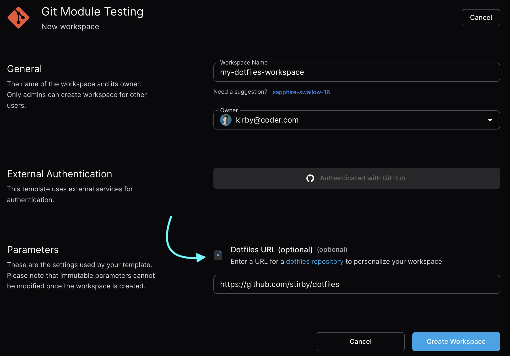

<!-- markdown-link-check-disable -->

Coder offers the `coder dotfiles <repo>` command which simplifies workspace personalization.
Our behavior is consistent with Codespaces, so [their documentation](https://docs.github.com/en/codespaces/customizing-your-codespace/personalizing-codespaces-for-your-account#dotfiles) explains how it loads your repo.

<!-- markdown-link-check-enable -->

You can read more on dotfiles best practices [here](https://dotfiles.github.io).

## From templates

Templates can prompt users for their dotfiles repo URL, which will personalize your workspace automatically.



> [!NOTE]
> Template admins: this can be enabled quite easily with a our [dotfiles module](https://registry.coder.com/modules/dotfiles) using just a few lines in the template.

## Personalize script

Templates can be configured to support executing a `~/personalize` script on startup which users can populate with commands to customize their workspaces.

You can even fill `personalize` with `coder dotfiles <repo>`, but those looking for a simpler approach can inline commands like so:

```sh
#!/bin/bash
sudo apt update
# Install some of my favorite tools every time my workspace boots
sudo apt install -y neovim fish cargo
```

The script can read the [environment variables the agent sets](../templates/extending-templates/environment-variables.md#variables-the-agent-sets) to adapt to the workspace it runs in.
For example, this script installs the Go language server only in workspaces created from the `go` template, which provides the Go toolchain:

```sh
#!/bin/bash
if [ "$CODER_WORKSPACE_TEMPLATE_NAME" = "go" ]; then
  go install golang.org/x/tools/gopls@latest
fi
```

> [!NOTE]
> Template admins: refer to [this module](https://registry.coder.com/modules/personalize) to enable the `~/personalize` script on templates.

## Setup script support

Users set up their dotfiles by creating one of the following script files in their dotfiles repo.
The files Coder looks for depend on the operating system of the workspace.

On non-Windows workspaces:

- `install.sh`
- `install`
- `bootstrap.sh`
- `bootstrap`
- `setup.sh`
- `setup`
- `script/install.sh`
- `script/install`
- `script/bootstrap.sh`
- `script/bootstrap`
- `script/setup.sh`
- `script/setup`

On Windows workspaces:

- `install.ps1`
- `bootstrap.ps1`
- `setup.ps1`
- `script/install.ps1`
- `script/bootstrap.ps1`
- `script/setup.ps1`

If any of the above files are found (in the specified order), Coder will try to execute the first match.
After the first match is found, other files will be ignored.

On Windows workspaces, Coder runs the script with PowerShell and does not check for executable permissions.

On non-Windows workspaces, the setup script must be executable, otherwise the dotfiles setup will fail.
If you encounter this issue, you can fix it by making the script executable using the following commands:

```sh
cd <path_to_dotfiles_repo>
chmod +x <script_name>
git commit -m "Make <script_name> executable" <script_name>
git push
```
