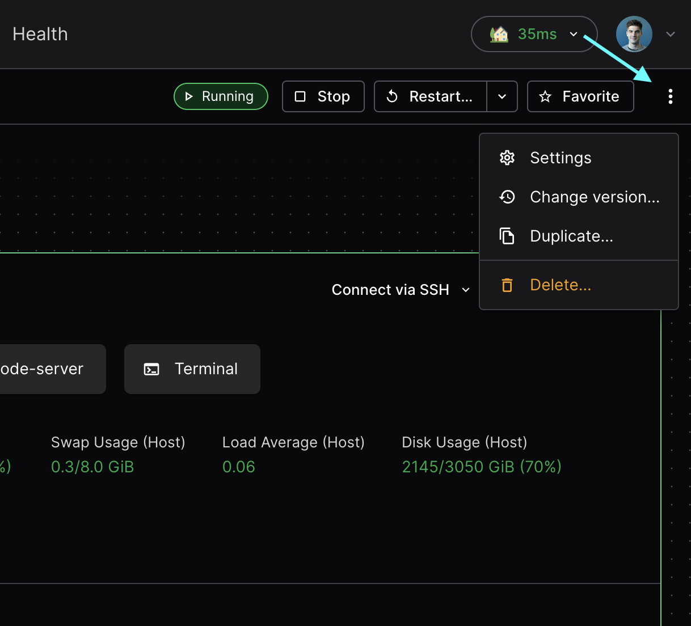
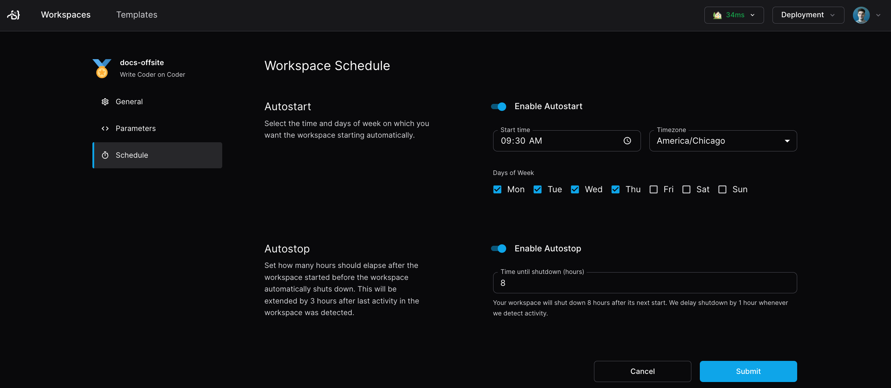
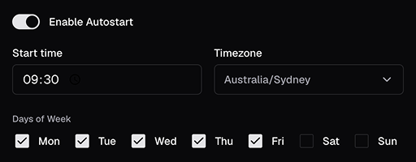
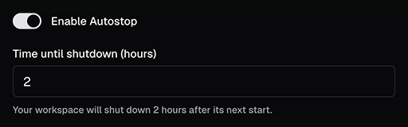
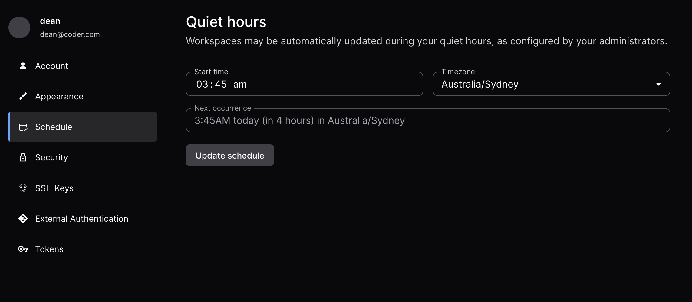

Scheduling helps minimize cloud costs without sacrificing the availability of your workspaces.

You can configure each workspace to automatically start in the morning, and automatically stop once you log off.
Coder also features an inactivity timeout, configured by your template admin, which will stop a workspace when a user's absence is detected.

To learn more workspace states and schedule, read the [workspace lifecycle](workspace-lifecycle.md) documentation.

## Where to find the schedule settings

Select any workspace the **Workspaces** tab of the dashboard, then go to **Workspace settings** in the top right.



Then open the **Schedule** tab to see your workspace scheduling options.



## Autostart

Autostart must be enabled in the template settings by your administrator.

Use autostart to start a workspace at a specified time and which days of the week.
Also, you can choose your preferred timezone.
Admins can restrict which days of the week your workspace is allowed to autostart.



## Autostop

Use autostop to stop a workspace after a number of hours.
Autostop won't stop a workspace if you're still using it.
It will wait for the user to become inactive before checking connections again (1&nbsp;hour by default).
Template admins can modify this duration with the **activity bump** template setting.

> [!NOTE]
> Autostop must be enabled on the template prior to workspace creation, it is not applied to existing running workspaces.



## Activity detection

Workspaces automatically shut down after a period of inactivity.
The **activity bump** duration can be configured at the template level and is visible in the autostop description for your workspace.

### What counts as workspace activity?

A workspace is considered "active" when Coder detects one or more active sessions with your workspace.
Coder specifically tracks these session types:

- **VSCode sessions**:
  Using code-server or VS Code with a remote extension
- **JetBrains IDE sessions**:
  Using JetBrains Gateway or remote IDE plugins
- **Terminal sessions**:
  Using the web terminal (including reconnecting to the web terminal)
- **SSH sessions**:
  Connecting via `coder ssh` or SSH config integration
- **AI agent task status**:
  When a coding agent reports "working" status, the workspace deadline is extended

Activity is only detected when there is at least one active session.
An open session will keep your workspace marked as active and prevent automatic shutdown.

The following actions do **not** count as workspace activity:

- Viewing workspace details in the dashboard
- Viewing or editing workspace settings
- Viewing build logs or audit logs
- Accessing ports through direct URLs without an active session
- Background agent statistics reporting (note: AI agent _task status_ reporting is different and does count as activity, see above)

To avoid unexpected cloud costs, close your connections, this includes IDE windows, SSH sessions, and others, when you finish using your workspace.

### Keep a workspace running without a connection

A process that runs in the background doesn't open a session, so Coder doesn't count it as activity.
This includes long-running jobs and coding agents such as Claude Code that run in a detached `tmux` session, in a terminal multiplexer like Herdr, or under `nohup`.
If the workspace has autostop enabled, it stops at its deadline even while the process works.

To keep the workspace running, use one of these options.

#### Extend the deadline from the CLI

Run `coder schedule extend` to set the stop time to a duration from now:

```sh
coder schedule extend my-workspace 90m
```

The duration must be at least 30&nbsp;minutes, and the template's maximum workspace runtime still applies.
Refer to [`coder schedule extend`](../reference/cli/schedule/extend.md).

#### Extend the deadline from a script

Call the [extend workspace deadline](../reference/api/workspaces.md#extend-workspace-deadline-by-id) endpoint with a user [session token or API token](../admin/users/sessions-tokens.md).
The workspace agent token, `CODER_AGENT_TOKEN`, can't call this endpoint.

For a script that keeps extending the deadline while a job runs, refer to [Manually send workspace activity](../reference/index.md#workspace-agents).

#### Keep coding agents running

A template admin can make a workspace stay running while a coding agent works, with no user action.
The examples in this section do this for Claude Code and Herdr with the [Claude Code](https://registry.coder.com/modules/coder/claude-code) and [Herdr](https://registry.coder.com/modules/gojnimer6553/herdr) registry modules.

Both examples use a startup script that creates a [scoped token](../admin/users/sessions-tokens.md#api-key-scopes) for the workspace.
The script uses the owner's session token from the workspace build once, to create a token that can only read and extend this workspace.
It also installs a `coder-keepalive` helper that moves the deadline to one hour from now when the deadline is closer than 50&nbsp;minutes.
The helper never shortens the deadline, and it never moves the deadline past the template's maximum workspace runtime.

Add this script to the template:

```tf
data "coder_workspace" "me" {}
data "coder_workspace_owner" "me" {}

resource "coder_script" "keepalive" {
  agent_id     = coder_agent.main.id
  display_name = "Keep-alive token"
  run_on_start = true
  script       = <<-EOT
    #!/usr/bin/env bash
    set -euo pipefail

    export CODER_URL='${data.coder_workspace.me.access_url}'
    export CODER_SESSION_TOKEN='${data.coder_workspace_owner.me.session_token}'
    name='keepalive-${data.coder_workspace.me.id}'
    dir="$HOME/.config/coder-keepalive"
    mkdir -p "$dir" "$HOME/.local/bin"
    chmod 700 "$dir"
    coder tokens remove "$name" > /dev/null 2>&1 || true
    echo "$${CODER_URL%/}/api/v2/workspaces/${data.coder_workspace.me.id}" > "$dir/url"
    (umask 077 && coder tokens create --name "$name" --lifetime 168h \
      --scope workspace:read --scope workspace:update \
      --allow 'workspace:${data.coder_workspace.me.id}' > "$dir/token")

    cat > "$HOME/.local/bin/coder-keepalive" << 'HELPER'
    #!/usr/bin/env bash
    # Moves the workspace deadline to KEEPALIVE_WINDOW minutes from now when it
    # is closer than that. Never shortens the deadline. Runs at most once a minute.
    set -u
    dir="$HOME/.config/coder-keepalive"
    token=$(cat "$dir/token" 2> /dev/null) || exit 0
    now=$(date +%s)
    last=$(cat "$dir/last" 2> /dev/null || echo 0)
    [ $((now - last)) -lt 60 ] && exit 0
    echo "$now" > "$dir/last"

    url=$(cat "$dir/url")
    ws=$(curl -fsS --max-time 5 -H "Coder-Session-Token: $token" "$url?include_related=latest_build") || exit 0
    deadline=$(jq -r '.latest_build.deadline // empty' <<< "$ws")
    max=$(jq -r '.latest_build.max_deadline // empty' <<< "$ws")
    [ -n "$deadline" ] || exit 0 # Autostop is off.

    target=$((now + $${KEEPALIVE_WINDOW:-60} * 60))
    [ -n "$max" ] && [ "$(date -d "$max" +%s)" -lt "$target" ] && target=$(date -d "$max" +%s)
    # The API rejects deadlines less than 30 minutes away.
    [ $((target - now)) -ge 1800 ] || exit 0
    [ "$(date -d "$deadline" +%s)" -lt $((target - 600)) ] || exit 0

    curl -fsS --max-time 5 -o /dev/null -X PUT "$url/extend" \
      -H "Coder-Session-Token: $token" \
      -d "{\"deadline\": \"$(date -u -d "@$target" +%Y-%m-%dT%H:%M:%SZ)\"}"
    HELPER
    chmod 755 "$HOME/.local/bin/coder-keepalive"
  EOT
}
```

The helper needs `curl`, `jq`, and GNU `date` in the workspace image.
The owner's session token is part of the script, so the workspace agent can read it.
Only the scoped token is saved in the workspace, and the script replaces it each time the workspace starts.
Deleting the workspace doesn't delete the token, but the token can't reach any other workspace and expires after 7&nbsp;days.

To extend the deadline while Claude Code works, add hooks that run the helper with the module's `managed_settings`:

```tf
module "claude-code" {
  source            = "registry.coder.com/coder/claude-code/coder"
  version           = "5.5.2"
  agent_id          = coder_agent.main.id
  anthropic_api_key = "xxxx-xxxxx-xxxx"

  managed_settings = {
    hooks = {
      for event in ["UserPromptSubmit", "PreToolUse", "PostToolUse"] : event => [{
        hooks = [{ type = "command", command = "cat > /dev/null; $HOME/.local/bin/coder-keepalive" }]
      }]
    }
  }
}
```

Claude Code runs the hooks when you send a prompt and before and after each tool call.
A single tool call that runs for longer than 50&nbsp;minutes can still reach the deadline.

To extend the deadline while any agent in Herdr works, start a loop that checks `herdr agent list` with the module's `post_start_script`:

```tf
module "herdr" {
  count    = data.coder_workspace.me.start_count
  source   = "registry.coder.com/gojnimer6553/herdr/coder"
  version  = "1.0.0"
  agent_id = coder_agent.main.id

  post_start_script = <<-EOT
    #!/usr/bin/env bash
    # While any agent in Herdr is working, keep the workspace running.
    nohup flock -n "$HOME/.config/coder-keepalive.lock" bash -c '
      while true; do
        if herdr agent list 2> /dev/null | grep -q "\"agent_status\":\"working\""; then
          "$HOME/.local/bin/coder-keepalive"
        fi
        sleep 60
      done' > /dev/null 2>&1 &
  EOT
}
```

When the agents stop working, the helper stops extending the deadline, and the workspace stops at its deadline.

## Autostop requirement

> [!NOTE]
> Autostop requirement is a Premium feature.
> [Learn more](https://coder.com/pricing#compare-plans).

Licensed template admins can enforce a required stop for workspaces to apply updates or undergo maintenance.
These stops ignore any active connections or inactivity bumps.
Rather than being specified with a CRON, admins set a frequency for updates, either in **days** or **weeks**.
Workspaces will apply the template autostop requirement on the given day **in the user's timezone** and specified quiet hours (see below).

Admins: See the template schedule settings for more information on configuring Autostop Requirement.

### User quiet hours

> [!NOTE]
> User quiet hours are a Premium feature.
> [Learn more](https://coder.com/pricing#compare-plans).

User quiet hours can be configured in the user's schedule settings page.
Workspaces on templates with an autostop requirement will only be forcibly stopped due to the policy at the **start** of the user's quiet hours.



## Scheduling configuration examples

The combination of autostart, autostop, and the activity bump create a powerful system for scheduling your workspace.
However, synchronizing all of them simultaneously can be somewhat challenging, here are a few example configurations to better understand how they interact.

> [!NOTE]
> The activity bump must be configured by your template admin.

<a id="working-hours"></a>

### Work schedule

The intended configuration for autostop is to combine it with autostart, and set a "working schedule" for your workspace.
It's pretty intuitive:

If I want to use my workspace from 9 to 5 on weekdays, I would set my autostart to 9:00 AM every day with an autostop of 9&nbsp;hours.
My workspace will always be available during these hours, regardless of how long I spend away from my laptop.
If I end up working overtime and log off at 6:00 PM, the activity bump will kick in, postponing the shutdown until 7:00 PM.

<a id="basing-solely-on-activity-detection"></a>

#### Rely solely on activity detection

If you'd like to ignore the time to live (TTL) from autostop and have your workspace solely function on activity detection, you can set your autostop equal to activity bump duration.

Let's say that both are set to 5&nbsp;hours.
When either your workspace autostarts or you sign in, you will have confidence that the only condition for shutdown is 5&nbsp;hours of inactivity.

## Dormancy

> [!NOTE]
> Dormancy is a Premium feature.
> [Learn more](https://coder.com/pricing#compare-plans).

Dormancy automatically deletes workspaces that remain unused for long durations.
Template admins configure a dormancy threshold that determines how long a workspace can be inactive before it is marked as `dormant`.
A separate setting determines how long workspaces will remain in the dormant state before automatic deletion.

Licensed admins can also configure failure cleanup, which stops workspaces that remain in a `failed` state for too long.
Failure cleanup does not delete workspaces.
Refer to [failure cleanup](../templates/managing-templates/schedule.md#failure-cleanup) for details.
