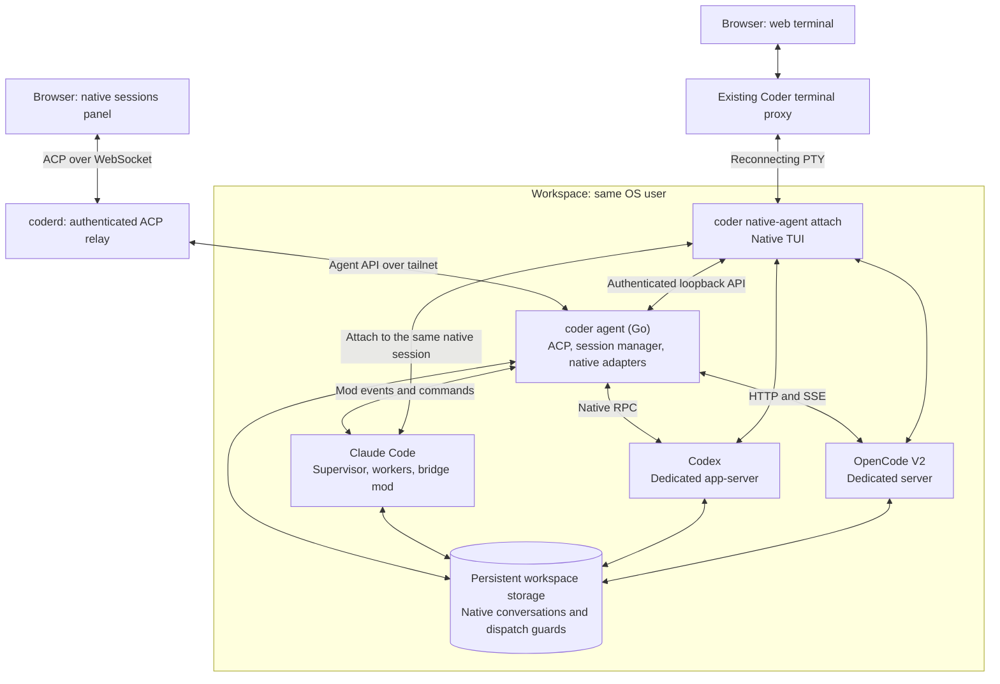

# Native workspace agents (experimental)

Run **Claude Code, Codex, or OpenCode** in a Coder workspace, observe structured output in the browser, and open the same conversation in its native terminal UI.
This POC requires the opt-in `native-agents` experiment and `CODER_AGENT_NATIVE_AGENTS=true` in the workspace agent's environment.
It isn't integrated with Coder Agents or `chatd`.

## Architecture



Coder provides authentication, workspace connectivity, and terminal transport.
The Go workspace agent owns native adapters, persistence, lifecycle, and ACP projection.
There is no standalone Node broker, per-browser ACP process, or SSH protocol hop.
Each harness owns model calls, tools, permissions, and its authoritative conversation history.
There is no terminal scraping or second model loop.

| Harness     | Native integration                              | Target version         |
|-------------|-------------------------------------------------|------------------------|
| Claude Code | Bridge mod in native background workers         | `2.1.309` template pin |
| Codex       | Dedicated app-server and remote TUI             | `0.164.0`              |
| OpenCode    | Dedicated authenticated server and attached TUI | V2 `2.0.28`            |

## How each integration starts and connects

The manager prepares private directories at startup, but starts native workers or servers only when creating or restoring a session.
Creating a conversation and submitting a task are separate operations: the manager saves the native identity before allowing prompts.
The browser connects to the manager's ACP endpoint, not directly to a harness.
The commands below describe adapter-generated invocations, not additional setup steps.

### Claude Code

The [Claude adapter](../../agent/x/agentnative/claude.go) extracts its embedded `workspace-bridge` plugin into the private state directory.
For each new conversation, it invokes `claude --bg` with a generated `--name`, `--plugin-dir`, and `--settings`, followed by `/bridge-status`.
Claude's native supervisor owns the background worker; `/bridge-status` initializes the bridge without submitting a model task.
The settings supply a launch ID and `WORKSPACE_BRIDGE_FILE`, which points to the private callback URL and bearer token.

The plugin's `session.start` hook registers the native session ID and starts authenticated `POST /v1/runtime` polling back to the Go agent.
Each request carries structured events; the response acknowledges event sequence numbers and returns pending prompt, cancellation, or control-mode commands.
The adapter waits for registration before returning the new session.
The plugin rereads the descriptor on each poll, so an agent-only restart can change the callback address without replacing the native worker.

**Open** runs `claude attach <short-session-id>` through the existing Coder terminal transport.
The terminal joins that background conversation; it doesn't start another model session.

#### What the Claude plugin hooks

These are native JavaScript module hooks, not shell scripts or a separate Node process.
The plugin's [hooks.json](../../agent/x/agentnative/claudemod/hooks/hooks.json) loads the module:

```json
{
  "modules": ["./register.js"]
}
```

The following excerpts from [register.js](../../agent/x/agentnative/claudemod/hooks/register.js) run inside its `register(on)` function.
Claude supplies `$` for native APIs, `e` for the event, and `next(e)` for the remaining hook chain and native behavior.
They aren't standalone scripts to install separately.

The `turn.step` hook observes text and thinking chunks while passing the complete stream back to Claude unchanged:

```javascript
on('turn.step', async function* ($, e, next) {
  const stream = next(e);
  let part = await stream.next();
  while (!part.done) {
    const chunk = part.value;
    if (!e.agentId && (chunk.kind === 'text' || chunk.kind === 'thinking')) {
      emit(chunk.kind === 'text' ? 'text' : 'thought', { turnId: e.turnId, requestId: requestFor(e.turnId), text: chunk.text });
    }
    yield chunk;
    part = await stream.next();
  }
  return part.value;
});
```

The `!e.agentId` check keeps nested native subagent output out of the top-level turn projection.
`emit` queues structured events for the Go agent; it doesn't read terminal output or call a model.

The permission hook reports that Claude needs your input, but leaves the decision to Claude's native UI:

```javascript
on('classic.PermissionRequest', async ($, e, next) => {
  if (config && (!e.session_id || e.session_id === sessionId)) {
    const permission = { kind: 'permission', tool: e.tool_name, input: e.tool_input, toolCallId: e.tool_use_id, turnId: activeTurnId, requestId: requestFor(activeTurnId) };
    permissions.set(e.tool_use_id || Symbol(), permission);
    emit('needs.input', { ...permission, pending: true });
  }
  // Returning from PermissionRequest does not mean the user has answered it.
  return next(e);
});
```

Calling `next(e)` isn't an approval.
The plugin clears the pending notice when the corresponding tool or turn finishes, or the session ends.
The remaining hooks connect observation to safe control:

| Hook                                              | Purpose                                                                                                              |
|---------------------------------------------------|----------------------------------------------------------------------------------------------------------------------|
| `session.start`                                   | Register the worker, start polling, and register bridge control commands.                                            |
| `prompt.submit`                                   | Detect competing submissions, invalidate pending ownership evidence, and pause new automation on native human input. |
| `turn.start`, `turn.complete`                     | Associate verified submissions with top-level turns and track completion.                                            |
| `tool.call`                                       | Report tool input, output, and errors while letting Claude execute the tool.                                         |
| `command.run`                                     | Handle `/bridge-status`, `/bridge-human`, and `/bridge-auto` locally.                                                |
| `session.attach`, `session.detach`, `session.end` | Report terminal attachment changes and attempt a bounded final-event drain at session shutdown.                      |

Automation uses `$.prompt.submit({ text: request.text, asUser: true })`, preserving literal prompt text without attribution wrappers or tracking markers.
Native receipt metadata and turn events establish which request owns a turn; text matching alone isn't enough.
Cancellation uses `$.turn.abort({ turnId })` only for a verified owned turn, not whichever turn happens to be active.

### Codex

The [Codex adapter](../../agent/x/agentnative/codex.go) shares one dedicated app-server across managed Codex conversations.
It reconnects to a verified server or starts `codex app-server --listen unix://<state-dir>/codex.sock` as a detached process.
Native authentication, configuration, and history stay in `CODEX_HOME`, defaulting to `$HOME/.codex`.

The connection uses `codex app-server proxy --sock <state-dir>/codex.sock` as a byte transport.
The Go adapter performs a WebSocket upgrade over that proxy's stdin/stdout, not a public TCP listener, then sends `initialize` and `initialized`.
It verifies the local server's ownership and pinned version before using the connection.

`thread/start` creates a conversation; `turn/start` submits a prompt with a persisted client message ID.
The same connection carries thread, turn, tool, text, reasoning, and approval events, which the adapter routes by thread ID into ACP updates.
Native user-message receipts establish prompt ownership; the adapter doesn't answer approval requests.

**Open** runs `codex resume --remote unix://<state-dir>/codex.sock <thread-id>` in the saved working directory.
The TUI connects to the same server and thread rather than starting a separate local conversation.

### OpenCode V2

The [OpenCode adapter](../../agent/x/agentnative/opencode.go) shares one dedicated server across managed OpenCode sessions.
It reconnects using a verified private descriptor or starts `opencode serve --hostname 127.0.0.1 --port <port>` as a detached process.
The server and attached TUIs use `<state-dir>/opencode-home`, with isolated config, data, state, cache, and temporary directories.
This separates the integration from ordinary workspace-home OpenCode state, not one managed session from another.

The Go adapter connects over loopback HTTP with Basic authentication, using a generated `OPENCODE_PASSWORD` stored in the private server descriptor.
This transport password is separate from model-provider credentials.
The adapter verifies the server identity and authentication before opening `GET /api/event` for server-sent events (SSE).

`POST /api/session` creates a conversation for the requested working directory.
`POST /api/session/<session-id>/prompt` queues input with a persisted message ID.
SSE events trigger reconciliation of bounded HTTP snapshots of messages, queued input, permissions, and activity; a periodic poll also reconciles state.
The adapter derives browser updates from those snapshots rather than treating SSE as a replayable transcript.

**Open** runs `opencode --server <loopback-url> --session <session-id> <cwd>` with the same isolated home and server password.
The TUI therefore joins the existing server-side conversation without creating a new session.

## Behavior

- **Background:** after template setup finishes, the workspace agent restores saved sessions and attempts the configured initial job once, without a browser connection.
- **Open:** opens another web terminal on the same native conversation. Attachment selects human control; it doesn't restore or restart sessions.
- **Observe:** permits new automation prompts without closing terminals or cancelling active work. It isn't an exclusive lock against native terminal input.
- **Restart:** the workspace agent restores eligible saved sessions using their native identities. It never resubmits the original task; uncertain state requires inspection. Agent-only restarts reconnect observation without intentionally stopping native work.
- **Continuity:** native history and dispatch guards persist in the workspace. The browser retains bounded drafts and panel choices in tab-scoped storage across workspace rebuilds.

## Boundaries

The common contract is strongest for discovery, structured observation, prompt dispatch, and terminal handoff.
Recovery, cancellation, approvals, and native process ownership remain harness-specific.
The adapter refuses unsafe operations rather than pretending all harnesses support the same semantics.

Native APIs are version-sensitive, permissions remain terminal-only, and conversation forking isn't implemented.
Bounded agent history isn't a backup of native history; dispatch guards prevent automatic replay, not exactly-once tool side effects.
The Go POC uses separate state rather than migrating the earlier JavaScript broker's saved sessions.

## Possible Coder Agents integration

A future integration could offer native harnesses as an alternative execution backend, not another model provider.
Coder Agents would own task metadata, authorization, workspace lifecycle, and the user-facing activity stream; the native harness would retain conversation and execution ownership.

Persist an organization-scoped binding from the Coder task to its workspace, stable agent identity, harness, and native session ID.
A backend observer could project native events into the existing UI and reconcile after disconnection without replaying prompts.
Keep Open as terminal handoff, and expose cancellation, approvals, and recovery according to each backend's capabilities.
This is a proposal, not implemented behavior.

## Setup and implementation

- [Setup, commands, safety limits, and verification](REFERENCE.md)
- [Prompt-driven Docker workspace template](template/README.md)
- [ACP relay](../../coderd/workspaceagents_acp.go), [Go session manager and adapters](../../agent/x/agentnative/), and [local CLI](../../cli/nativeagent.go)
- [Claude's embedded JavaScript mod](../../agent/x/agentnative/claudemod/) remains inside the native Claude runtime.
