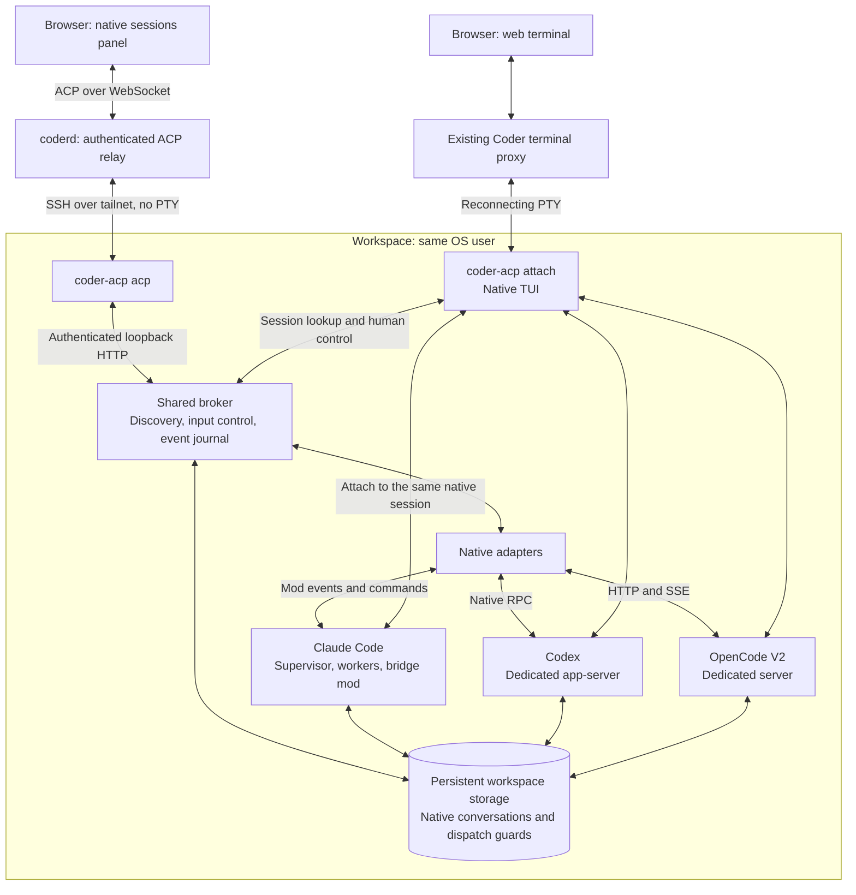

# Native workspace agents (experimental)

Run **Claude Code, Codex, or OpenCode** in a Coder workspace, observe structured output in the browser, and open the same conversation in its native terminal UI.
This POC requires the opt-in `native-agents` experiment; it isn't integrated with Coder Agents or `chatd`.

## Architecture

Coder provides authentication, workspace connectivity, and terminal transport.
The broker normalizes native events; the ACP adapter exposes them to clients.
Each harness owns model calls, tools, permissions, and its authoritative conversation history.
There is no terminal scraping or second model loop.

| Harness     | Native integration                              | Target version         |
|-------------|-------------------------------------------------|------------------------|
| Claude Code | Bridge mod in native background workers         | `2.1.309` template pin |
| Codex       | Dedicated app-server and remote TUI             | `0.164.0`              |
| OpenCode    | Dedicated authenticated server and attached TUI | V2 `2.0.28`            |

## Behavior

- **Background:** template startup can submit an initial job without a browser connection.
- **Open:** opens another web terminal on the same native conversation. Attachment selects human control; it doesn't restore or restart sessions.
- **Observe:** permits new automation prompts without closing terminals or cancelling active work. It isn't an exclusive lock against native terminal input.
- **Restart:** template startup restores eligible saved sessions using their native identities, independently of the browser. It never resubmits the original task; uncertain state requires inspection.
- **Continuity:** native history and dispatch guards persist in the workspace. The browser retains bounded drafts and panel choices in tab-scoped storage across workspace rebuilds.

## Boundaries

The common contract is strongest for discovery, structured observation, prompt dispatch, and terminal handoff.
Recovery, cancellation, approvals, and native process ownership remain harness-specific.
The adapter refuses unsafe operations rather than pretending all harnesses support the same semantics.

Native APIs are version-sensitive, permissions remain terminal-only, and conversation forking isn't implemented.
Bounded broker history isn't a backup of native history; dispatch guards prevent automatic replay, not exactly-once tool side effects.

## Possible Coder Agents integration

A future integration could offer native harnesses as an alternative execution backend, not another model provider.
Coder Agents would own task metadata, authorization, workspace lifecycle, and the user-facing activity stream; the native harness would retain conversation and execution ownership.

Persist an organization-scoped binding from the Coder task to its workspace, stable agent identity, harness, and native session ID.
A backend observer could project native events into the existing UI and reconcile after disconnection without replaying prompts.
Keep Open as terminal handoff, and expose cancellation, approvals, and recovery according to each backend's capabilities.
This is a proposal, not implemented behavior.

## Setup and implementation

- [Setup, commands, safety limits, and verification](REFERENCE.md)
- [Prompt-driven Docker workspace template](template/README.md)
- [ACP relay](../../coderd/workspaceagents_acp.go), [ACP adapter](src/acp.mjs), and [broker routing](src/broker.mjs)
- Native adapters: [Claude Code](plugin/hooks/register.js), [Codex](src/codex-service.mjs), [OpenCode](src/opencode-service.mjs)
