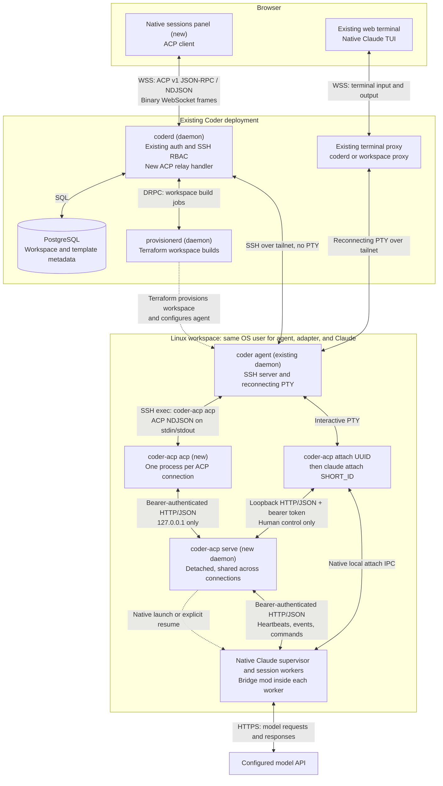
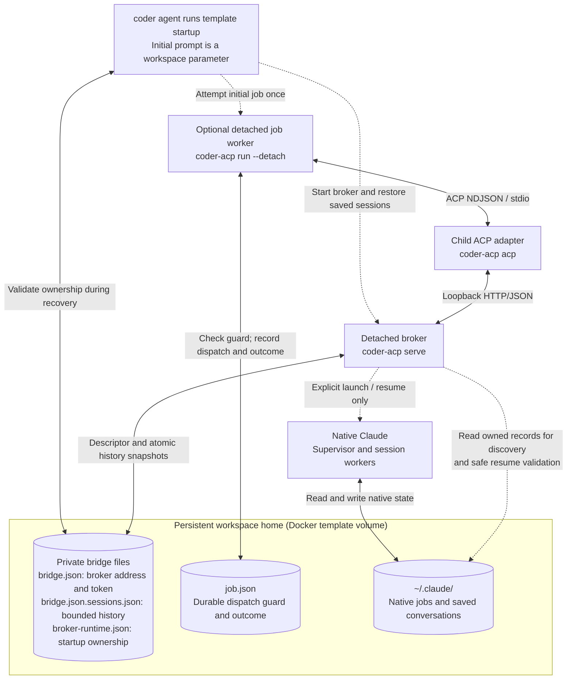
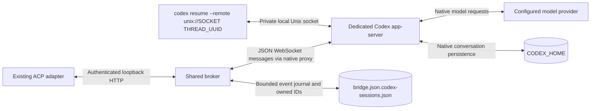
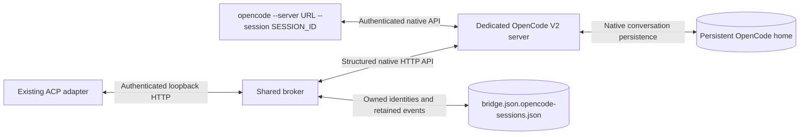

# Native workspace agent reference

For the concise three-harness architecture, refer to the [overview](README.md).

Control native Claude Code, Codex, or OpenCode background sessions from the Coder UI, then
open the same conversation in its native terminal UI. This is an experimental
adapter for an existing Linux workspace, not a production-ready service. It
requires a Coder build with the `native-agents` experiment, or a standalone ACP
client. Claude remains the default; Codex and OpenCode support are explicitly enabled.

## High-level architecture

The integration adds an ACP relay to `coderd` and an adapter inside the workspace.
It reuses Coder's workspace provisioning, authentication, SSH authorization,
tailnet connectivity, and web terminal. It does not use Coder Agents or `chatd`.

### Claude connections and process boundaries



Solid connections carry protocol traffic; dotted connections create or resume
processes. The diagram assumes TLS at Coder's ingress (`WSS`); local development
can use `WS`. Tailnet is Coder's existing encrypted WireGuard network, using a
direct connection when possible or DERP relay otherwise. The browser does not
connect directly to the broker. ACP enters through
`/api/v2/workspaceagents/{agent}/experimental/acp`; the terminal uses the existing
`/api/v2/workspaceagents/{agent}/pty` route. External provisioner DRPC uses yamux
over a WebSocket; provisioning is not part of the ACP message path.

The native mod initiates `/v1/runtime` HTTP requests containing registration,
heartbeats, and structured events. Broker responses return acknowledgements and
queued commands. ACP clients independently long-poll the broker for events.
The mod uses `$.prompt.submit`, `$.turn.abort`, and structured turn/tool events;
there is no terminal scraping or synthetic keyboard input in the control path.
Claude owns model calls, native permissions, tool execution, and conversation
state. The relay does not interpret ACP or own a second conversation.

### Claude startup, persistence, and ownership



Here dotted connections indicate startup, launch, or discovery work rather than
the live ACP stream. The job worker exits after observing an outcome; it is not
an always-on supervisor. The broker and native workers outlive individual SSH,
ACP, and terminal connections. `coder-acp acp` is connection-scoped, not a daemon.

- **Open:** launches Coder's web PTY. Its `coder-acp attach` command selects human
  control and attaches to the existing native session. It never requests a
  restart or resumes an archive. Open remains available when a terminal is
  already open, so another terminal can attach to the same conversation.
- **Observe:** ACP hands new prompts back to automation. It neither closes an
  open terminal nor cancels an existing turn. For Claude, `Ctrl+Z` detaches the native TUI; for Codex and OpenCode, close the terminal tab.
- **Restart:** workspace shutdown stops processes, not the persistent home.
  Template startup restores the broker and every eligible saved native session,
  retaining its native identity and history without resending prompts. Restoration is
  independent of browser connections and Open. Unsafe saved state is reported
  rather than replayed; one failed restoration does not block other sessions.
- **Storage:** PostgreSQL remains Coder's workspace metadata store. This POC adds
  no central conversation store: broker history, dispatch guards, and native
  conversations live in the workspace. Full native history and bounded broker
  transcript history are distinct.

Implementation entry points: [ACP relay](../../coderd/workspaceagents_acp.go),
[existing terminal proxy](../../coderd/workspaceapps/proxy.go),
[ACP adapter](src/acp.mjs), [broker](src/broker.mjs),
[native mod](plugin/hooks/register.js), [native resume](src/native-resume.mjs),
[job worker](src/job.mjs), and [template startup](template/image/startup.mjs).

## Prerequisites

- An already running Linux workspace. Install and start the broker as the same
  workspace user that runs the Coder agent, not as root or another account.
- Node.js 22 or later and npm. The installer captures the absolute Node executable
  path so non-interactive SSH does not depend on shell initialization or `nvm`.
- Claude Code with mods and agent view enabled. Runtime probing used 2.1.306
  and 2.1.309; these preview APIs are version-sensitive.
- Working Claude authentication and a trusted project directory. Run `claude`
  there once to complete login and trust if necessary. Managed policy must allow
  this mod. The bridge does not bypass trust, approve permissions, or configure
  authentication. Use the workspace's existing login or secret provisioning;
  do not copy credentials into the launcher, template, or logs.
- `claude` on the broker and terminal's `PATH`. The broker inherits its startup
  environment, not environment changes from later SSH clients.
- Keep the workspace running. Detachment survives SSH disconnect, not workspace
  shutdown, reboot, or a process manager that kills the workspace's processes.

## Enable Codex alongside Claude

Install `@openai/codex@0.164.0` and authenticate with `codex login` as the workspace
user, or configure a provider using Codex's native configuration and credentials.
This POC pins the native app-server protocol to **0.164.0**; its network and
multi-client interfaces are experimental. Complete native project trust and
configuration before running unattended work. The adapter does not override
native authentication, approval policy, or sandbox settings.

The adapter uses the stable version's experimental queue and resume fields.
Regenerate its protocol reference with `codex app-server generate-ts --experimental --out /private/protocol-reference` when evaluating a different native version; do not assume `main` describes the installed CLI.

After installing the adapter as described below:

```sh
coder-acp serve --detach --codex
coder-acp start --harness codex --cwd /absolute/project
coder-acp list
coder-acp attach codex:FULL_NATIVE_THREAD_UUID
```

Use `--codex` on the initial broker start, not on a second broker pointing to an
existing descriptor. The command starts a dedicated native app-server process,
not Codex's managed, auto-updating daemon. It does not submit a task or resume
archived threads. The server uses `CODEX_HOME` (default `~/.codex`) for native
configuration and authentication. Broker and terminal connect to the same private
Unix socket beside the bridge descriptor. No Codex network endpoint is exposed
to the browser.



Codex is a separate native adapter, not a Claude mod and not an ACP-owned model
conversation. Only threads created by this broker are listed. Their public IDs
are `codex:<native UUID>`; existing Claude UUIDs and archive files are unchanged.
The UI advertises the available harnesses and identifies each session separately.
The fixed SSH commands remain `coder-acp acp` and `coder-acp attach SESSION_ID`.

The pinned CLI runs `codex app-server --listen unix://SOCKET`. Unlike
`codex app-server daemon start`, this does not install a managed updater or
restore a managed daemon's restart snapshot. The native process outlives a broker
restart. Read-only initialization verifies the running protocol version before
accepting work; it never subscribes to or resumes archived threads.

A persistent proxy connection receives structured native events independently of
browser connections. Opening the terminal selects human control without interrupting an active
turn. Native permissions remain in the native TUI; the bridge never grants them.
Observe returns new bridge prompts to automation without closing the terminal.
Control modes gate bridge input; they are not exclusive controller leases.

On workspace restart, the template automatically restores each saved Codex
thread using its exact native identity, without an initial prompt. Browser
list/load remains passive and Open only launches the web PTY. Native conversation files remain owned by Codex and are accessed through
app-server methods, not parsed by this adapter. Uncertain dispatch outcomes are
not retried automatically. Keep both the bridge state directory and `CODEX_HOME`
on persistent storage. The adapter journal is not a replacement for full native
history.

For unattended startup, `coder-acp run --harness codex` uses the same durable
job guard as Claude. A guard's harness is immutable; a missing harness in an older
record means Claude. Changing the harness cannot replay an existing job.
Conversation forking is not implemented. `coder-acp stop` does not support Codex;
use the native terminal or cancel the bridge-owned prompt instead. It must not
report a stopped session when only observation has ended.

## Enable OpenCode alongside Claude and Codex

OpenCode support targets **V2 2.0.28**, not the V1 API. Install that exact native
version and configure a model/provider using OpenCode's native configuration and
credentials. The adapter does not copy another harness's authentication or change
native permission policy.

```sh
npm install --global @opencode/cli@2.0.28
coder-acp serve --detach --codex --opencode
coder-acp start --harness opencode --cwd /absolute/project
coder-acp list
coder-acp attach opencode:FULL_NATIVE_SESSION_ID
```

`--opencode` starts a dedicated, authenticated loopback OpenCode server. It does
not use or restart the user's shared OpenCode service. The bridge and native TUI
connect to that same explicit server. Only bridge-owned sessions are exposed as
`opencode:ses_...`; existing Claude and Codex identities remain unchanged.
The browser still uses the common ACP relay, not direct access to OpenCode.



Native conversations, configuration, and credentials live in the private
`opencode-home/` beside the bridge descriptor, inside the persistent workspace
home. Provision native settings at
`~/.local/state/coder-acp/opencode-home/config/opencode/opencode.jsonc` for the
default installation. This isolates the database from any shared OpenCode service.
The server and TUI receive this directory as `HOME` with isolated XDG paths;
provision required tool configuration there rather than relying on workspace-home
dotfiles. Keep this directory together with the private bridge registry.
Template startup restores saved session access without submitting a prompt.
The dedicated server uses plain `opencode serve`, never `serve --service`:
V2 2.0.28 managed-service startup can automatically continue interrupted work.
Do not point a managed OpenCode service at this server's saved database.
The template's stop hook verifies and gracefully stops the dedicated server,
then removes only its unchanged rendezvous descriptor after confirmed exit.
An abrupt stop that leaves a descriptor from another PID namespace requires
manual inspection; startup never guesses that a foreign process is dead.
Opening a terminal and changing control mode never dispatch bridge restoration.
Native permission requests still require the native terminal; the adapter does
not approve them automatically.

The adapter consumes structured SSE events and reconciles native message
snapshots, including terminal-originated turns and separate thinking content.
Snapshots are bounded to 200 messages and 4 MiB. Restoration checks retained
request receipts and the saved history anchor; pending, rewritten, or ambiguous
work requires inspection instead of a fresh prompt. Native transport loss fails
closed rather than silently reconnecting and retrying a mutation.

Only a demonstrably queued, bridge-owned prompt can be cancelled. Running or
ambiguous cancellation is refused because a session-wide interrupt could stop
human work. Stop is not reported as successful when native work could continue.
`--session` can create a missing native session, so attachment checks the exact
native identity and directory before invoking the TUI. OpenCode does not expose
an atomic attach-only flag, so deletion after this preflight remains a native
limitation.

## Install in an existing workspace

From a stable checkout of this directory:

```sh
cd /absolute/path/to/coder/examples/claude-acp-bridge
npm ci --ignore-scripts
./install.sh
export PATH="$HOME/.local/bin:$PATH"
coder-acp serve --detach --model haiku
coder-acp list
```

An empty list is expected. Installation, broker startup, and `list` do not launch
Claude sessions or make model requests. The installer does **not** run npm or
modify `package.json`, the lockfile, or existing dependencies. Use `npm ci
--ignore-scripts` for a reproducible fresh install; skip it when dependencies
are already installed and verified. Do not substitute an unpinned `npm install`
as a workspace startup step.

The generated owner-only executable at `~/.local/bin/coder-acp` delegates all
arguments to `src/cli.mjs`, using safely quoted absolute source and Node paths.
Keep both paths available. The source is not copied or packaged. Reinstall after
moving the source or removing the captured Node version. Installation refuses to
replace unrelated executables or symlinks.

Default state is `${XDG_STATE_HOME:-$HOME/.local/state}/coder-acp/bridge.json`.
The installer records this absolute path in the launcher, so every SSH client
uses the same broker regardless of its current directory or environment. State
has mode `700`; the descriptor and detached broker log have mode `600`.
The descriptor contains a bearer token controlling all broker sessions. Never
publish it or print it in startup diagnostics.

Optional installer flags:

```sh
./install.sh --help
# Alternative to separate install and serve commands; choose one startup method.
./install.sh --start --model haiku
# Custom paths, without starting anything:
./install.sh --bin-dir /your/bin --state-dir /your/private/state/coder-acp
```

`--start` is explicit, starts only a detached broker, and waits for its descriptor
to be ready. It does not automatically restart a broker, remove stale state, or
create a native session. `--model` configures that broker's future launches; it
is not stored in the launcher.

### Make the fixed SSH command available

The Coder backend runs exactly `coder-acp acp`; it does not know this checkout's
location or run installation. The web terminal runs `coder-acp attach SESSION_ID`.
Both commands must resolve for the Coder agent's non-interactive SSH environment.
An `export PATH` in your current terminal is useful for a local check but is not
a deployment configuration. Shell profile edits alone may not affect SSH exec.

Add the install directory and the directory containing `claude` to the Coder
agent's configured `PATH`, or install with `--bin-dir` into an existing writable
agent `PATH` directory. Preserve the workspace's other required paths. For
example, for a workspace user named `coder` with Claude in `~/.local/bin`, merge
this into the existing `coder_agent` resource:

```hcl
env = {
  PATH = "/home/coder/.local/bin:/usr/local/bin:/usr/bin:/bin"
}
```

Adapt the home and Claude locations to your workspace. After applying the
template change, verify `coder-acp list` through Coder SSH, not only an interactive
terminal. Do not put `serve` in a shell profile or start a broker for each client.

## Create a workspace that starts a job

Use the [Docker job template](template/README.md) to supply an initial prompt when you create a workspace.
The template prepares a private project, starts the broker, and dispatches the prompt through ACP without opening the workspace panel.
It keeps dispatch state in the workspace's persistent home directory so a restart cannot silently submit the same job again.
The template restores its detached broker and saved native sessions after a verified container restart, without resubmitting their previous prompts.
This template-specific policy does not change the generic CLI's refusal to replace stale descriptors.
Native permissions still require terminal interaction when the configured policy asks for approval.

For an already configured workspace, save the prompt in an owner-only file and run:

```sh
coder-acp run --detach --cwd /absolute/project \
  --prompt-file /private/prompt.txt \
  --job-file /private/jobs/initial-job.json
```

The command returns a session identity after dispatch starts, not after the native turn finishes.
A detached ACP client observes completion and updates the private job record.
Load that session in the workspace panel or use `coder-acp attach SESSION_ID` to open its native terminal.
Without `--detach`, the client waits for the turn to finish.

Keep the job file for the lifetime of the job.
Repeated invocations with the same input return the recorded state immediately without creating another session or resending the prompt.
Foreground success requires completion; detached success requires a recorded dispatch attempt and `prompting` or `completed` status.
Earlier milestones return the JSON record with a nonzero exit status.
Native setup dialogs produce a `blocked` record with a session ID and `native_input_required`; the initial task was not submitted.
Select **Open** on the listed session to resolve its native dialog, then **Observe** and explicitly submit the task.
A matching job record is never automatically resumed or replayed after approval.
A transport failure can leave native work running; inspect the recorded session before taking further action.
This guard prevents automatic retries, but it does not recover a broker or promise exactly-once side effects across crashes.

## Workspace startup and shutdown

`scripts/workspace-startup.sh` is a runnable startup helper after installation:

```sh
/absolute/path/to/claude-acp-bridge/scripts/workspace-startup.sh --model haiku
```

It executes `~/.local/bin/coder-acp serve --detach`. Set `CODER_ACP_BIN` if the
launcher was installed elsewhere. The process gets a new OS session, closed
stdin, and redirected stdout/stderr, so it survives the startup script and SSH
connection exiting. It is not a supervisor and has no restart loop.

For an existing Coder template, a minimal addition is:

```hcl
resource "coder_script" "claude_acp" {
  agent_id           = coder_agent.main.id
  display_name       = "Start Claude ACP broker"
  run_on_start       = true
  start_blocks_login = true
  script             = <<-EOT
    #!/bin/sh
    set -eu
    exec /home/coder/.local/bin/coder-acp serve --detach --model haiku
  EOT
}
```

Install the source, dependencies, and launcher before this script runs. This is
a fragment for an existing Linux template, not a Docker image or a complete
provisioning template. It deliberately fails if a descriptor already exists.
A workspace restart after an unclean shutdown may require manual reconciliation.

Detached startup prints its PID and private log path, never the token. With the
default installation, inspect logs using:

```sh
tail -n 100 "${XDG_STATE_HOME:-$HOME/.local/state}/coder-acp/broker.log"
```

For foreground operation under a terminal or your own process manager:

```sh
coder-acp serve --model haiku
```

Use `Ctrl+C` to stop a foreground broker. For a detached broker, verify that the
PID reported at startup still belongs to this broker with `ps -p PID -o pid,args`,
then run `kill -TERM PID`. Do not signal an unverified PID from an old descriptor:
PIDs can be reused. Graceful shutdown removes only this broker's descriptor.
It **does not stop native sessions**. Use `coder-acp stop SESSION_ID` before broker
shutdown, or `claude agents --json --all` and `claude stop SHORT_ID` afterward.

### Missing, offline, or stale state

- **Missing descriptor:** start the broker explicitly. Clients fail rather than
  silently starting a new broker.
- **Offline, interrupted request, or rejected authentication:** check the private
  log, broker process, and which state file the launcher uses. A network failure
  can leave work running; do not blindly retry a launch or prompt.
- **Descriptor already exists:** a broker may still be running, or shutdown may
  have left stale state. Inspect the process and native sessions first. Only
  after confirming the old broker is stopped, remove the stale descriptor and
  explicitly start a new broker. No command here automatically performs recovery.

A missing native heartbeat makes `inspect` report `stale: true`. The broker
rejects new prompts, mode changes, and cancellations until that runtime responds,
but keeps observing accepted work. A valid heartbeat restores availability;
only matching, contiguous events establish a turn's outcome. A heartbeat gap
alone does not end the session or cause a prompt to be sent again. If a cancel
attempt fails while stale, reconnect ACP to observe the still-running turn and
open the native terminal to interrupt it once available. The new ACP connection
does not own the earlier prompt, and that cancellation is not automatically
retried.

Command acknowledgement deadlines are separate from heartbeat freshness. An
unacknowledged command or a broken event sequence still stops automation with an
unknown outcome. Inspect the native session before starting replacement work.

Broker restart replaces its port and token, but retains session identities and
bounded transcript history in `<descriptor-path>.sessions.json`.
The template's startup restoration visits all saved sessions independently of
browser activity. For Claude, the adapter verifies native identity, the private
transcript, and the absence of queued work before using
`claude --bg --resume UUID` without new flags or a prompt. New flags would create
a copy rather than resume that native job. After registration, startup enables
automation. Selecting a session only reads history; Open only launches a web PTY.

Claude can retain a `blocked` job after its worker exits. For the pinned Linux
runtime, the adapter accepts that state only when matching supervisor, worker,
and session records prove the native processes are absent in the current PID
domain. Missing, changing, or foreign-domain records still require manual
inspection; an absent local PID alone cannot prove a foreign worker has stopped.

Original tasks are not resent. A failed restoration leaves that session's
history readable while startup continues restoring the others. Missing
transcripts, queued work, and native workers that survived a broker-only restart
require inspection rather than an automatic replacement. There is no guarantee of
exactly-once side effects across crashes; inspect interrupted work before continuing.

## Coder UI roundtrip

1. Enable `native-agents` in the Coder **server** experiments, for example
   `CODER_EXPERIMENTS=native-agents`, preserving any other required experiments.
   The workspace does not need this environment variable.
2. Install the adapter, configure the agent `PATH`, and explicitly start one broker as above, or create a workspace from the job template.
   Open your running Linux workspace as its owner.
   Coder discovers broker sessions automatically and shows their agent icon and session IDs.
   The experiment is unavailable in browser-only mode.
3. Select a session to observe its live transcript.
   You can also create an idle session in an absolute, already trusted project directory; sending a prompt requests model inference.
4. Send a text prompt.
   The UI receives ACP text, thinking, tool, mode, and completion updates over its WebSocket.
   Permissions and questions still require native terminal interaction; the adapter never approves them automatically.
5. Select **Open**, allow the new tab, and confirm **Run command** in Coder's terminal.
   The web PTY runs `coder-acp attach SESSION_ID`, which selects human control and attaches to that same running session without restarting it.
   Running work continues; new automation submissions pause.
6. Type a normal prompt or handle a permission in the native terminal.
   For Claude, use `Ctrl+Z` to detach to a shell while native work continues.
   For Codex or OpenCode, close the terminal tab to detach; native interrupt commands can stop work.
   The terminal command starts a login shell after attachment exits so Coder's reconnecting terminal does not reattach it.
7. Return to the workspace panel and select **Observe** to hand control back to automation.
   This does not close or detach a terminal tab that is still open.
   If ACP disconnected, select **Reconnect** and load the same session.
   Do not create a replacement merely because a tab disconnected.

Unsent drafts, directory and harness choices, and the selected/collapsed session
are retained in tab-scoped browser storage across panel remounts and workspace
rebuilds. Storage is scoped to the owner, workspace, and stable agent name, not
the agent's replaceable runtime ID. A saved selection loads only after fresh
discovery matches its ID and directory; it never submits the draft. This is
best-effort when browser storage is unavailable, and drafts over 32,000
characters remain in the live form but are not saved across remounts.

The bridge refuses terminal attachment to archived or restoring sessions. Native
Claude `attach` can itself reopen a worker that exits after the live check; the
pinned CLI has no attach-only flag. Open never invokes the bridge's resume
endpoint.

### Agent identity and session diagnostics

ACP initialization reports the adapter's machine name, display title, and version in `agentInfo`.
A Claude-only broker identifies itself as `claude-acp-bridge` with the title **Claude Code**.
With additional harnesses enabled it identifies as `coder-acp`, titled **Native agents**, and advertises the enabled harnesses in `_meta["coder-acp"].harnesses`.
Each session carries its own harness identity in `_meta["coder-acp"]`; legacy Claude metadata remains available for compatibility.
Coder uses known agent identities for local agent logos, not the configured model provider.
Unknown implementations retain their reported identity with a generic icon.

Session diagnostics are adapter metadata, not required ACP fields.
The session start time is the native background start time when discovery supplies it, or this broker's first registration; it is not the most recent heartbeat.
A broker without that timestamp shows an unknown start time rather than an invented age.
The adapter retains the latest known error summary even if a later turn succeeds.
Stale heartbeats are shown separately from integrity faults, and do not by themselves mean that native work failed.
The CLI broker persists identities, timestamps, error summaries, and retained transcript events in an owner-only file beside its descriptor.
Writes are atomic and synced before acknowledging recorded events. The file contains private conversation text; do not publish it.
Records awaiting startup restoration expose `archived: true` and `ended: true`. A verified native identity adds `resumable: true`; Observe and prompts remain unavailable until restoration completes.
Startup restoration sets `resumePending: true` until the same native conversation passes the harness's readiness checks. Old transcript events remain readable across that boundary. Open never dispatches restoration; a stopped session's terminal reports the unavailable runtime and leaves a shell for inspection.
Claude discovery also lists completed and failed bridge-owned native sessions, including those created before upgrading, as archives with the same explicit resume checks.
Their identities can be recovered from native state, but transcripts not recorded by the persistence-enabled broker are not reconstructed.
Each harness archive keeps at most 100 sessions, 10,000 events or 8 MiB per session, and 32 MiB of event data in total, within a 40 MiB snapshot limit.
Older transcript events can be evicted; saved history is explicitly partial. Exhausting the session count refuses new launches rather than deleting session records.

Claude sessions waiting at a native startup dialog appear before the mod registers.
They expose `registrationPending: true` and, when known, a controlled `blockedReason` in the adapter's ACP metadata.
Select **Open** to review the native prompt. Automation stays disabled until registration completes.
The first registration promotes the same native UUID rather than replacing the conversation.
Discovery uses structured Claude background-session state scoped to this broker's descriptor, not terminal output or unrelated native processes.

### Command contract

| Command                                                                               | Behavior                                                                                                                           |
|---------------------------------------------------------------------------------------|------------------------------------------------------------------------------------------------------------------------------------|
| `coder-acp acp`                                                                       | ACP v1 NDJSON on stdin/stdout. Diagnostics on stderr. Connects to the existing broker; no banners, native launches, or auto-start. |
| `coder-acp attach SESSION_ID`                                                         | Uses a full session ID, selects human mode, then opens the running harness's native TUI. Never resumes an archive.                 |
| `coder-acp serve [--detach] [--model MODEL]`                                          | Explicitly starts a broker, foreground by default. Never overwrites an existing descriptor.                                        |
| `coder-acp list`                                                                      | Lists live sessions, owned pending sessions, and saved read-only archives as JSON.                                                 |
| `coder-acp start --cwd /absolute/project`                                             | Explicitly creates an idle instrumented native session; returns its full ID.                                                       |
| `coder-acp run --cwd /absolute/project --prompt-file FILE --job-file FILE [--detach]` | Creates and prompts a session through ACP once, retaining private dispatch state.                                                  |
| `coder-acp inspect SESSION_ID`                                                        | Shows structured native identity, mode, runtime, and status.                                                                       |
| `coder-acp control SESSION_ID human\|automation`                                      | Changes bridge control mode, with native acknowledgement when required by the harness.                                             |
| `coder-acp stop SESSION_ID`                                                           | Stops a Claude session, not the broker. Codex and OpenCode reject this command; use native controls.                               |

All commands accept `--state /absolute/path/to/bridge.json`; use the same file for
broker and clients. ACP supports `session/new`, `session/list`, `session/load`,
`session/prompt`, `session/cancel`, and `session/set_mode`. Load requires the full
session ID and matching project `cwd`. Only text prompts are supported.
`serve --codex --opencode` enables all three harnesses; either flag can be used
independently. `start` and `run` accept `--harness claude|codex|opencode`.
The `--model` serve option configures Claude only; Codex and OpenCode use their
native model configuration.

**Disconnect is not cancellation.** Closing the ACP/WebSocket/SSH connection or
detaching the terminal does not stop native work or the broker. Explicit ACP
`session/cancel` targets the active prompt owned by that connection, not an
unrelated human turn. Cancellation cannot undo tool side effects. Switching to
human mode prevents new automation prompts; it does not interrupt running work.

Inside native Claude:

- `/bridge-status`: inspect bridge identity and control mode.
- `/bridge-human`: pause new automation prompts without cancelling current work.
- Normal native input also selects human mode.
- `/bridge-auto`: allow automation prompts again when idle.
- `Ctrl+Z`: detach to the shell while Claude keeps running.

A launch runs the mod's `/bridge-status` command instead of issuing an initial
model request. If registration times out, inspect `claude agents --json --all`
before retrying: a failed response does not prove that no session was launched.

## Standalone POC use

The source CLI still works without installing a launcher:

```sh
node src/cli.mjs serve --detach --model haiku
node src/cli.mjs list
node src/cli.mjs start --cwd /absolute/path/to/trusted/project
node src/cli.mjs attach SESSION_ID
```

Its default descriptor is this checkout's private `.runtime/bridge.json`, not
the installed launcher's state directory. To connect the installed launcher to
an existing POC broker, install with `./install.sh --state-dir "$PWD/.runtime"`.
Do not start another broker. Otherwise, keep source CLI and launcher invocations
on their respective state files, or pass an explicit matching `--state`.

Configure a standalone ACP client with the installed executable:

```json
{
  "command": "/home/coder/.local/bin/coder-acp",
  "args": ["acp"]
}
```

## Acceptance testing

```sh
npm test
npm run test:mod
npm run validate:mod
```

`npm test` exercises real ACP SDK framing, simulated runtimes, real HTTP brokers,
and isolated installer/launcher tests. Installer tests include spaces and
apostrophes, argument delegation, private permissions, token-safe diagnostics,
startup without a native launch, detached process lifetime, and refusal to
replace running or stale descriptors. `npm run test:mod` runs the real hooks
module in Claude's native offline test kit with mocked host APIs and a controlled
clock. Neither suite makes model requests. Job tests cover ACP dispatch,
concurrent duplicate prevention, ambiguous outcomes, detached lifetime, and
private records. Template tests cover packaging, literal parameter handling,
authentication provisioning, and restart guards. Validation can warn about the
missing marketplace icon; this local adapter is not a marketplace submission.

The opt-in live suite launches the actual broker, ACP subprocesses, native
Claude, and a test terminal. It makes billed inference requests, requires
Python 3 on Linux, and stops the sessions it creates:

```sh
BRIDGE_LIVE_CWD=/absolute/path/to/trusted/project npm run test:live
```

`BRIDGE_LIVE_MODEL` overrides the default `haiku`. Test artifacts use uniquely
named directories under `/tmp/opencode`; create that parent if running elsewhere.
The test-only PTY helper recognizes the prompt glyph to synchronize keystrokes.
It asserts behavior through structured bridge events and native process IDs,
not by reconstructing model answers from terminal output.

| Coverage                                                        | Test layer       |
|-----------------------------------------------------------------|------------------|
| Text streaming, real turn completion, tools                     | Offline and live |
| Native typing, takeover, detach, process continuity             | Live             |
| ACP disconnect, background completion, reconnect                | Offline and live |
| Cancellation correlated to the correct native turn              | Offline and live |
| Lost responses, duplicate commands, prompt drops                | Offline          |
| Human drafts, queued cancellation, subagent isolation           | Offline          |
| Authentication, stale runtimes, event gaps, bounded buffers     | Offline          |
| Installation, detached startup, stale descriptors, private logs | Offline          |
| Permission decisions, dialogs, keyboard ergonomics              | Manual native UI |
| Native conversation forks and filesystem isolation              | Not covered      |

The five standalone live scenarios passed against Claude Code 2.1.309 on
October 23, 2026. A separate browser check of this Coder integration also passed:

- Created and prompted a native session from the workspace panel.
- Joined Coder's browser terminal and sent native keyboard input; the reply
  appeared in both the native terminal and the workspace panel.
- Detached to a shell during a native Bash tool call, reconnected ACP before the
  turn completed, and received the completion in the panel.
- Switched back to Automation and sent another prompt from Coder.
- Cancelled a Coder prompt and verified the native turn reported `aborted`.
- Suspended the native test process for 12 seconds after prompt acceptance. The
  broker reported temporary staleness without faulting the session; after
  resuming the process, the original turn completed without resubmission.

Structured broker events and native process inspection confirmed that the
session UUID, native PID, and mod runtime ID stayed unchanged. This check used
a separate local Coder development database and a real workspace-agent process
on the existing development workspace filesystem, not a newly provisioned VM.
The Node/Claude installation and provider authentication were already present.
Repeat the browser check on the deployment and template you plan to use.

For a manual UX check, attach while Claude is busy, inspect the transcript,
interrupt if desired, send a correction, handle a normal permission prompt,
then run `/bridge-auto` and detach. This checks the human experience, not just
protocol correctness.

### Codex verification

Native 0.164.0 protocol tests use an isolated `CODEX_HOME`, project, Unix socket,
and synthetic Responses API. They exercise a running turn joined by a second
client and the native TUI, late approval and user-input delivery, human prompts
visible to observers, detachment without cancellation, and passive history reads
across an ordinary server restart. The transport is also smoke-tested against a
real native server, not only protocol mocks.

Cold resume tests confirm that native queues and goals can start work without
`turn/start`. The adapter must check them before loading a saved thread. These
synthetic checks do not validate real provider authentication, model inference,
latency, billing, or sandbox isolation.

A separate authenticated check exercised the full ACP, broker, and native
app-server path with two Codex sessions. Both recalled distinct conversation
tokens after broker and native process restarts. Archive list/load made no native
RPC calls, and explicit restoration neither replayed prompts nor replaced the threads.
The check sent four text-only prompts and executed no tools.

### OpenCode verification

With `@opencode/cli@2.0.28` installed, run the isolated native smoke tests:

```sh
OPENCODE_SERVER_SMOKE=1 npm test
```

These tests create disposable native homes and servers without provider
credentials or inference requests. They verify authentication, version checks,
read-only connection, repeated attachment preflight and invocation arguments,
graceful shutdown, and retained session identity across restart. The CLI smoke
test captures TUI invocation rather than launching an interactive terminal. The regular suite covers HTTP/SSE contracts,
Unicode streaming, finalized tool inputs, synthetic native turns, native
pagination, prompt tombstones, and guarded restoration.

A separate live Docker-workspace check exercised prompt-driven startup, native
terminal input, repeated Open, and Observe while both terminals stayed attached.
The same OpenCode conversation recalled its codeword after a workspace restart;
all three harnesses retained their identities, transcripts, and completed-turn
counts without replay. A read-only `pwd` tool call verified final tool arguments
through ACP. Native thinking updates are tested separately; the live model did
not emit thinking content.

## Deliberate limits

- **Workspace adapter, not provisioning.** Source checkout, Node and native CLIs,
  authentication, trust, and workspace lifecycle policy remain template concerns.
- **One trusted workspace owner.** All clients share one token; there are no
  controller leases, client identities, or cross-user security boundaries.
  Human mode gates bridge prompts, not every possible native source of work.
- **Permissions and questions stay native.** Permission waits are observed where
  native events report them, but bridge approval and every possible dialog are not
  implemented. Existing native permission configuration still applies.
- **Scoped discovery, not arbitrary process control.** Owned Claude background sessions
  can be listed and opened before loading the mod. Automation requires this mod
  and its bridge descriptor; unrelated native processes are not adopted.
  New background launches pass settings explicitly because the supervisor does
  not inherit arbitrary caller environment variables.
  Codex and OpenCode list only their separately persisted bridge-owned registries.
- **Bounded saved history.** The CLI broker persists its retained normalized
  events, not complete native history. Metadata labels this partial history.
  Restored archives are read-only and can start after older events were evicted.
  Live clients still fail explicitly on expired cursors.
- **Restart is not seamless recovery.** Mod reload or native process replacement
  invalidates pending requests. Explicit reattachment starts a new history
  boundary. Broker restart restores archives, not its old port, token, or pending
  work. Template startup restores eligible native sessions automatically, but
  never retries an ambiguous prompt. Unsafe saved state requires inspection.
- **Native lifecycle still applies.** Claude can evict unpinned idle sessions;
  reattachment after eviction is a history resume, not process continuity.
  `/clear`, `/resume`, and forks require explicit reconciliation or a new bridge
  session. A fork does not clone running subprocesses or guarantee file isolation.
- **Harness-specific correlation.** Claude prompts include a visible UUID marker
  and native mod attribution. Codex uses native `clientUserMessageId` attribution.
  OpenCode uses caller-selected native message IDs with durable request receipts.
- **Bounded telemetry.** Oversized events or exhausted buffers stop automation
  rather than silently dropping output. Native work can still continue; attach
  to reconcile it.

## Sources

- [Claude mods API](https://code.claude.com/docs/en/plugins/mods/api.md)
- [Native offline mod tests](https://code.claude.com/docs/en/plugins/mods/test.md)
- [Native background sessions and attachment](https://code.claude.com/docs/en/agent-view.md)
- [Agent Client Protocol](https://agentclientprotocol.com/)
- [Codex app-server](https://developers.openai.com/codex/app-server/)
- [Pinned Codex 0.164.0 release](https://github.com/openai/codex/releases/tag/rust-v0.164.0)
- [OpenCode V2 documentation](https://opencode.ai/v2/docs/)
- [Pinned OpenCode 2.0.28 source](https://github.com/anomalyco/opencode/tree/v2.0.28)
