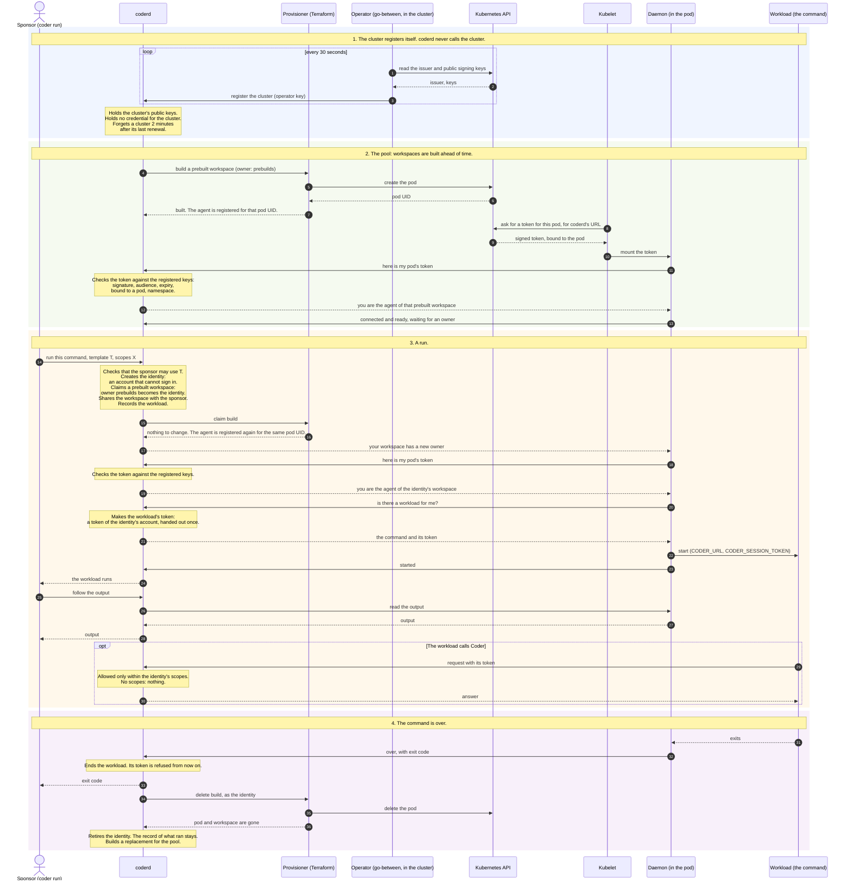

# Workloads in prebuilt workspaces

A proof of concept. `coder run --template <template> -- <command>` runs a
command, usually an AI agent, in a workspace of its own. The workspace is one
that the template keeps ready, so the command starts in a couple of seconds.
The workload's identity is an account of its own: it owns the workspace, and
it has nothing of the person who asked for it.

Everything is an ordinary Coder feature put to this use: a Terraform
template, prebuilt workspaces, a service account, workspace sharing and
scoped permissions. The parts that are new are listed under
[What is new](#what-is-new).

## How a run goes

1. A person, the sponsor, runs `coder run --template prebuilt -- <command>`.
1. coderd checks that the sponsor may make a workspace from the template.
1. coderd makes the identity: a service account that cannot sign in, has
   no token and is a plain member of the organization.
1. As that identity, coderd makes a workspace from the template. When the
   template keeps workspaces ready, one of them is claimed: its owner
   changes from `prebuilds` to the identity.
1. The identity shares the workspace with the sponsor, to use and not to
   own.
1. The daemon in the pod is told it has a new owner. It proves which pod it
   is with the kubelet's token, and coderd hands it the workload, with a
   token for the workload.
1. The command runs next to the daemon, with that token in its
   environment. The token is the identity's own. What it may do is what
   the sponsor asked for with `--scope`, and without that nothing.
1. When the command is over, the token is worth nothing, and coderd deletes
   the workspace and retires the identity. The record of what ran stays.

## In sequence

From the cluster registering itself to the command being over:



## Files

| File                                                | Purpose                                                   |
|-----------------------------------------------------|-----------------------------------------------------------|
| [template/main.tf](template/main.tf)                | The template: a pod, pod identity, and how many are ready |
| [cluster/namespace.yaml](cluster/namespace.yaml)    | The namespace of the pods                                 |
| [cluster/pods.yaml](cluster/pods.yaml)              | The pods' service account, which may do nothing           |
| [cluster/operator.yaml](cluster/operator.yaml)      | The go-between that registers the cluster with coderd     |
| [cluster/users.yaml](cluster/users.yaml)            | A name and a shell for the user the pods run as           |
| [provider/](provider/kubernetes-pod-identity.patch) | The change to the Coder Terraform provider this needs     |
| [validate.py](validate.py)                          | Checks a running setup, from inside and outside           |
| [RESULTS.md](RESULTS.md)                            | What the checks showed, and the limits                    |

## Set up

coderd needs a Premium license, for prebuilt workspaces and service
accounts, and the `runtime-workloads` experiment. It needs no way to the
cluster's API and no credential for the cluster. It is given a key, and an
operator in the cluster registers the cluster with that key.

```sh
head -c 32 /dev/urandom | base64 > operator-key

CODER_EXPERIMENTS=runtime-workloads \
CODER_POD_IDENTITY_OPERATOR_KEY="$(cat operator-key)" \
coder server

kubectl apply -f cluster/namespace.yaml -f cluster/pods.yaml -f cluster/users.yaml
kubectl -n coder-sandbox-workloads create secret generic \
  coder-pod-identity-operator --from-file=key=operator-key
CODER_URL=https://coder.example.com CLUSTER_NAME=my-cluster \
  envsubst < cluster/operator.yaml | kubectl apply -f -

coder templates push prebuilt -d template --yes
```

The template says `auth = "kubernetes-pod-identity"`, which the Coder
Terraform provider does not accept yet.
[provider/kubernetes-pod-identity.patch](provider/kubernetes-pod-identity.patch)
adds it to version 2.20.0 of the provider. Build the provider with the
patch and point Terraform at it with a filesystem mirror, in the file
`TF_CLI_CONFIG_FILE` names for coderd:

```hcl
provider_installation {
  filesystem_mirror {
    path    = "/path/to/mirror"
    include = ["registry.terraform.io/coder/coder"]
  }
  direct {
    exclude = ["registry.terraform.io/coder/coder"]
  }
}
```

The provider binary goes to
`<mirror>/registry.terraform.io/coder/coder/2.20.1/linux_amd64/terraform-provider-coder_v2.20.1`.

## How coderd believes a pod

1. **The operator registers the cluster.** It runs in the cluster and reads
   what every service account there may read: the issuer of the cluster's
   service account tokens and the public keys they are signed with. It
   sends these to coderd with the operator key, every 30 seconds.
1. **The kubelet gets the pod a token.** The pod's spec asks for a token
   for coderd's URL. The cluster signs it and binds it to the pod.
1. **The daemon presents the token to coderd.**
1. **coderd checks it against the registered keys.** The signature, the
   audience, the expiry, that it is bound to a pod, and that the pod is in
   a namespace the operator named. coderd asks the cluster nothing.
1. **The pod's UID finds the agent** that the template registered it for.

coderd stops believing a cluster two minutes after its operator last
renewed the registration.

## Try it

```sh

# Who am I in there?
coder run --template prebuilt --preset agent -- coder identity

# Let it read templates, and nothing else.
coder run --template prebuilt --preset agent --scope template:read -- coder templates list

# Keep the workspace, and go and look.
coder run --template prebuilt --preset agent --keep --detach --name fix-1 -- sleep 3600
coder run --all
coder ssh workload-<id>/fix-1
coder run --remove fix-1
```

`CODER_WORKSPACE_PREBUILDS_RECONCILIATION_INTERVAL` decides how soon a
claimed workspace is replaced. The default is one minute.

## What is new

- **`POST /api/v2/workloads`.** One request makes the identity, the
  workspace and the workload. The sponsor's command line never holds
  anything of the workload's.
- **An identity can own a workspace.** It is a service account, recorded
  with its sponsor and scopes.
- **The workload has a token of its own.** It is an API token of the
  identity's account, handed to the daemon that proved which pod it is, and
  to nobody else. What it may do is read from the identity's record
  whenever it is used. It is refused once the workload is over.
- **The sponsor's access to the template counts.** coderd makes and deletes
  the workspace as the identity, and lets it use the template because its
  sponsor may. The template need not be open to everybody.
- **Pod identity.** The daemon proves which pod it is with the kubelet's
  token, and coderd checks the token against the cluster's keys. The
  template holds no token.
- **An operator in the cluster**, `coder exp pod-identity-operator`,
  registers the cluster's keys with coderd. coderd holds no credential for
  the cluster, and the operator needs no permission in it. A prebuilt workspace's daemon gets a new credential when the
  workspace is claimed, because the pod is found by its UID and not by a
  token.
- **No session token for an identity.** A build normally hands Terraform a
  token for the workspace's owner. For an identity it does not, since such
  a token would ignore the workload's scopes.
- **The sponsor can end what they sponsor**, though they do not own the
  workspace. Removing the workload deletes its workspace, also one that
  was kept.
- **An identity is retired with its workspace**, whoever deletes it.

## Limits

- **A workload cannot read a template that is not open to its identity.**
  Reading a workspace takes reading its template, so in a template that is
  restricted to groups a workload cannot read its own workspace either,
  whatever its scopes.
- **The template must not need the owner's external authentication.** An
  identity has none, by design.
- **A pod that is deleted is believed until its token expires**, ten
  minutes at most. coderd no longer asks the cluster whether the pod is
  still there.
- **The operator key is one key for every cluster.** Whoever has it can
  register keys of their own and then be any pod. A key per cluster or per
  organization would bound that.
- **Registered clusters are held in memory.** Replicas tell each other. A
  coderd that has just started believes no pod until the operator's next
  registration, half a minute at most.
- **coderd believes the template about which pod is which agent's.** A
  template registers a pod's UID as its agent's instance. Whoever may
  write templates could register somebody else's pod.
- **The workload and its pod's daemon are one principal.** The workload can
  read the pod's token, and with it be the daemon.
- **A sponsor who enters the workspace is inside the workload's pod** and
  can act as the workload.
- **A workload cannot start workloads.** What a child may inherit is not
  designed.
- **A workspace that is kept keeps its identity** until the workload is
  removed or the workspace is deleted.
- **The pods' network is not restricted** by this template.
- **The license is not checked** by the new endpoint.
