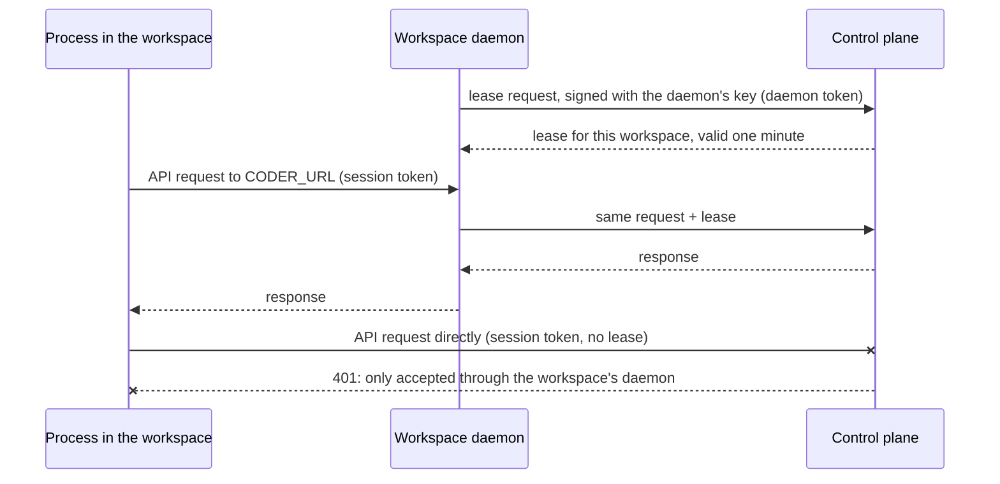

# Workspace daemon relay

A proof of concept. It is not production code.

A workspace build gives the workspace owner a session token, and templates
hand it to what runs in the workspace: the command line, a coding agent, a
client of AI Gateway. Today that token works for whoever holds it, from
anywhere, until it expires. A copy that ends up in a log, a transcript or
Terraform state is a working credential.

With the relay, the control plane accepts a workspace's session token only
when the request comes through that workspace's daemon. A copy of the token
is useless anywhere else. This holds for every workspace, a person's as much
as an agent's.

## How it works

1. **The daemon obtains a lease.** It asks the control plane, with its own
   token, for a lease for its workspace. A lease is a token the control plane
   signs. It names the workspace and lasts a minute. The daemon keeps it in
   memory and renews it every 20 seconds.
1. **The daemon serves a local address.** It listens on the loopback
   interface inside the workspace and gives that address to the processes it
   starts, as `CODER_URL`. This wins over a value the template set.
1. **The daemon forwards and vouches.** It passes each request on to the
   control plane and attaches the lease. It adds nothing else: the caller
   authenticates with its own credential.
1. **The control plane checks.** A workspace session token is accepted only
   together with a lease for the same workspace. On its own it is refused,
   and the answer says why.
1. **The lease lapses.** A daemon that stops no longer renews, and within a
   minute nothing can use the workspace's session token.



### One daemon at a time

The daemon's own token is in the workspace too, and could leak as well. So a
token is not enough to obtain a lease:

- **A key per daemon instance.** A daemon makes an Ed25519 key when it starts
  and keeps the private half in memory. It signs every request for a lease.
- **The first instance holds the relay.** The control plane remembers its
  public key. Only that key renews.
- **Another instance waits.** A request signed by another key is refused
  while the holder keeps renewing. Once the holder has not renewed for a
  minute, the other instance takes over, the generation goes up, and the
  control plane records a takeover.
- **A clean stop hands over at once.** A daemon that is stopped gives the
  relay up, so the next one does not wait.

Nothing is locked. A daemon that reconnects is the same instance with the
same key, so it is never in its own way.

### Rollout

`CODER_WORKSPACE_RELAY` on the control plane is `off`, `log` or `enforce`.

- **`off`**: nothing changes. Daemons get no lease and serve no address.
- **`log`**: daemons relay. A session token that arrives without a lease is
  accepted, logged and counted, so an operator sees what enforcing would
  break.
- **`enforce`**: it is refused.

Two counters tell what happens: `coderd_workspace_relay_requests_total` by
route (`relayed`, `bare`, `invalid_lease`) and outcome, and
`coderd_workspace_relay_leases_total` by result (`claimed`, `renewed`,
`takeover`, `refused`). A relayed request's line in the request log names the
workspace, the daemon and the generation.

## Try it

From a checkout of this branch:

```sh
CODER_WORKSPACE_RELAY=enforce ./scripts/develop.sh
alias cdr=./scripts/coder-dev.sh

cdr templates push relay-demo -d examples/workspace-daemon-relay/template --yes
cdr create demo --template relay-demo -y
```

```sh
# Inside, CODER_URL is the daemon's address, and the command line works.
cdr ssh demo -- 'printenv CODER_URL; coder whoami'

# The session token works through the daemon, and not directly.
cdr ssh demo -- 'curl -s -o /dev/null -w "%{http_code}\n" \
  -H "Coder-Session-Token: $CODER_SESSION_TOKEN" "$CODER_URL/api/v2/users/me"'
cdr ssh demo -- 'curl -s -o /dev/null -w "%{http_code}\n" \
  -H "Coder-Session-Token: $CODER_SESSION_TOKEN" "$CODER_AGENT_URL/api/v2/users/me"'

# Outside the workspace, a copy of the token is refused.
TOKEN=$(cdr ssh demo -- 'printenv CODER_SESSION_TOKEN' | tail -1)
curl -s -H "Coder-Session-Token: $TOKEN" http://127.0.0.1:3000/api/v2/users/me
```

[validate.py](validate.py) runs these and the rest: a leaked daemon token, a
daemon that is restarted, and one that is killed.

## What is in the branch

| Part                           | Where                                                                             |
|--------------------------------|-----------------------------------------------------------------------------------|
| Lease, modes, the signed input | `coderd/x/workspacerelay`                                                         |
| Lease endpoint and the check   | `coderd/workspacerelay.go`                                                        |
| Where every API key is checked | `WorkspaceRelay` and `ValidateAPIKey` in `coderd/httpmw/apikey.go`                |
| AI Gateway                     | `relayAIGateway` in `coderd/workspacerelay.go`, `enterprise/coderd/aibridge.go` |
| Who holds the relay            | `workspace_agent_relays`, `coderd/database/queries/workspaceagentrelays.sql`      |
| The daemon's relay             | `agent/agentrelay`                                                                |
| Wiring into the daemon         | `agent/agent.go` (`CODER_URL`), `cli/agent.go`                                    |
| Tests                          | `coderd/workspacerelay_test.go`, `agent/agentrelay/relay_test.go`                 |
| A check of a live deployment   | [validate.py](validate.py), with what it showed in [RESULTS.md](RESULTS.md)       |
