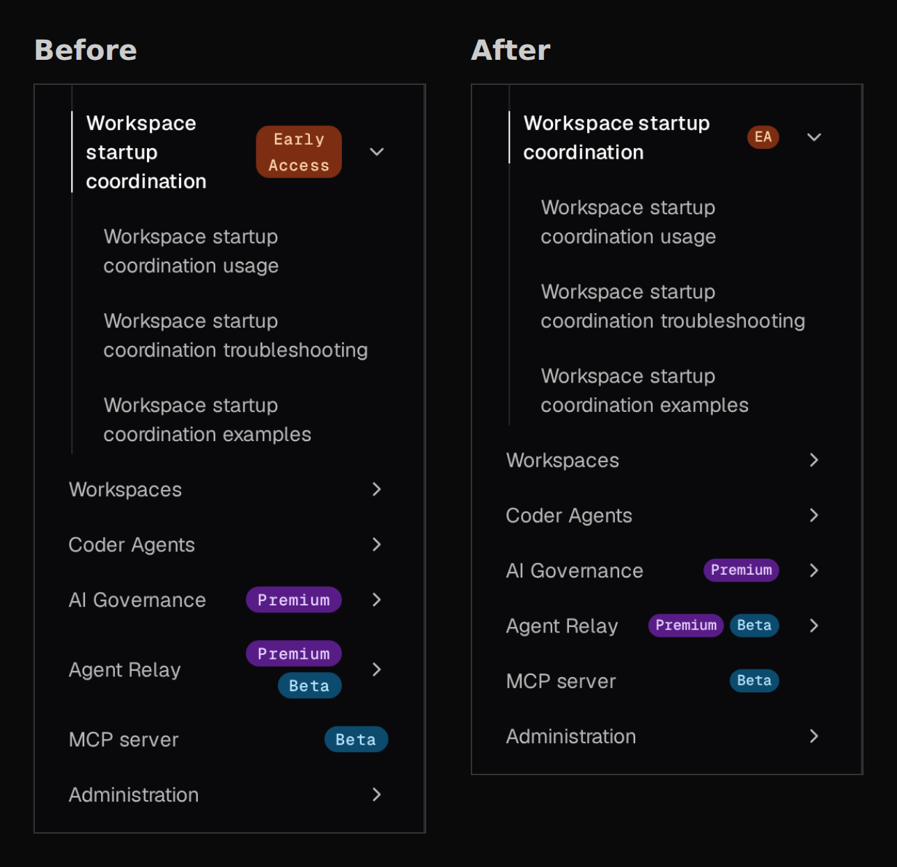

# docs-engine sidebar state pills

Before and after of the sidebar state pills on the Coder docs site. "Early Access" becomes "EA", stacked pills sit in one row, and pills on rows without a chevron line up with the rest.

Captured 2026-11-18 against `vigilante/sidebar-state-pills` in coder/docs-engine, with the coder/coder `main` docs.

